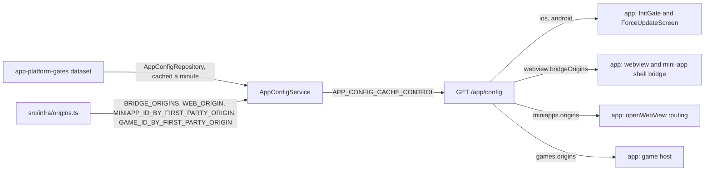

# App Config Architecture

> What `src/app-config/` tells the app at boot: the minimum version per platform, the origins the app may trust, and mini app and game origins apart. Read it before you raise a minimum version or minimum OS, or add an origin.

## Context

App config assembles one body, the same for every client, and the app fetches it once per cold start. The values belong to their sources: the platform gates to the `app-platform-gates` dataset ([ADR 0013](../decisions/0013-runtime-data-in-mongodb.md)), the one value it reads from MongoDB, so a raised floor is a push, not a deploy; and the origins and the owner of each first-party mini app and game origin to `src/infra/origins.ts`.

| System | Quirk tag | Gives | Enters at |
| --- | --- | --- | --- |
| `npm run data` | — | The minimum version, the update URL and the minimum OS per platform, pushed without a deploy | the `app-platform-gates` dataset, read by `AppConfigRepository.findPlatformGates` |
| The first-party web origins | — | The origins allowed to talk to the native bridge, and the web app's origin | `BRIDGE_ORIGINS` and `WEB_ORIGIN` in `src/infra/origins.ts` |
| The first-party mini app owners | — | Each first-party mini app origin and the mini app that owns it | `MINIAPP_ID_BY_FIRST_PARTY_ORIGIN` in `src/infra/origins.ts` |
| The first-party game owners | — | Each first-party game origin and the game that owns it | `GAME_ID_BY_FIRST_PARTY_ORIGIN` in `src/infra/origins.ts` |
| skkuverse-app | — | Nothing; it reads the body at boot | `GET /app/config` |

## Glossary

| Term | Means | Derived from | Not |
| --- | --- | --- | --- |
| client config (`AppClientConfig`) | The whole `GET /app/config` body | `AppConfigService.getConfig` | `AppSettings` |
| platform gate (`platformGate`) | One platform's `minVersion`, `updateUrl` and `minOsVersion`: below `minVersion`, the app blocks on its force-update screen, unless the device OS is below `minOsVersion` | the `app-platform-gates` dataset (`AppPlatformGates`) | `forceUpdate` |
| min OS version (`minOsVersion`) | The lowest OS that can install the store build meeting `minVersion`: an iOS version (`16.4`) or an Android API level (`24`) | the `app-platform-gates` dataset | — |
| bridge origins | The origins whose pages may post messages to the app's native bridge | `BRIDGE_ORIGINS` | — |
| web origin | The origin of the first-party web app | `WEB_ORIGIN` | — |
| mini-app origins | Each first-party mini app's id with its origin, so the app opens such a URL in that mini app's shell | `MINIAPP_ID_BY_FIRST_PARTY_ORIGIN` | — |
| game origins | Each first-party game's id with its origin, so the app grants a page there only the game methods, for that game | `GAME_ID_BY_FIRST_PARTY_ORIGIN` | — |

## Structure

What the app reads, from `skkuverse-app/packages/shared/src/schema/app-config.schema.ts` (`parseAppConfig`) and its callers:

| Field | App use |
| --- | --- |
| `ios.minVersion`, `android.minVersion` | The current platform's entry gates boot: below it, `InitGate` shows `ForceUpdateScreen` |
| `ios.minOsVersion`, `android.minOsVersion` | Below it, the gate lets the user through: the store cannot install the required build there |
| `ios.updateUrl`, `android.updateUrl` | The `ForceUpdateScreen` button opens it; `null` leaves the button inert |
| `webview.bridgeOrigins` | The allowlist every bridge message is checked against, in the web view and the mini-app shell |
| `miniapps.origins` | `openWebView` sends a URL on one of these origins to that mini app's shell |
| `web.origin` | Parsed and cached, not read |
| `games.origins` | Served and not read: the hosted game screen will check each game message's origin against it, and `openWebView` will send a URL on one of these origins to the game host |

## Invariants

- The body is the same for every client; it is served with `APP_CONFIG_CACHE_CONTROL`, which Cloudflare's edge also honors. A pushed gate reaches every replica within `DATASET_CACHE_TTL_MS`, then the edge and device caches within `APP_CONFIG_CACHE_CONTROL`: a cold start about two minutes after the push applies it.
- The body only grows: installed apps ignore keys they do not know, and a removed key breaks them (`CONTRACT(skkuverse-app)` on `AppClientConfig`). The one exception is `features`, the retired kill switches: installed builds read its absence as every switch off, so a build that still reads `sharedMapShell` keeps its NativeTabs shell, while later builds run the shared-map shell unconditionally.
- A game origin is served only under `games.origins`, never in `webview.bridgeOrigins` or `miniapps.origins`, so no game page gets a mini app's grants or shell ([Web origins](web-origins.md)).
- The platform gates have no default. A replica that never read a good `app-platform-gates` revision (none stored, only an invalid one, or a database that never answered) answers `503 APP_PLATFORM_GATES_UNAVAILABLE` with no `Cache-Control`, never a permissive gate, and logs the cause at error (`app_config.platform_gates.missing`, `.invalid`, `.read_failed`). A stored `updateUrl` outside the app store hosts is served as `null` while the rest of the gate stays, logged as `.update_url_refused`. One that read a good revision keeps it through failed reloads for `DATASET_STALE_WINDOW_MS` ([ADR 0013, D6](../decisions/0013-runtime-data-in-mongodb.md)).
- The dataset is stricter than the wire: `minVersion` is three dot-separated numbers, `updateUrl` an https URL, and `minOsVersion` an iOS version or an Android API level (`appPlatformGatesDataset`), the shapes the app compares. A push that breaks one is refused, and a stored revision that does is not served.
- In the app, a failed fetch lets the boot pass the gate and keeps the cached config, so the gate holds only when the route answers.

## Open questions

- `web.origin` has no live reader in the app while its share and add-to-home menus are disabled.

## Related

- [Raise the minimum app version](../how-to/raise-the-minimum-app-version.md): the checklist for a new floor
- [Edit runtime data](../how-to/edit-runtime-data.md#raise-an-app-platform-gate): pushing the `app-platform-gates` dataset
- [Web origins](web-origins.md): why each first-party host is a constant, and bridge versus CORS
- [Register a mini app](../how-to/register-a-miniapp.md): adding a first-party origin and its owner
- [ADR 0010](../decisions/0010-server-architecture.md): the module shape
