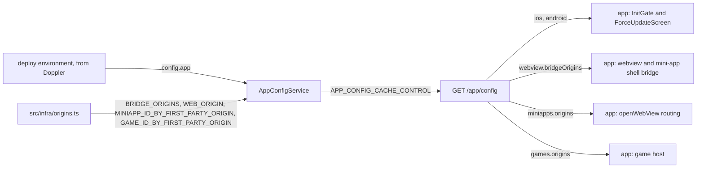

# App Config Architecture

> What `src/app-config/` tells the app at boot: the minimum version per platform and the origins the app may trust, mini app and game origins apart. Read it before you raise a minimum version or add an origin.

## Context

App config owns no data. It assembles one body from values the server reads at boot, the same for every client, and the app fetches it once per cold start. The values belong to their sources: the version gates to the deploy's environment, the origins and the owner of each first-party mini app and game origin to `src/infra/origins.ts`. It reads no dataset, so a registry outage never reaches the force-update gate.

| System | Quirk tag | Gives | Enters at |
| --- | --- | --- | --- |
| Doppler, through the deploy's environment | — | The minimum version and update URL per platform (`APP_IOS_MIN_VERSION` and its siblings) | `config.app` in `src/infra/config.ts` |
| The first-party web origins | — | The origins allowed to talk to the native bridge, and the web app's origin | `BRIDGE_ORIGINS` and `WEB_ORIGIN` in `src/infra/origins.ts` |
| The first-party mini app owners | — | Each first-party mini app origin and the mini app that owns it | `MINIAPP_ID_BY_FIRST_PARTY_ORIGIN` in `src/infra/origins.ts` |
| The first-party game owners | — | Each first-party game origin and the game that owns it | `GAME_ID_BY_FIRST_PARTY_ORIGIN` in `src/infra/origins.ts` |
| skkuverse-app | — | Nothing; it reads the body at boot | `GET /app/config` |

## Glossary

| Term | Means | Derived from | Not |
| --- | --- | --- | --- |
| client config (`AppClientConfig`) | The whole `GET /app/config` body | `AppConfigService.getConfig` | `AppSettings` |
| platform gate (`platformGate`) | One platform's `minVersion` and `updateUrl`: below `minVersion`, the app blocks on its force-update screen | `config.app` | `forceUpdate` |
| bridge origins | The origins whose pages may post messages to the app's native bridge | `BRIDGE_ORIGINS` | — |
| web origin | The origin of the first-party web app | `WEB_ORIGIN` | — |
| mini-app origins | Each first-party mini app's id with its origin, so the app opens such a URL in that mini app's shell | `MINIAPP_ID_BY_FIRST_PARTY_ORIGIN` | — |
| game origins | Each first-party game's id with its origin, so the app grants a page there only the game methods, for that game | `GAME_ID_BY_FIRST_PARTY_ORIGIN` | — |

## Structure

What the app reads, from `skkuverse-app/packages/shared/src/app/parser.ts` and its callers:

| Field | App use |
| --- | --- |
| `ios.minVersion`, `android.minVersion` | The current platform's entry gates boot: below it, `InitGate` shows `ForceUpdateScreen` |
| `ios.updateUrl`, `android.updateUrl` | The `ForceUpdateScreen` button opens it; `null` leaves the button inert |
| `webview.bridgeOrigins` | The allowlist every bridge message is checked against, in the web view and the mini-app shell |
| `miniapps.origins` | `openWebView` sends a URL on one of these origins to that mini app's shell |
| `web.origin` | Parsed and cached, not read |
| `games.origins` | Served and not read: the hosted game screen will check each game message's origin against it, and `openWebView` will send a URL on one of these origins to the game host |

## Invariants

- The body is built from boot-time values and is the same for every client; it is served with `APP_CONFIG_CACHE_CONTROL`. A raised minimum version reaches a cold start once the replicas restart with it and that cache expires.
- The body only grows: installed apps ignore keys they do not know, and a removed key breaks them (`CONTRACT(skkuverse-app)` on `AppClientConfig`). `games` is the last key, after every key an installed app reads.
- A game origin is served only under `games.origins`, never in `webview.bridgeOrigins` or `miniapps.origins`, so no game page gets a mini app's grants or shell ([Web origins](web-origins.md)).
- In the app, a failed fetch lets the boot pass the gate and keeps the cached config, so the gate holds only when the route answers.

## Open questions

- `config.app` falls back to a built-in minimum version when `APP_IOS_MIN_VERSION` or `APP_ANDROID_MIN_VERSION` is unset, against the rule that config fails fast. Whether these become required is open.
- `web.origin` has no live reader in the app while its share and add-to-home menus are disabled.

## Related

- [Web origins](web-origins.md): why each first-party host is a constant, and bridge versus CORS
- [Register a mini app](../how-to/register-a-miniapp.md): adding a first-party origin and its owner
- [ADR 0010](../decisions/0010-server-architecture.md): the module shape
