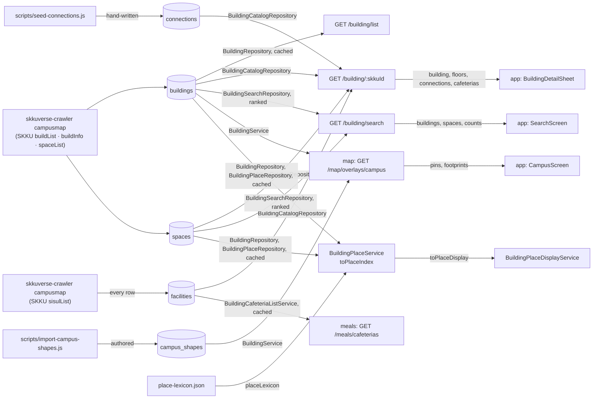

# Building Architecture

> What `src/building/` mirrors from SKKU, what each id means, and which app screen reads which field. Read it before you change building, or before you build on its data in `map`.

## Context

Building serves SKKU's campus map, which skkuverse-crawler copies into MongoDB, as list, detail and search. It owns no truth about the campus and writes none of it: skkuverse-crawler fetches SKKU's campusMap.do and writes `buildings`, `spaces` and `facilities` (its `docs/decisions/adr-014-campus-map-ownership.md`), so SKKU's field names stop in the crawler. Building parses each document where it reads it, and derives `displayNo` from `buildNo` on every read. It also serves two hand-written collections.

| System | Quirk tag | Gives | Enters at |
| --- | --- | --- | --- |
| skkuverse-crawler, `campusmap` (SKKU campusMap.do, modes buildList, buildInfo and spaceList) | `skku` | Buildings and facilities with names, coordinates, photo, attachments and the parsed barrier-free text; rooms per floor, with `conspaceCd` | `buildings` and `spaces`, parsed by `buildingDoc` and `storedSpace` (and their picks) in the building, catalog and place repositories |
| skkuverse-crawler, `campusmap` module (SKKU campusMap.do, mode sisulList) | — | The facility registry: cafeterias, cafes, ATMs and more, each with a `conspaceCd` and the `buildNo` it sits in | `facilities`, every row (`FacilityDoc`, skkuverse-crawler `adr-014-campus-map-ownership.md`); the `kind` `cafeteria` rows parsed by `cafeteriaDoc` in `BuildingCatalogRepository` and `BuildingCafeteriaListRepository` |
| MongoDB | `mongo` | Storage, the GeoJSON indexes, and the aggregation the search runs | The five repositories, through `mongoCollection` |
| `scripts/seed-connections.js` | — | Hand-written walkways between two floors | `connections`, read by `BuildingCatalogRepository` |
| `scripts/import-campus-shapes.js` | — | Authored footprints, boundaries and paths | `campus_shapes`, parsed by `campusShapeDoc` in `BuildingRepository` |
| `src/building/place/place-lexicon.json` | — | Facility slugs and the places skkumap lacks, reviewed as code | `placeLexicon`, parsed at import by `placeLexiconFile` |
| skkuverse-crawler, a notice's stored place ids | — | The pinned places the crawler resolved itself, as `space:<campus>:<spaceCd>`, `building:<campus>:<buildNo>` or `facility:<campus>:<slug>`, or `unresolved` | `BuildingPlaceDisplayService.describePlaces`, which takes the id strings and reads each through `toStoredPlace` |

buildInfo returns rooms that spaceList lacks, and the other way round, so the crawler merges both into `spaces`, and `sources` records which listed a room.

## Glossary

The brands live in `src/building/building.types.ts`; each is minted only by its function in `src/building/building.rules.ts` ([ADR 0010, D4](../decisions/0010-server-architecture.md)).

| Term | Means | Derived from | Not |
| --- | --- | --- | --- |
| `skkuId` (`SkkuId`) | SKKU's building id: `_id` of `buildings`, the route's `:skkuId`, and `skkuId` in `connections` and `campus_shapes` | buildList `id`, minted by `isSkkuId` | a bare id, `buildingId` |
| `buildNo` (`BuildNo`) | SKKU's building number (`"227"`); its first digit is the campus code. `null` for a facility | buildList `buildNo`, minted by `isBuildNo` | `buildingNo` |
| `displayNo` (`DisplayNo`) | The number users see and type: `buildNo` without the campus digit (`"227"` gives `"27"`), or `buildNo` as is when it lacks that digit. Derived on every read (`withDisplayNo`); the search matches the stored copy | `toDisplayNo` | — |
| `spaceCd` (`SpaceCd`) | A room code. In the captures it starts with the building's `displayNo`, so a prefix search finds a building's rooms; it repeats across campuses | buildInfo `space_cd`, spaceList `spaceCd`, minted by `isSpaceCd` | `roomId` |
| space | A room or area inside a building: one `spaces` document per `spaceCd`, `buildNo` and `campus` | buildInfo `floorItem`, spaceList `items` | room |
| facility | A listed place with no `buildNo` (a gate, a field): `type` is `facility`, it has no spaces, and buildInfo is never called for it. Not the same as a `facilities` row of `kind` `facility` (a cafe, an ATM: any sisulList row that is not a cafeteria), which building does not read | `hasBuildNo` | — |
| cafeteria (`CafeteriaDoc`) | A `facilities` document of `kind` `cafeteria`: one sisulList row of `bizKind` `0201`, keyed by its `conspaceCd`, with the `buildNo`, floor and `spaceCd` it sits in. Every other row is `kind` `facility` with its raw `bizKind`, which building does not read. The detail lists a building's cafeterias, so the app can link the cafeteria menu | sisulList rows, written by skkuverse-crawler | — |
| `conspaceCd` | SKKU's code for a registered facility: `_id` of `facilities`, and the cafeteria id that SKKU's menu page and skkuverse-crawler's meals module use. spaceList stamps it on some rooms too | sisulList `conspaceCd`, spaceList `conspaceCd` | — |
| campus (`Campus`) | `hssc` (Seoul) or `nsc` (Suwon); SKKU's own code for each is `SKKU_CAMPUS_CODE` | `CAMPUSES` | — |
| buildList, buildInfo, spaceList | The three campusMap.do modes skkuverse-crawler reads into `buildings` and `spaces` | skkuverse-crawler | — |
| sisulList | The campusMap.do mode of the facility registry, which skkuverse-crawler mirrors into `facilities` | skkuverse-crawler | — |
| stored building (`storedBuilding`) | The fields of a `buildings` document the reads use, as a zod schema; `buildingDoc` adds the derived `displayNo`. The writer's bookkeeping (`sync`, `enrichVersion`, `extensions`) is never read | `building.schema.ts` | — |
| stored space (`storedSpace`) | The fields of a `spaces` document the reads use, as a zod schema; `sources` and `syncedAt` are the writer's and never read | `building.schema.ts` | — |
| connection | A walkway between a floor of one building and a floor of another. `a` and `b` are unordered; the response reads it from the requested building, `fromFloor` to `toFloor` | `toBuildingConnections` | — |
| tier, band | A ranking tier scores one kind of match; the strong and weak bands split results at `BUILDING_STRONG_MIN_SCORE` and `SPACE_STRONG_MIN_SCORE` | `BUILDING_TIERS`, `SPACE_TIERS` | `level`, `bucket` |
| ranked result | Rows plus the campus counts the same predicate produced (`RankedSearchResult`) | `toRankedResult` | `searchData` |
| `keyword` | The search text: `q` on the wire, `keyword` from the service down and in `meta` | `buildingSearchQuery` | query (the `.query` role), `term` |
| campus shape (`CampusShapeDoc`) | A `campus_shapes` document: an authored footprint, boundary or path that `map` draws | `campusShapeDoc` | `geometryDoc` |
| cafeteria list (`BuildingCafeteriaListService`) | Every cafeteria of a campus, in `conspaceCd` order, with the fields a listing serves (`ListedCafeteria`): the door `meals` lists cafeterias through (`cafeteria-list/`) | `BuildingCafeteriaListRepository.listCafeterias` | — |
| catalog | Building's list-and-detail flow (`catalog/`): the list is the catalog, `:skkuId` one entry of it | `BuildingCatalogModule` | list, detail, core, read |
| resolved place (`ResolvedPlace`) | A pinned place (`PinnedPlace`: a `space`, a `building` or a `facility`) or `unresolved` with its reason (`online`, `offcampus`, `campusOnly`, `unknown`) and its campus when it has one: what the primary-place picks read | — | — |
| place id (`PlaceId`) | `space:<campus>:<spaceCd>`, `building:<campus>:<buildNo>` or `facility:<campus>:<slug>`: the only form a pinned place is stored in; its name and code are derived at display | `toPlaceId` | — |
| stored place (`StoredPlace`) | What a stored place id names, read back by building: a room by its code and campus alone, a building by its number, a facility by its slug. It is a pinned place without the `buildNo` a room's id never carries | `toStoredPlace` | — |
| map target (`PlaceMapTarget`) | The building sheet the campus map opens a pinned place on: the `skkuId` of its building or facility, and the room's `spaceCd` for a space. Null for a place no `buildings` document lists (a building only its spaces name, an `extraFacilities` place) | `toPlaceDisplay` | — |
| facility slug | The pinned id of a numberless place: a skkumap facility's by its `skkuId`, or a place skkumap lacks (`extraFacilities`), never derived from a name | `place-lexicon.json` | — |
| place lexicon (`placeLexicon`) | The committed facility slugs and the places skkumap lacks, which the place index is built with | `place-lexicon.json` | — |
| place index (`PlaceIndex`) | The places by key and the spaces by room code, built from `buildings`, `spaces` and the lexicon | `toPlaceIndex` | — |
| campus primary place (`CampusPrimaryPlace`) | The place a session shows on one campus (a space over a building over a facility, ties by list order) and the count of that campus's other pinned places | `pickPrimaryPlacesByCampus` | — |

## Structure

What the app reads, from `skkuverse-app/packages/shared/src/building/parser.ts` and the screens that use it:

| Field | App use |
| --- | --- |
| `GET /building/list` | No caller in the app, web or mini sources; `useBuildings` is exported and never used |
| `_id`, `campus` | Search: a tap moves the map to the building and switches campus; the detail sheet opens by `_id` |
| `displayNo`, `name`, `campusLabel` | `BuildingHeader` in `BuildingDetailSheet`, and the rows of `SearchScreen` |
| `name.ko` | `BuildingDetailSheet` matches it against `BuildingNameMapping.ts` for the HSSC floor map, so an SKKU rename unlinks it silently |
| `description` | `BuildingDetailSheet`, clamped with a more button |
| `image.url` | `BuildingHeader` thumbnail |
| `accessibility.elevator`, `accessibility.toilet` | `BuildingHeader` badges |
| `location` | Search: the camera target. Served and not used in detail |
| `floors[].floor`, `floors[].spaces[].spaceCd`, `floors[].spaces[].name` | The floor accordion of `BuildingDetailSheet`; a search hit expands and highlights its `spaceCd` |
| `connections[].targetName`, `targetDisplayNo`, `fromFloor`, `toFloor`, `targetSkkuId` | `ConnectionsSection` and the floor chips; a tap opens the target's sheet |
| `spaces[].buildingName`, `items[].spaceCd`, `items[].name`, `items[].floor`, `spaces[].skkuId` | `SearchScreen` space rows; a row with a `null` `skkuId` ignores the tap |
| `meta.buildingCount`, `meta.spaceCount`, `meta.counts` | `SearchScreen` section counts and the campus tabs |
| `cafeterias[].id`, `name`, `floor`, `spaceCd` | Not read yet: the planned chip that opens a cafeteria's menu, by the crawler's cafeteria id. `floor` is the Korean floor name, the key of `floors[].floor.ko` |
| `buildNo`, `type`, `image.filename`, `attachments`, `conspaceCd`, `targetBuildNo`, `spaces[].displayNo`, `spaces[].campusLabel`, `meta.keyword` | Parsed, not rendered |
| `accessibility.detail`, `skkuCreatedAt`, `skkuUpdatedAt`, `updatedAt`, `meta.limits` | Served, not parsed |

## Invariants

- Building writes none of `buildings`, `spaces` or `facilities`. skkuverse-crawler owns their writes and the indexes that guard them: the unique index on `spaces` `spaceCd`, `buildNo` and `campus` that its upserts key on, and the `buildings` `location` `2dsphere` index that rejects a malformed point. Building creates only the indexes its reads use (`spaces` and `facilities` by `buildNo`, `connections` by either end, `campus_shapes`).
- Every read of `buildings` and `spaces` projects the fields it uses and parses them; a document that fails is left out and logged (`building.buildings.invalid`, `building.spaces.invalid`), and a building the detail cannot parse answers `404`. The search is the exception: its ranked `$facet` is typed, not parsed, so its rows and counts stay one predicate.
- Building never writes `facilities`: skkuverse-crawler does, and owns its write-side indexes. Both cafeteria reads filter `kind: "cafeteria"`, project the fields they use and parse them (`cafeteriaDoc`); a cafeteria that fails is left out and logged (`building.cafeterias.invalid`, at most hourly per building on the detail).
- Data is at most one crawler run plus `BUILDING_CACHE_TTL_MS` old, and every route sends `BUILDING_CACHE_CONTROL`. Nothing invalidates a cache: the TTL is the stated freshness bound ([ADR 0012, D6](../decisions/0012-runtime-roles.md)).
- The detail lists the cafeterias whose `buildNo` is the building's, in `conspaceCd` order; a building without a `buildNo` reads none and serves `[]`.
- The cafeteria list reads every cafeteria in one cached read (`BUILDING_CACHE_TTL_MS`, no stale window) and filters it by campus, so a failed read reaches `meals`. Nothing clears it: the TTL is its freshness bound, after the crawler's run.
- `GET /building/:skkuId` answers `400` `INVALID_ID` for an id `isSkkuId` rejects, before any read, and `404` `NOT_FOUND` for a valid id with no building.
- A `campus_shapes` document that fails `campusShapeDoc` is left out and logged (`building.campus_shapes.invalid`), and a failed reload serves the last good shapes for `CAMPUS_SHAPES_STALE_WINDOW_MS`. The buildings cache has no stale window, so a failed read reaches `map`.
- The search ranks by the tier tables, in one `$facet` per collection so the counts describe the same predicate as the rows ([ADR 0006](../decisions/0006-building-search-relevance-ranking.md)).
- A pinned place's name, code and map target are derived from skkumap when shown (`toPlaceDisplay`), never stored, and show nothing once skkumap no longer holds it. Resolving a notice's place strings to pinned places is skkuverse-crawler's, not this server's.
- The lexicon is code, not a dataset ([ADR 0013, D2](../decisions/0013-runtime-data-in-mongodb.md)): a facility slug is an identity stored notices name. A synced facility with no pinned slug is left out of the index and logged (`building.place.lexicon_gaps`).
- The place index is rebuilt only when a cached read returns new data, so it is at most `BUILDING_CACHE_TTL_MS` late, and a failed read rejects rather than serving an empty index.
- `BuildingService`, `BuildingCafeteriaListService` and `BuildingPlaceDisplayService` are the doors other modules use; building's own flows inject the repositories ([ADR 0010, D1](../decisions/0010-server-architecture.md)).

## Open questions

- The places skkumap lacks (`extraFacilities`) and the buildings only their spaces name have no `buildings` document, so no `skkuId` for the campus map to open them by. `NoticesScreenService` gives them no `map` action until they have one.
- `GET /building/list` has no caller in the app, web or mini sources, and only the response-compare script called it in the logs checked. Removing it waits for several days of logs or per-app-version counts.
- A version stamp that api replicas check, so a crawler run reaches them before their TTL, is open.
- Why spaceList stamps a `conspaceCd` on some rooms and not on others. The detail serves it on each space, and nothing joins on it there.
- buildInfo also sends a floor code (`floor`), which `spaces` does not carry; `floorSortKey` orders floors by the Korean floor name instead.

## Related

- [ADR 0010](../decisions/0010-server-architecture.md): why building is shaped as it is
- [ADR 0006](../decisions/0006-building-search-relevance-ranking.md): why a `spaceCd` prefix ranks first
- [Map architecture](map-architecture.md), "Campus shapes": why shapes are a collection of their own
- SKKU payload fields as sent: skkuverse-crawler's `campusmap` module; the documents it stores, as this server reads them: the `skkumap-*` fixtures in `__tests__/nest/building/fixtures/`
- [Building data survey](../archive/building-data-2026-03.md): the cross-checks behind the schema, kept as evidence
