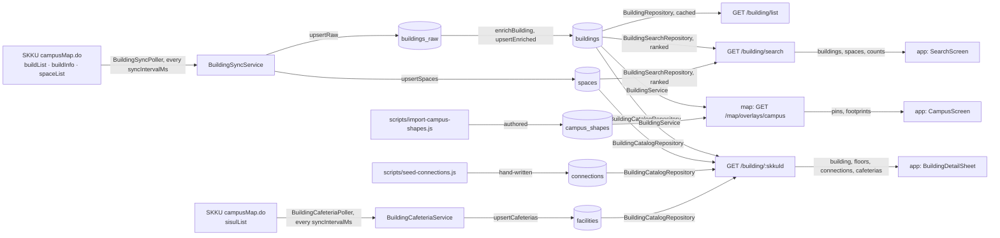

# Building Architecture

> What `src/building/` mirrors from SKKU, what each id means, and which app screen reads which field. Read it before you change building, or before you build on its data in `map`.

## Context

Building copies SKKU's campus map into MongoDB on a schedule and serves list, detail and search. It owns no truth about the campus: it mirrors SKKU behind an anti-corruption layer, so SKKU's field names stop at the sync client and the code's names start there. It owns only the shapes it derives (`displayNo`, the parsed barrier-free text) and serves two hand-written collections it does not write.

| System | Quirk tag | Gives | Enters at |
| --- | --- | --- | --- |
| SKKU campusMap.do, mode buildList (per campus) | `skku` | Buildings and facilities: names, coordinates, photo, barrier-free text | `BuildingSyncClient.fetchBuildList`, then `buildings_raw` and `buildings` |
| SKKU campusMap.do, mode buildInfo (per building with a `buildNo`) | `skku` | Rooms per floor and photo attachments | `BuildingSyncClient.fetchBuildInfo`, then `spaces`, and `attachments` on the building |
| SKKU campusMap.do, mode spaceList (per campus) | `skku` | Rooms, with `conspaceCd` | `BuildingSyncClient.fetchSpaceList`, then `spaces` |
| SKKU campusMap.do, mode sisulList (per campus) | `skku` | The facility registry: cafeterias, cafes, ATMs and more, each with a `conspaceCd` and the `buildNo` it sits in | `BuildingCafeteriaClient.fetchCafeterias`, then `facilities` (cafeterias only) |
| MongoDB | `mongo` | Storage, the GeoJSON indexes, and the aggregation the search runs | The five repositories, through `mongoCollection` |
| `scripts/seed-connections.js` | — | Hand-written walkways between two floors | `connections`, read by `BuildingCatalogRepository` |
| `scripts/import-campus-shapes.js` | — | Authored footprints, boundaries and paths | `campus_shapes`, parsed by `campusShapeDoc` in `BuildingRepository` |

buildInfo returns rooms that spaceList lacks, and the other way round, so `spaces` merges both and `sources` records which listed a room.

## Glossary

The brands live in `src/building/building.types.ts`; each is minted only by its function in `src/building/building.rules.ts` ([ADR 0010, D4](../decisions/0010-server-architecture.md)).

| Term | Means | Derived from | Not |
| --- | --- | --- | --- |
| `skkuId` (`SkkuId`) | SKKU's building id: `_id` of `buildings` and `buildings_raw`, the route's `:skkuId`, and `skkuId` in `connections` and `campus_shapes` | buildList `id`, minted by `isSkkuId` | a bare id, `buildingId` |
| `apiId` (`ApiId`) | The building id handed back to SKKU on buildInfo. The same number as `skkuId`; not stored, derived during the sync | `toApiId` | — |
| `buildNo` (`BuildNo`) | SKKU's building number (`"227"`); its first digit is the campus code. `null` for a facility | buildList `buildNo`, minted by `isBuildNo` | `buildingNo` |
| `displayNo` (`DisplayNo`) | The number users see and type: `buildNo` without the campus digit (`"227"` gives `"27"`), or `buildNo` as is when it lacks that digit | `toDisplayNo` | — |
| `spaceCd` (`SpaceCd`) | A room code. In the captures it starts with the building's `displayNo`, so a prefix search finds a building's rooms; it repeats across campuses | buildInfo `space_cd`, spaceList `spaceCd`, minted by `isSpaceCd` | `roomId` |
| space | A room or area inside a building: one `spaces` document per `spaceCd`, `buildNo` and `campus` | buildInfo `floorItem`, spaceList `items` | room |
| facility | A listed place with no `buildNo` (a gate, a field): `type` is `facility`, it has no spaces, and buildInfo is never called for it. Not a row of the `facilities` collection, which holds cafeterias | `hasBuildNo` | — |
| cafeteria (`CafeteriaDoc`) | A `facilities` document: one sisulList row of kind `0201` (cafeteria), keyed by its `conspaceCd`, with the `buildNo`, floor and `spaceCd` it sits in. The detail lists a building's cafeterias, so the app can link the cafeteria menu | sisulList rows, `BuildingCafeteriaClient.fetchCafeterias` | — |
| `conspaceCd` | SKKU's code for a registered facility: `_id` of `facilities`, and the cafeteria id that SKKU's menu page and skkuverse-crawler's meals module use. spaceList stamps it on some rooms too | sisulList `conspaceCd`, spaceList `conspaceCd` | — |
| campus (`Campus`) | `hssc` (Seoul) or `nsc` (Suwon); SKKU's own code for each is `SKKU_CAMPUS_CODE` | `CAMPUSES` | — |
| buildList, buildInfo, spaceList | The three campusMap.do modes the building sync reads, and its phases named after them | `CAMPUS_MAP_URL` | — |
| sisulList | The campusMap.do mode of the facility registry, read by the cafeteria sync (`BuildingCafeteriaService`), a poller of its own | `CAMPUS_MAP_URL` | — |
| raw, enriched | `buildings_raw` holds SKKU's data as sent; `buildings` holds it parsed and served, stamped with `enrichVersion` | `enrichBuilding` | — |
| `EnrichedBuilding` | What `enrichBuilding` derives from a raw building; the sync repository writes it field by field | `toEnrichedSet` | enrichment fields |
| connection | A walkway between a floor of one building and a floor of another. `a` and `b` are unordered; the response reads it from the requested building, `fromFloor` to `toFloor` | `toBuildingConnections` | — |
| tier, band | A ranking tier scores one kind of match; the strong and weak bands split results at `BUILDING_STRONG_MIN_SCORE` and `SPACE_STRONG_MIN_SCORE` | `BUILDING_TIERS`, `SPACE_TIERS` | `level`, `bucket` |
| ranked result | Rows plus the campus counts the same predicate produced (`RankedSearchResult`) | `toRankedResult` | `searchData` |
| `keyword` | The search text: `q` on the wire, `keyword` from the service down and in `meta` | `buildingSearchQuery` | query (the `.query` role), `term` |
| campus shape (`CampusShapeDoc`) | A `campus_shapes` document: an authored footprint, boundary or path that `map` draws | `campusShapeDoc` | `geometryDoc` |
| catalog | Building's list-and-detail flow (`catalog/`): the list is the catalog, `:skkuId` one entry of it | `BuildingCatalogModule` | list, detail, core, read |

## Structure

What the app reads, from `skkuverse-app/packages/shared/src/building/parser.ts` and the screens that use it:

| Field | App use |
| --- | --- |
| `GET /building/list` | No caller in the app, web or mini sources; `useBuildings` is exported and never used |
| `_id`, `campus` | Search: a tap moves the map to the building and switches campus; the detail sheet opens by `_id` |
| `displayNo`, `name`, `campusLabel` | `BuildingHeader` in `BuildingDetailSheet`, and the rows of `SearchScreen` |
| `name.ko` | `BuildingDetailSheet` matches it against `BuildingNameMapping.ts` for the HSSC floor map, so an SKKU rename unlinks it silently |
| `description` | `BuildingDetailSheet`, clamped with a more button |
| `image.url` | `BuildingHeader` thumbnail |
| `accessibility.elevator`, `accessibility.toilet` | `BuildingHeader` badges |
| `location` | Search: the camera target. Served and not used in detail |
| `floors[].floor`, `floors[].spaces[].spaceCd`, `floors[].spaces[].name` | The floor accordion of `BuildingDetailSheet`; a search hit expands and highlights its `spaceCd` |
| `connections[].targetName`, `targetDisplayNo`, `fromFloor`, `toFloor`, `targetSkkuId` | `ConnectionsSection` and the floor chips; a tap opens the target's sheet |
| `spaces[].buildingName`, `items[].spaceCd`, `items[].name`, `items[].floor`, `spaces[].skkuId` | `SearchScreen` space rows; a row with a `null` `skkuId` ignores the tap |
| `meta.buildingCount`, `meta.spaceCount`, `meta.counts` | `SearchScreen` section counts and the campus tabs |
| `cafeterias[].id`, `name`, `floor`, `spaceCd` | Not read yet: the planned chip that opens a cafeteria's menu, by the crawler's cafeteria id. `floor` is the Korean floor name, the key of `floors[].floor.ko` |
| `buildNo`, `type`, `image.filename`, `attachments`, `conspaceCd`, `targetBuildNo`, `spaces[].displayNo`, `spaces[].campusLabel`, `meta.keyword` | Parsed, not rendered |
| `accessibility.detail`, `skkuCreatedAt`, `skkuUpdatedAt`, `updatedAt`, `meta.limits` | Served, not parsed |

## Invariants

- Writes are keyed by SKKU's ids, so a rerun converges: buildings by `skkuId`, spaces by the unique index on `spaceCd`, `buildNo` and `campus`, never `spaceCd` alone.
- Buildings are never deleted. A space no listing saw in a run is deleted (`deleteSpacesSyncedBefore`) only when spaceList returned at least `MIN_SPACES_FOR_STALE_DELETE` spaces.
- The cafeteria sync fetches both campuses before it writes. A failed fetch, or a run that lists no cafeteria, writes nothing and rejects. A cafeteria the run did not list is deleted (`deleteCafeteriasSyncedBefore`) only when it listed at least `MIN_CAFETERIAS_FOR_STALE_DELETE`. A row that fails `skkuSisulListCafeteria` is dropped and logged (`building.cafeteria.payload_items_dropped`).
- sisulList also lists three dormitory cafeterias (`20201252`, `20201253`, `20201254`). They are kept: they are real cafeterias, whether or not the crawler has a menu for them.
- A buildList run that lists fewer than `MIN_BUILDINGS_TO_TRUST` buildings writes nothing and fails the sync. After that phase, a failed phase does not stop the next one (`toSyncError` reports them together).
- A payload item that fails its schema is dropped and logged (`building.sync.payload_items_dropped`); a list where more than `MAX_INVALID_PAYLOAD_ITEM_RATIO` fail is rejected whole. The buildInfo phase fails when more than `MAX_BUILD_INFO_FAILURE_RATIO` of its calls fail.
- A building is re-enriched only when it is new, SKKU's `updateDt` changed, or its `enrichVersion` is not `ENRICH_VERSION` (`needsEnrichment`).
- Data is at most one sync interval (`config.building.syncIntervalMs`) plus `BUILDING_CACHE_TTL_MS` old, and every route sends `BUILDING_CACHE_CONTROL`. Both syncs also run once when the poller boots. Development runs neither (`BUILDING_SYNC=off`).
- An api replica serves a synced list at most `BUILDING_CACHE_TTL_MS` late: the sync's `clearCache` clears only the poller process's cache, so the TTL, not an invalidation, is the stated freshness bound ([refactor design, D15](../../openspec/changes/archive/2026-10-15-refactor-server-architecture/design.md)).
- The detail lists the cafeterias whose `buildNo` is the building's, in `conspaceCd` order; a building without a `buildNo` reads none and serves `[]`.
- `GET /building/:skkuId` answers `400` `INVALID_ID` for an id `isSkkuId` rejects, before any read, and `404` `NOT_FOUND` for a valid id with no building.
- A `campus_shapes` document that fails `campusShapeDoc` is left out and logged (`building.campus_shapes.invalid`), and a failed reload serves the last good shapes for `CAMPUS_SHAPES_STALE_WINDOW_MS`. The buildings cache has no stale window, so a failed read reaches `map`.
- The search ranks by the tier tables, in one `$facet` per collection so the counts describe the same predicate as the rows ([ADR 0006](../decisions/0006-building-search-relevance-ranking.md)).
- `BuildingService` is the door other modules use; building's own flows inject the repositories ([ADR 0010, D1](../decisions/0010-server-architecture.md)).

## Open questions

- `ApiId` equals `SkkuId`, and no reason for keeping them apart is recorded. Merging them, which would retire `toApiId`, is open ([brand minter design](../../openspec/changes/archive/2026-10-13-enforce-single-brand-minter/design.md), Open questions).
- `GET /building/list` has no caller in the app, web or mini sources, and only the response-compare script called it in the logs checked. Removing it waits for several days of logs or per-app-version counts.
- A version stamp that api replicas check, so a sync reaches them before their TTL, is open (`spencer0124/skkuverse#64`).
- Why spaceList stamps a `conspaceCd` on some rooms and not on others. The detail serves it on each space, and nothing joins on it there.
- What `extensions` is for: the sync creates it empty on insert, and no route serves it.
- buildInfo also sends a floor code (`floor`), which the schema ignores; `floorSortKey` orders floors by the Korean floor name instead.

## Related

- [ADR 0010](../decisions/0010-server-architecture.md): why building is shaped as it is
- [ADR 0006](../decisions/0006-building-search-relevance-ranking.md): why a `spaceCd` prefix ranks first
- [Map architecture](map-architecture.md), "Campus shapes": why shapes are a collection of their own
- SKKU payload fields as sent: `src/building/sync/building-sync.schema.ts` and the fixtures in `__tests__/nest/building/fixtures/`
- [Building data survey](../archive/building-data-2026-03.md): the cross-checks behind the schema, kept as evidence
