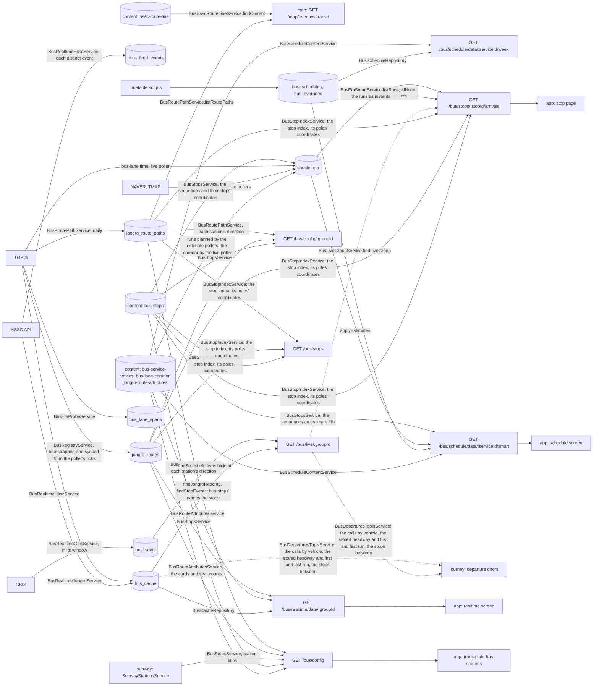

# Bus Architecture

> What `src/bus/` serves: live bus positions, the shuttle timetables with arrival estimates, and the bus groups the transit tab draws. Read it before you change a poller, a timetable rule or the bus config.

## Context

Pollers fetch from the shuttle and city-bus APIs and write `bus_cache`, which every role serves from, `combined` included, never from a poller's memory; the timetable scripts write `bus_schedules` and `bus_overrides`, and `npm run data` the `bus-service-notices`, `bus-lane-corridor`, `jongro-route-attributes`, `bus-stops` and `hssc-route-line` datasets of the content database, which this module only reads; the estimate pollers write `shuttle_eta` and the smart view reads it; the bus-lane probe writes `bus_lane_spans` and the HSSC poller appends `hssc_feed_events`, neither of which anything reads yet; the Jongro pollers keep each route's stations in `jongro_routes` (the registry), which the pollers, the realtime groups and the config view read. The root holds the module file, which binds the limiter on every `/bus` prefix, and what several flows share: the TOPIS route identities (`JONGRO_ROUTES` in `bus.constants.ts`, the Jongno routes in the app's order, then `REGIONAL_ROUTES`, `gyeonggi7800` by its GBIS route id, unlisted and polled only with `REGIONAL_BUS` on; `TOPIS_ROUTES` is both: each route's id, TOPIS route id, `code`, `capabilities`, `isListed` and `pollIntervalMs`, with no station), the service table (`SERVICE_CONFIG`: each service's id and the behavior its code branches on) and its types, and the stop shapes the config view serves (`bus.wire.ts`). Flows are sub-modules: `cache/`, `registry/`, `route-attributes/`, `route-path/`, `hssc-route-line/`, `realtime/` (with `hssc/`, `jongro/`, `gbis/`, `arrival/`, `group/` and `hssc-eta/`), `live/` (with `jongro/`, `hssc/` and `group/`), `stops/`, `stop-index/`, `stop-arrivals/`, `stop-list/`, `schedule-content/` (the schedule content: `BusScheduleContentService`, the one door to the `bus-service-notices` dataset and to the calendar's day, which the routes and the estimate pollers share), `schedule/`, `eta/` (with `lane/`, `probe/`, `travel/`, `forecast/`, `live/`, `baseline/` and `smart/`), and `config/`. `registry/` holds `BusRegistryService`, the one door to the stations: it inserts a route with no document from the poller's TOPIS observations (no snapshot is committed), derives each route's stations and TOPIS id mapping from its stored document through a cache of `REGISTRY_TTL_MS`, and compares each poller tick's arrival list and turnaround stop with the stored list. `route-attributes/` holds `BusRouteAttributesService`, the one door to the `jongro-route-attributes` dataset (each route's card, refresh interval, seat count and transfer lines by ARS number), which the config view and the realtime group join where they serve, never in the registry, so the Jongro pollers read no dataset. `stops/` holds `BusStopsService`, the one door to the `bus-stops` dataset: the local stops (the catalog stops and the HSSC stops), the shuttle sequences and the HSSC line, read as one snapshot per revision that the config view, the smart view, the estimate pollers and the stop index share; its rules hold the push checks `npm run data` runs (`toBusStopsIssues`). `stop-index/` holds `BusStopIndexService`, the door to the stop index: each stop id's served routes, derived from the current snapshot and the stored registry, rebuilt when the revision or a stations version changes and never stored. `stop-arrivals/` serves the stop page from the index, the live route (`BusLiveGroupService.findLiveGroup`, the one answer the live route serves too), each live entry's direction (`BusLiveGroupService.findStationDirection`, which asks `BusConfigService.findStationDirection` for the station's `/bus/config` direction under the index's stations version) and the run read (`BusEtaSmartService.listRuns`), with no read of its own. `stop-list/` serves the stop list from the index (`BusStopIndexService.listStops`, which reads the route lines once for every pole) and each local stop's config record, with no read of its own either. The code keeps what it branches on: the service ids and estimate opt-ins (`SERVICE_CONFIG`), the travel strategies, the HSSC position count (`HSSC_POSITION_COUNT`, which `toLinearSequence` fills), the positions the shuttle passes through (`isHsscPassThrough`, which the stored line's `null` stops must match and the HSSC estimates skip) and the matching of HSSC API rows to positions. `route-path/` holds `BusRoutePathService`, the one door to the route lines, which the map module reads for `/map/overlays/transit`, the stop index for a pole's coordinates and the config view for each station's direction: it syncs each route's line and stations from TOPIS `busRouteInfo` once a day (`SYNC_INTERVAL_MS`, one poller per route), writing a missing route at its first trusted answer, and answers the stored lines through a cache of `ROUTE_PATHS_TTL_MS` that waits for its reload and keeps the last good lines for `ROUTE_PATHS_STALE_WINDOW_MS` only when one fails, leaving out a route with none. `hssc-route-line/` holds `BusHsscRouteLineService`, the one door to the `hssc-route-line` dataset, the HSSC shuttle's loop measured from GPS ([ADR 0018, D9](../decisions/0018-hssc-arrival-estimates.md)), which the map reads for `/map/overlays/transit` (`findCurrent`, null with no good line ever read); its rules hold the push checks (`toRouteLineIssues`). `realtime/hssc-eta/` holds the HSSC ETA engine, pure rules behind `BusRealtimeHsscEtaService`, its door for the live route: from each fresh bus anchored on its latest stop event and each stop's measured dwell and travel medians (`SEGMENTS_BY_SEQ`, derived as [ADR 0018, D3](../decisions/0018-hssc-arrival-estimates.md) records), it answers per stop whether a bus is en route with an expected instant, arriving or waiting to depart, and never estimates across the layover; a bus at a stop leaves after the rest of its dwell median, and its lap times run stop by stop to the turnaround. `live/` serves the live route, `GET /bus/live/:groupId` ([ADR 0019](../decisions/0019-bus-live-api.md)), from what the realtime view reads and nothing else: `live/jongro/` maps a Jongno route from `BusRealtimeGroupService.findJongroReading` (the same cached rows and positions, tracked and placed as the realtime view does, each key with when its poller wrote it) and names each pole's stop through the `bus-stops` aliases; `live/hssc/` anchors each cached HSSC bus on its anchor row's stop event (`BusRealtimeHsscService.findStopEvents`), asks the engine for each stop's estimates and each bus's lap times, and names each station's stop from the stored HSSC line; `live/group/` holds the route, which answers a schedule group `404 GROUP_NOT_LIVE`. The realtime route is frozen and deprecated for it: its body stays byte for byte, it answers `Deprecation` and a `Link` to its successor, and `bus.realtime.deprecated_route_called` counts its calls by app version. Estimates depend on the timetable, never the reverse, so the smart view that merges them lives in `eta/smart/`. `eta/lane/` holds the travel strategies and lane hours (`LANE_STRATEGIES`, `LANE_HOURS`: code, since they pick a run's model), the read of the `bus-lane-corridor` dataset (the corridor, its entry and exit points and the probe routes) and `BusEtaLaneService`, its door, which checks the strategies against each `bus-stops` revision's estimated sequences, answers them to both estimate pollers each tick, and answers a run's strategy and the corridor snapshot. `eta/probe/` holds the bus-lane probe: the TOPIS position client, the spans repository and `BusEtaProbeService`, which times the corridor from probe buses seen twice about ten minutes apart. `eta/travel/` holds the NAVER Directions client and its parsing, and `BusEtaTravelService`, the live flow's one door to the travel model: a run's strategy, the car route, the route forced through the corridor ends, the probe's corridor time and priming. `eta/forecast/` holds the TMAP client and its parsing, and `BusEtaForecastService`, the baseline flow's one door to its predictions: the TMAP forecast, and the fixed value a bus-lane run's prediction reuses. `realtime/gbis/` holds the GBIS seat poller, registered only with `GBIS` on, which inside its window (`SERVICE_WINDOW_START_MINUTE` to `SERVICE_WINDOW_END_MINUTE`, KST) asks GBIS every `POLL_INTERVAL_MS` for each regional route's buses and replaces that route's `bus_seats` document, a collection of its own since the `bus_cache` TTL is shorter than its tick, and `BusRealtimeGbisService.findSeatsLeft`, the door `live/jongro/` joins to its vehicles by id (`withSeatsLeft`), from an answer at most `MAX_SEATS_AGE_MS` old and with no read for a Jongno route ([ADR 0019, D17](../decisions/0019-bus-live-api.md)).

The live poller (`eta/live/`) groups each sequence's due runs by travel strategy and makes one call per group. A car run gets the unforced NAVER route through its stops. A bus-lane run gets one NAVER route forced through the corridor entry and exit as vias, whose corridor leg is its car time, and the probe's corridor time for the same direction: every stop after the first moves by the difference between the two, since each bus-lane sequence boards on one side of the corridor and drops off on the other. When no corridor was ever read, the probe cannot answer (no partner snapshot, too little coverage) or its request fails or is capped, the run falls back at the same tick to the unforced route, one more NAVER call; with no corridor, no forced route or position request is made. A value that fixes from the last live one keeps how that one was timed. Ten minutes before a bus-lane run's window opens, the tick asks the probe for a snapshot without timing a leg, so the window's first call has a partner; ticks run each minute, so `isPrimeMinute` primes in exactly one. Live values of bus-lane runs record their travel model in `travel` on `shuttle_eta` (`busLane` with the corridor's car time, the bus-lane time, the span count and the coverage, or `car` when the run fell back); a car-sequence run carries none, the smart view never reads it, and no wire carries it.

The baseline poller (`eta/baseline/`) predicts every run the smart view shows from today on, refreshed from `04:00` KST; the smart view shows no run on a shown day inside a stored suspension, and none at all while it answers `suspended`. So planning resumes only once the smart view leaves `suspended`: on Saturday `2026-12-19`, before a suspension of Monday `12-21` to Tuesday `12-22`, it opens on `12-21` and answers `suspended`, so no run is planned, and the runs of `12-23` to `12-25` are planned from the first tick of Wednesday `12-23` (KST), when the view opens on that day; the `04:00` refresh is unaffected, since a missing prediction is due at the next five-minute tick and `refreshCutoff` only renews a stored one. A bus-lane run reuses the most recent fixed value of the same service, route type, KST weekday and departure time: the frozen live document of one of the two latest same-weekday dates before the run, on or before today, still unexpired and fitting its sequence's stop count (`reusableFixedDates`, `toReusableFixedByRun`, one batched `listFixedEstimates` read per refresh). Its prediction is that value's offsets, stored as `kind: "baseline"` with `source: "naver"`, `fetchedAt` the refresh, the prediction's life (`BASELINE_LIFE_MS`), and `derivedFrom` the fixed document's `_id`, and makes no TMAP call. Any other run, a bus-lane run without such a value (its first week, a holiday a week earlier, a new departure time) and every car run, is a TMAP forecast, under the TMAP daily cap. The smart view serves both as `predicted`, dated by `fetchedAt`; `derivedFrom` is never served. Every source is a travel time from the run's departure without stopping, so when the smart view applies one (`applyEstimates`), a scheduled stop after the first holds the bus until its timetable time (`floorAtScheduledStops`): reaching it early moves it and every later stop to that time, reaching it late keeps the delay. The 강남·양재 등교 run, which boards at 강남 and then at 양재 five minutes later, is the one estimated sequence with such a stop.

| System | Quirk tag | Gives | Enters at |
| --- | --- | --- | --- |
| The HSSC shuttle API | `hssc` | Shuttle rows on its circular route, local Korean time | `BusRealtimeHsscClient` |
| Seoul TOPIS | `topis` | Jongro arrival rows (the next two buses of each stop, with `traTime` in seconds although its guide says minutes, every stop of the route on every tick, and on each row the route's headway `term` in minutes and the stop's first and last run `firstTm`/`lastTm` as KST `yyyyMMddHHmmss`, a last run after midnight dated the next day, kept on the stored row and optional on read) and bus positions over the whole route from `getBusPosByRtid` (coordinates in `gpsY`/`gpsX`, its `tmX`/`tmY` null, and each row naming the route's turnaround stop, `trnstnid`; `getBusPosByRouteSt` names none), the probe routes' GPS positions (`getBusPosByRtidList`, a quota pool of its own), and each Jongro route's line and stations from `busRouteInfo` (`getRoutePath` points by `no`, `getStaionByRoute` as TOPIS spells it, each operation with a daily quota of its own) | `BusRealtimeJongroClient`, `BusEtaProbeClient`, `BusRoutePathClient` |
| GBIS, the Gyeonggi bus information service on data.go.kr | `gbis` | Each Gyeonggi bus's seats left (`getBusLocationListv2`, by the `vehId` TOPIS gives the same bus, a negative count meaning no information), with `resultCode` four for no bus, and the gateway's own refusal of a spent daily quota; the key travels in the query string | `BusRealtimeGbisClient` |
| NAVER Directions and Map | `naver` | Real-time travel times, unforced or forced through the corridor ends, and the street view link format | `BusEtaTravelClient`, `toStreetViewUrl` |
| TMAP | `tmap` | Forecast travel times, kept no longer than its terms allow | `BusEtaForecastClient` |
| The subway module | — | Each served station's slug and its title per language, which a catalog stop names by slug and the config serves with the stop ([subway](subway-architecture.md)) | `SubwayStationsService.listStations`, read by `BusStopsService` |
| The calendar module | — | Each date's public holiday and school rest day, and a revision key that changes with the school rest days ([calendar](calendar-architecture.md)) | `CalendarService.current`, one snapshot per schedule content read, through `BusScheduleContentService` |
| The timetable scripts | — | `bus_schedules` and `bus_overrides` | `BusScheduleRepository` |
| `npm run data` | — | The `bus-service-notices`, `bus-lane-corridor`, `jongro-route-attributes`, `bus-stops` and `hssc-route-line` datasets of the content database's `datasets`, checked at push against the schema, `SERVICE_CONFIG`'s ids, the corridor geometry (`corridorIssues`), `JONGRO_ROUTES`' ids (`toRouteAttributesIssues`), the stop, sequence, HSSC line and alias checks (`toBusStopsIssues`) and the HSSC loop's closure and segment lengths (`toRouteLineIssues`) ([edit-runtime-data.md](../how-to/edit-runtime-data.md), [edit-bus-stops.md](../how-to/edit-bus-stops.md), [ADR 0018, D9](../decisions/0018-hssc-arrival-estimates.md)) | `BusScheduleContentRepository`, `BusEtaLaneRepository`, `BusRouteAttributesRepository`, `BusStopsRepository`, `BusHsscRouteLineRepository` |
| MongoDB | `mongo` | `bus_cache`, `bus_seats`, `shuttle_eta`, `bus_lane_spans`, `hssc_feed_events` with their TTL indexes, `jongro_routes` and `jongro_route_paths` | `BusCacheRepository`, `BusRealtimeGbisRepository`, `BusEtaRepository`, `BusEtaProbeRepository`, `BusRealtimeHsscRepository`, `BusRegistryRepository`, `BusRoutePathRepository` |
| OpenStreetMap | — | The corridor centerline and its boundary names, rebuilt by `scripts/build-bus-lane-corridor.js` into a pulled `bus-lane-corridor` working file, then pushed. Corridor geometry © OpenStreetMap contributors, ODbL | `BusEtaLaneRepository` |
| Express | `express` | A repeated query parameter as an array | `weekQuery` (`bus-schedule.schema.ts`) |
| skkuverse-app | `app` | Nothing; it reads the routes below | `parser.ts` in its shared package |
| The map module | — | Nothing; it reads the route lines and the HSSC loop and draws them ([map](map-architecture.md)) | `BusRoutePathService.listRoutePaths`, `BusHsscRouteLineService.findCurrent` |

## Glossary

| Term | Means | Derived from | Not |
| --- | --- | --- | --- |
| group | One card of the transit tab and its screen: realtime or schedule | `toBusGroups` | `busGroupConfig` |
| station | A stop as the app lists it on a route, by index | the registry, the stored HSSC line | `busStop` |
| registry | Each Jongro route's ordered stations and turnaround stop, and each stop's last-stated first and last run (`serviceHours`, kept through a night whose ticks answer no rows), one `jongro_routes` document per route, which the pollers keep in step with TOPIS | `BusRegistryService` | — |
| stations version | The first `STATIONS_VERSION_LENGTH` hex characters of a `sha256` over a route's ordered stations (TOPIS id, ARS number, name) and its turnaround stop; `/bus/config` and the realtime response both carry it, so a client sees that its stations changed | `toStationsVersion` | — |
| route path | A Jongro route's line as TOPIS draws it, its points in order as `[lng, lat]`, with its stations, their coordinates and their direction; one `jongro_route_paths` document per route, apart from the registry's document so each has one writer | `BusRoutePathService` | — |
| HSSC route line | The HSSC shuttle's loop as its buses drive it, `[lng, lat]` and closed, starting at 농구장, measured once from GPS rather than synced, since no upstream draws it; one `hssc-route-line` dataset, apart from `bus-stops` ([ADR 0018, D9](../decisions/0018-hssc-arrival-estimates.md)) | `BusHsscRouteLineService.findCurrent` | — |
| direction | A realtime line's 방면, as NAVER Map's direction tabs show it: a contiguous range of its stations, served once per `/bus/config` realtime screen with each station's `directionId`; on Jongno the terminal TOPIS names per station (`getStaionByRoute` `direction`, stored with the route path), flipping at the station after the turnaround and joined to the registry by sequence and TOPIS id, its id the terminal's TOPIS station id; on the HSSC line the owner's 하교 (`fromCampus`, from 농구장 through the first rotary pass) and 등교 (`toCampus`, the rest of the lap); the label is built in the request language around TOPIS's Korean terminal name. Not `towards`, which names a stop page entry's next stop ([ADR 0019, D16](../decisions/0019-bus-live-api.md)) | `toJongroDirections`, `toHsscDirections`, `toStationDirection`, `HSSC_DIRECTIONS`, `screen.directions`, `screen.stations[].directionId`, `routes[].direction` | — |
| path version | The first `PATH_VERSION_LENGTH` hex characters of a `sha256` over a route path's points and stations; a sync whose answer has the stored version writes nothing | `toPathVersion` | — |
| held path change | A route path TOPIS answered with fewer than `MIN_PATH_POINTS_TO_TRUST` points, no station, or a point count or length off the stored line by more than `MAX_PATH_CHANGE_SHARE_TO_APPLY`: logged at warn, never written | `toPathSyncDecision` | — |
| turnaround stop | Where a Jongro route turns back, served as the station's `isRotationStation`; it follows the position rows' `trnstnid` when they agree | `toTurnaroundTopisId` | — |
| held change | A stop list TOPIS answered three ticks in a row that changes more than `MAX_CHANGED_SHARE_TO_APPLY` of the stops: logged at error, never applied ([how-to](../how-to/resync-the-jongro-registry.md)) | `toSyncDecision` | — |
| stop | A boarding or drop-off place of a timetabled run, or an HSSC position's pole, stored in `bus-stops`; one at a subway station names it by its registry slug (`subwayStationId`) and is served with `subwayStation: { id, title }` | `BusStopsService.current` | — |
| pole | One physical bus stop sign: TOPIS gives each its national nine-digit station id (`topisId`, never reused, kept through a rename) and an ARS number shown on the sign (display only: they collide and get reassigned), and two sides of a road are two poles; a stop is one pole, never a place | the station id, `topisIds`, `arsIds` | — |
| stop id | A stop's id, opaque to clients: a local stop's slug (`STOP_ID_PATTERN`, with a letter, `SLUG_LETTER_PATTERN`), or for a TOPIS pole its station id, derived and never stored; a pole a local stop aliases is that stop, and a virtual stop is none. A pole's `seoul-<ARS>` id (`LEGACY_POLE_ID_PREFIX`, which no slug takes) is an alias that never retires: it resolves to the pole's stop (`toCanonicalStopId`) and is never served ([ADR 0019, D5](../decisions/0019-bus-live-api.md)). Each realtime station of `/bus/config` serves its own as `stopId`, its last field, with no key where it has none; an HSSC position with none is a pass-through, where the bus never stops and no arrival is served, and its station says so as `isPassThrough`; a TOPIS station named `(미정차)` is one too (`isTopisPassThrough`), left out of `stopsAway`, while `/bus/live` still serves TOPIS's arrival there (a Jongno virtual stop has none and is still a stop). An HSSC position riders may only get off at is drop-off only (the 하교 direction's 올림픽기념국민생활관 and 혜화동우체국): stored as its optional `isAlightOnly`, absent meaning false and never at a pass-through, served as the station's `isAlightOnly` right after `isPassThrough` and as a stop page live entry's `action: "alight"`, never on the live route's stations; once clients read it, no name carries a `[하차전용]` marker ([ADR 0019, D15](../decisions/0019-bus-live-api.md)) | `stops[].id`, `hssc.stations[].stopId`, `toPoleStopId`, `toCanonicalStopId`, `screen.stations[].stopId`, `screen.stations[].isPassThrough`, `hssc.stations[].isAlightOnly`, `screen.stations[].isAlightOnly`, `routes[].action` | — |
| alias | A local stop's claim to a TOPIS pole by its TOPIS station id (`topisIds` in `bus-stops`, preferred, and the only way for a pole TOPIS gives no ARS number; a station id wins over another stop's ARS alias) or its ARS number (`arsIds`), pushed only once the pair is confirmed on site: the pole's station id and `seoul-<ARS>` id then resolve to the local stop, whose page lists the pole's routes too; without one, two sources stay two stops however close. A route `/bus/config` does not list (`isListed: false`) names only aliased poles ([ADR 0019, D5](../decisions/0019-bus-live-api.md)) | `arsIds`, `topisIds`, `stopIdByArsId`, `stopIdByTopisId`, `toStationStopId` | — |
| stop index | Each stop id's served routes in the order of `/bus/config`'s groups: a Jongno pole per route at its first index (a loop lists its terminal twice), an HSSC position, a sequence stop; derived at read from one `bus-stops` snapshot and the stored registry, never stored | `toStopIndex`, `BusStopIndexService.findStop` | — |
| stop list | Every stop of the stop index once, in its order, with its coordinates (or `null`), its names, route labels and `towards` in every language, its campus (a catalog stop's `campus`, else `hssc` at a Jongno pole) and its served routes without arrivals; one public body for every language | `BusStopListService.listStops`, `BusStopIndexService.listStops`, `toStopCampus` | — |
| stop page | One stop's block and an entry per served route: a realtime line's live route entry at its index, with the next stop it heads towards (on the HSSC line named as that stop's own page names it; `null` at a Jongno route's last station, its 종점), the direction its `/bus/config` station lies on, and whether riders board or only get off there (`action`), a shuttle's next runs at the stop from the run read as scheduled arrivals | `BusStopArrivalsService.findStopArrivals` | — |
| sequence | A station's position on its route, from one; a TOPIS row's `sequence` is its ord | `toLinearSequence`, the registry index | `seqNo` |
| arrival | One bus or run at one station, as the live route and the stop page serve it: the shared call of [ADR 0022, D2](../decisions/0022-journey-and-call-spec.md), a status, expected and scheduled arrival and departure instants, their basis, stops away, run id, the vehicle's id, headsign (the station's direction label; a timetabled run's 등교 or 하교 for an up or down run, else its service label), first and last run, express (null for a bus) and the upstream's own text; every key always present, null when unknown ([ADR 0019](../decisions/0019-bus-live-api.md)); a bus at or standing at the station is `arriving`, `0` stops away, until it leaves, first there (on Jongno from its position, since TOPIS drops it from the station's row), and only a timetable run carries departure instants ([ADR 0019, D14](../decisions/0019-bus-live-api.md)); the deprecated realtime route serves the older realtime arrival: state, minutes, stops away, last bus, car number, crowding and passenger count beside its raw text (`toRealtimeArrival`) | `toCall`, `toStationCalls`, `toTimetableArrival`, `withHeadsigns` | — |
| stop call | An arrival before it is served: the shared wire `call` field for field with `Date` instants (`src/shared/call.types.ts`), a timetabled run adding its `runDepartureAt` (`RunCall`); each producer (the TOPIS rows, the HSSC engine, a timetabled run) builds one from stored state and the instant it is given, and only the shared `toCall` formats it, at `+09:00` and in the wire's key order, so no producer re-parses a served time | `StopCall`, `toJongroCall`, `toHsscCall`, `toCall` | — |
| live route | `GET /bus/live/:groupId`: a realtime group's vehicles and each station's arrivals in one shape for every source; it replaces the realtime route, which is frozen and deprecated ([ADR 0019](../decisions/0019-bus-live-api.md)) | `BusLiveGroupService.getLiveGroup` | — |
| vehicle | One bus a live answer mentions, once: the shared vehicle of [ADR 0022, D2](../decisions/0022-journey-and-call-spec.md) (its id, occupancy, seats left, low-floor flag) with its full plate, trajectory and position, its last-bus flag on the calls naming it, which is its station index, whether it is in transit, at a stop or waiting to depart, the section's progress and length and its coordinates when the source measures them, when it reaches the next station, when the source saw it (`positionAt`) and when this server last fetched that (`checkedAt`); arrivals name it by id. Its low-floor flag reads a Jongro bus type (TOPIS's `busType`: `general`, `lowFloor` or `articulated`, cached on position and arrival rows only when TOPIS sends one of those codes) from one row: the position's, else the arrival row its plate comes from ([ADR 0019 D13](../decisions/0019-bus-live-api.md)) | `toLiveJongroGroup`, `toLiveHsscGroup`, `toBusType`, `toLowFloor` | — |
| operation | Whether a live group or station runs (`running`), is done for the day (`ended`, TOPIS's end-of-service text at every slot) or states nothing (`noData`), or whether a timetable is `suspended`; per station, then per group | `toStationOperation`, `toGroupOperation` | — |
| arrival state | What an arrival's text says: `running`, `arriving`, `waiting`, `ended`, `noInfo` or `unknown`, its phrases tested by substring in the order ended, waiting, no information, arriving, then the timed pattern; it wins over the bus's numbers, and only a `running` arrival has minutes; a waiting tracked vehicle's arrivals are served `waiting` with no minutes, since TOPIS prints 곧 도착 at the next stop for a bus idling at its origin | `toArrivalState`, `toWaitingArrival` | — |
| stops away | How many stops a bus is from the station, only when TOPIS names a vehicle: on the realtime route the station's ord minus the bus's section ord, TOPIS's own `[N번째 전]` (the stops between, since an arrival row's section ord is the next stop's ord); on the live route one more, its next stop `1` and `0` standing there, less the stations between that TOPIS names `…(미정차)`, which a bus passes without stopping (`isTopisPassThrough`, served `isPassThrough` on `/bus/config`) ([ADR 0019 D4](../decisions/0019-bus-live-api.md)) | `toStopsAway`, `toStoppingStopsAway` | — |
| seats left | How many seats a bus still has free, `0` when none: GBIS's count for the vehicle's id from a fresh answer, null on every other bus, a null never meaning full ([ADR 0019, D17](../decisions/0019-bus-live-api.md)) | `seatsLeft`, `toSeatsLeft`, `withSeatsLeft`, `BusRealtimeGbisService.findSeatsLeft` | — |
| crowding | How full a bus is: `relaxed`, `normal` or `crowded`, from TOPIS's congestion code (type `4`) or its passenger count against the route's seat count (type `2`) | `toCrowding` | — |
| route attributes | A Jongro route's theme color, icon type, refresh interval, seat count and transfer lines by ARS number, stored per route id in `jongro-route-attributes`; the route's ids, code, capabilities, listing and poll interval stay in `JONGRO_ROUTES` | `BusRouteAttributesService.current` | — |
| seat count | A Jongro route's seats per bus in its stored attributes, which crowding compares the passenger count with: up to it relaxed, up to `1.5` times it normal | `seatCount`, `BusRealtimeArrivalService.seatCountOf` | — |
| dwell | How long a bus has been at its last passed station, counted from `firstSeenAt` in seconds (`dwellSeconds`); stored and served as `estimatedTime`, published as deprecated | `toDwellSeconds`, `toDwell` | — |
| bus kind | Whether a served bus is `estimated` (its station and dwell only: every HSSC bus) or `tracked` (a Jongro bus with its vehicle, status and section); an extensible enum, and a client reads an unknown kind as estimated | `toEstimatedBus`, `toTrackedBus` | — |
| tracked status | What a tracked bus is doing: `waiting` when it stands still at a terminal (the first or last index, or the turnaround stop) or its next stop's arrival text is a waiting phrase, else `atStop` on TOPIS's `stopFlag` or at the last index, else `running`; a lagging position is always `running`; only a running bus carries section progress, its section's length and seconds to its next stop | `toTrackedStatus`, `toJongroBusTracking` | — |
| lagging position | A Jongro position whose vehicle an arrival row gives a `sectOrd` two or more past the position's: the arrival API counts the section toward the next stop, one past, so two past means the position is a section stale | `isLaggingPosition`, `toHighestSectOrd` | — |
| stationary | A vehicle whose `sectDist` moved less than `MAX_STATIONARY_MOVE_METERS` in the same section since the poller's previous observation of it, judged only when TOPIS's observation time advanced, or a vehicle idling at the origin; never otherwise on the first observation after a restart | `isStationary`, `isIdlingAtOrigin` | — |
| idling at the origin | A vehicle at `sectOrd 1` whose position row's `lastStTm` (seconds to the terminal) is `0` and that has not moved `MAX_STATIONARY_MOVE_METERS` in that section since the previous observation, whether or not TOPIS's observation time advanced; on the first observation after a restart, one at `sectOrd 1` with `lastStTm 0` and `stopFlag 0` | `isIdlingAtOrigin` | — |
| section progress | How far a running bus is from its last passed stop toward the next one: `sectDist / fullSectDist`, clamped to `[0, 1]` | `toProgress` | — |
| next stop countdown | A running bus's travel time on its next stop's arrival row, re-based from when TOPIS made the row (`mkTm`) to when it observed the bus (`observedAt`), never below `0` | `toNextStopInSec` | — |
| s | Where a tracked bus is along its route, in `stationIndex`'s index space: its station index plus the fraction of the section toward the next station, so standing at station `k` is `s = k`; the first knot stays below the next station (`MAX_FIRST_KNOT_FRACTION`), so its floor is the bus's `stationIndex` | `toTrajectory` | — |
| knot | One point of a trajectory: an instant at `+09:00` (`at`) and the bus's `s` then; the app moves the bus linearly between knots and reads `at` against `meta.serverNow`, the server's clock when it built the response | `TrajectoryKnot`, `toKstInstant` | — |
| trajectory | The knots of a running or atStop tracked bus, ascending in time: its observation, an atStop bus's expected departure, then up to `TRAJECTORY_STOPS_AHEAD` next stops, each at its next stop countdown and at least `MIN_SEGMENT_SECONDS` after the knot before; when no row names the vehicle at its next stop, that stop alone is reached from the rest of its section at `ASSUMED_SPEED_METERS_PER_SECOND` (the app's speed, so the app has one predictor), and a later stop without a row ends it; none for a waiting bus, and the observation alone at the last index | `toTrajectory`, `toStopArrivalMs`, `toNamedBuses` | — |
| expected departure | When an atStop bus leaves its stop: `DWELL_SECONDS` after its first observation there (`atStopSince`, kept by the poller per vehicle), left out of the trajectory once due | `toAtStopSince`, `toDepartureMs` | — |
| run | One timetabled departure of a route type on a date; the run read answers each run of the smart view's week (and the next one when asked) still under way, its departure and stop times as instants parsed once from the stored `"HH:mm"` (one before the departure is the next day's), the served estimate applied at its estimated stops and the latest one beside it; the smart view is those runs formatted back as `"HH:mm"` | `runsOfDay`, `toStopAt`, `toDayRuns`, `BusEtaSmartService.listRuns` | `trip` |
| estimate | Travel times from a run's first stop, live, frozen or predicted; a run's latest estimate, its most recently fetched unexpired one of any kind (a live value too old to serve included), only decides how long the stop page lists it where the stop shows no timetable time | `pickEstimates`, `pickLatestEstimates` | `prediction` |
| week | Seven resolved days from a Monday | `BusScheduleService.resolveWeek` | — |
| schedule content | The editorial inputs a timetable folds in and the calendar's day, read as one snapshot keyed by the notices revision and the calendar's revision key (`revisionKey`) | `BusScheduleContentService.current` | — |
| service notice | One of a service's notices in `bus-service-notices`, served with `source: "service"` on each day with a timetable; the first is the app's banner | `noticesOf` | — |
| suspension | A service's `{ from, until }` in `bus-service-notices`, both days included: the smart view answers `suspended` when the day it would open on is inside it, otherwise shows each shown day inside it, before or after today, as no service with no label, notice or timetable, and the pollers plan no run; the deprecated week view serves the timetable as stored. A one-day suspension on the opening day answers `suspended` for the whole view, as one covering today does; a short closure that should keep the week visible is a `noService` day override instead | `suspendOf`, `toSuspendWindow`, `toSuspendedDay` | — |
| rest day | A date the calendar answers with a school rest day or a public holiday, labelled by the dataset's rest day, then the public holiday, then the crawled rest day, shown as a no-service day on services that respect holidays | `toNonOperatingDayLabel` | — |
| smart view | The days the app opens on, from today or next week | `BusScheduleService.resolveSmartSchedule` | — |
| travel strategy | How an estimated sequence's travel time is modelled: `car`, the directions route, or `busLane`, the corridor model; a sequence `LANE_STRATEGIES` leaves out is `car` | `strategyOf`, `LANE_STRATEGIES` | — |
| bus-lane run | A run of a `busLane` sequence that departs inside the lane hours, `from` inclusive and `to` exclusive in KST | `strategyOfRun` | — |
| corridor | The expressway stretch with the bus lane, from south of Hannam Bridge to Singal JC, as a centerline with along-distance in meters growing southbound; stored with its entry and exit points and probe routes as the `bus-lane-corridor` dataset | `bus-lane-corridor`, `projectOntoPolyline` | — |
| corridor snapshot | One stored corridor revision as the live tick reads it, once per tick and only when a bus-lane run is due: the centerline, the probe routes, and each direction's ends and leg bounds | `toCorridorSnapshot`, `BusEtaLaneService.corridor` | — |
| probe route | A city or regional bus route whose GPS positions time the corridor, with the section ranges that put its buses on it in each direction | `probeRoutes` in `bus-lane-corridor` | — |
| span | The corridor stretch one probe bus covered between two of its positions about ten minutes apart, with its average speed | `toSpans` | — |
| feed event | One HSSC row as a stop event: a line's `inout` at a stop index (`seq`) at its `get_date`, which the feed repeats on every tick until the bus reaches its next stop; appended once to `hssc_feed_events` as training data for a shuttle arrival model | `toFeedEventKey`, `toFeedEventTiming` | — |
| anchor | A fresh HSSC bus as of the stop event of its anchor row: departed its stop when that event is a departure (`LEFT`, `LEFT_LAST`) anywhere but the turnaround, at the stop since its first sighting there otherwise (`ENTERED`; `EMERGENCY`, which flags a bus near the stop; and a `LEFT` at the turnaround, which fires off the stop's geofence while a bus may still lay over beyond it). The anchor row is the feed's own row, or the bus's previous anchor row, which the poller holds while it is fresh against a feed row that puts the bus up to `MAX_BACKWARD_POSITIONS` positions back in its lap anywhere but the turnaround (the feed reports the second rotary pass for a bus past the first) and stores in the bus's `bus_cache` entry beside the feed's row, which the deprecated route reads | `HsscBusAnchor`, `isConfirmedDeparture`, `toHeldAnchorRow`, `HsscAnchorRow` | — |
| layover | A bus's stand at the HSSC turnaround between its arrival and its departure, whose end cannot be predicted; no ETA crosses it. It lasts until the feed reports the bus at a later stop of the lap, whatever it said at the turnaround | `isLayingOver`, `isBehindLayover` | — |
| HSSC ETA | A bus's status toward one HSSC stop: `enRoute` with its expected arrival instant (the rest of its current dwell and travel, each overdue part counting nothing, then each stop's medians in between), `arriving` at the stop with when it leaves (the rest of its dwell, which holds the marker there; the live route serves the arrival with no departure instant, [ADR 0019, D14](../decisions/0019-bus-live-api.md)), `waitingToDepart` when its path crosses the layover, or `unknown` for a stalled bus (departed away from the turnaround, its next stop event overdue past `MAX_OVERDUE_SECONDS`), which has no instant and no lap times; with its stops away, the stops it reaches first plus one, the rotary passes skipped, a whole lap of stops once it left the stop; a bus laying over at the turnaround comes first there; its lap times are its arrival at each position ahead and its departure after the dwell median, up to the turnaround | `toHsscEta`, `toStopEtas`, `toLapTimes` | — |

## Structure

What the app reads, from `skkuverse-app/packages/shared/src/bus/parser.ts`:

| Field | App use |
| --- | --- |
| `/bus/config` `groups` | The bus screens, each by its `screenType` |
| realtime `buses`, `stationEtas` | Bus markers by `stationIndex` and the arrival text per station (`eta`, published as deprecated in favor of `arrivals[].message` and served unchanged until installed builds from before the arrivals OTA are gone) |
| realtime `stationEtas[].arrivals`, `buses[].kind`, `buses[].tracked` | Not read yet; the app OTAs that show minutes, the second bus and crowding, and that move tracked buses between stations (falling back to `stationIndex` on an unknown kind or status) will |
| realtime `tracked.trajectory`, `meta.serverNow` | Not read yet; the app OTA that animates tracked buses will move each along its trajectory against `serverNow` |
| realtime `stationsVersion`, `/bus/config` Jongro `screen.stationsVersion` | Not read yet; the app OTA will refetch `/bus/config/:groupId` with `Cache-Control: no-cache` when the live route's differs, a revalidation the config's `ETag` answers ([bus-live-api.md](../reference/bus-live-api.md#stations-version)) |
| realtime `meta.currentTime`, `meta.totalBuses` | The screen header |
| `GET /bus/live/:groupId` | Not read yet; the app OTA moves each realtime line screen to it, keeping its clock offset, minute and marker rules ([bus-live-api.md](../reference/bus-live-api.md)) |
| smart `days`, `selectedDate`, `status` | The schedule screen, opened on `selectedDate` |
| smart entry `stopTimes`, `eta` | Times per stop, marked as estimated with their source |
| `/bus/config` `screen.stops[].map` | The stop's map card, drawn only when the stop has `map` and `coords` |
| `/bus/config` `screen.stops[].subwayStation` | Not read yet; the schedule screen's link to that station's arrivals (`/subway?station=<id>`), labeled with `title` as served |
| `/bus/config` realtime stations' `stopId`, `GET /bus/stops/:stopId/arrivals`, `GET /bus/stops` | Not read yet; the app OTA that opens a stop page from a line's station list will, reading a `404` as "stop gone", and the shared map OTA will draw stop pins from the stop list and open each one's page by `id` ([bus-stops-api.md](../reference/bus-stops-api.md)) |

## Invariants

- Pollers report by resolving or rejecting; none logs its own failure (`PollerRegistryService`).
- A Jongro arrival row in `bus_cache` keeps the fields installed apps read (`eta` is TOPIS's first-bus text as received) and `buses`, its first and second bus as TOPIS sent them, numbers parsed (`traTime`, `sectOrd`, `staOrd`, `arrmsg`, `isLast`, `plainNo`, `vehId`, `rerideDiv`, `rerideNum`). Arrivals are derived from them when served, so a rule change needs no cache change. A row without a numeric travel time or ord rejects the tick.
- A Jongro position in `bus_cache` keeps the fields installed apps read, its `sequence` TOPIS's `sectOrd` (so a bus at a loop end sits on the last index), and its vehicle fields as TOPIS sent them (`vehicleId`, `sectDist`, `fullSectDist`, `isAtStop`, `observedAt` at `+09:00`, and `busType` when TOPIS sent a documented code, which arrival rows keep per bus too) with `isStationary` and, for a bus at a stop, `atStopSince` (its first observation at that stop) from the poller's memory of each route's vehicles, which keeps only the last tick's. TOPIS stops advancing `dataTm` for a bus idling at its origin, so the origin is told by the row's `lastStTm` instead, which is `0` there and nowhere else (the evidence is in [ADR 0014, D3](../decisions/0014-jongro-realtime-from-topis.md)); a row without a numeric `lastStTm` falls back to the two-observation rule. A position row whose vehicle, section or observation time is missing or malformed rejects the tick. The tracked status, progress, countdown and trajectory are derived when served, by joining the position with its vehicle's arrival rows; the same join serves a waiting vehicle's arrivals as `waiting`.
- Each TOPIS route's poller ticks every `pollIntervalMs` its `TOPIS_ROUTES` entry states (`src/bus/bus.constants.ts`), a little slower than TOPIS refreshes `dataTm`, and each listed route's stored `refreshInterval` is the same number of seconds, so the app asks no more often than the cache changes. Both TOPIS functions the poller calls share a daily quota per key with the bus-lane probe: the budget is in `docs/project-docs.md` ("Daily Usage and Quota Check"); change the two together and recompute it. A call over the quota logs `bus.topis.quota_exceeded`, which pages. The GBIS seat poller spends a quota of its own (`getBusLocationListv2`, in the same budget) only inside its window, and a call over it logs `bus.gbis.quota_exceeded`, which alerts the maintainer at a lower priority: seats are null until it resets, and nothing else changes. `REGIONAL_BUS=off` (the development default) registers neither poller of a regional route, so its live route answers `noData` once its stations are stored, and the registry's `503` on a database where they never were.
- A `bus_cache` key is written only by its poller and read through `BusCacheService`; each replica keeps a read for `MEMORY_TTL_MS`. A poller writes its key on every tick its upstream answers, an empty value when the upstream lists no bus (an empty HSSC array, TOPIS's `"4"` no result, overnight on the Jongro positions), which serves the same response as a missing key. So a key goes missing only when its poller has not written within the `ttl_updatedAt` index's `expireAfterSeconds`. A missing key serves no bus with a `200` in every role, since no read falls back to a poller's own memory ([ADR 0012](../decisions/0012-runtime-roles.md)), and logs `bus.cache.missing` with the key, at most once a minute per key and process, which is what an alert on a stopped writer or a key typo reads. An upstream answer that is neither data nor `"4"` rejects the tick and writes nothing. A position row without a stop or coordinates rejects the tick too; one without a turnaround stop counts as no turnaround observation.
- A timetable document that does not parse is left out and logged (`bus.schedule.invalid_document`), never served. A dropped override is also a Sentry Issue (`BusScheduleDroppedOverrideError`), because its day falls through to the pattern. Only a `replace` override needs `entries`; a type other than `replace` or `noService` is dropped. `bus_overrides` carries the same shape as a `$jsonSchema` validator (`scripts/lib/bus-overrides-validator.js`, applied by `scripts/apply-bus-overrides-validator.js`), pinned to `busOverrideDoc` by `__tests__/nest/bus/bus-overrides-validator.test.ts`, so a bad write is refused where it is written.
- The week route answers only a `from` within a year of today (KST), a `400` otherwise: each Monday asked for is a cached week and two reads, and date-holidays does not return on an invalid date or a far year.
- A timetable or override that `npm run schedule` or a script writes is served within `WEEK_CACHE_TTL_MS` (a minute) with no restart, by every api replica and by the estimate pollers, which read runs through the same week cache: past the TTL a read waits for the reload, and only a failed reload serves the last good week, for `WEEK_STALE_WINDOW_MS`, logging `cache.reload_failed` ([ADR 0012](../decisions/0012-runtime-roles.md)).
- A cached week is keyed by its service, Monday and the schedule content's `revisionKey`, and the weeks of an older revision are dropped, so a push of `bus-service-notices` or of the calendar's school rest days reaches every week, its ETag and the pollers within a minute, and no week mixes two revisions. Each dataset keeps its last good value for a day through failed reads; with none ever read (the calendar's `503 CALENDAR_UNAVAILABLE` included), smart and week answer `503 BUS_SCHEDULE_UNAVAILABLE` (an unknown service is still a `404`), and both estimate pollers' ticks reject, so the registry reports them failing.
- `/bus/config` and `/bus/config/:groupId` read two datasets, `jongro-route-attributes` and `bus-stops`, and, for the Jongno groups and the all-groups body, the stored route lines for each station's direction (through `BusRoutePathService`'s cache; lines that cannot be read serve no Jongno direction and never fail the config, and the HSSC and schedule groups read none): their ETag cache key holds both revisions (`none` when the attributes were never read) beside every stations version and each route's directions, and the ETag is the body's `md5`, so a push that changes a body moves it within a minute and one that changes none keeps it, as `/bus/config/hssc` keeps its own through a push that changes a commute stop. A push of any other dataset never moves it.
- A frozen estimate never changes, a live one is served for `LIVE_MAX_AGE_MS`, and the smart view follows its estimates in its ETag; each directions provider and the TOPIS position client is bounded by its `DailyCap`.
- A bus-lane run's value never waits on the probe or the corridor: without a corridor time it is the car route's, stored and served at the same tick. With no corridor ever read (missing, invalid or unreadable), the tick rejects after its writes with `BusEtaLaneUnavailableError`, and each later tick reads the corridor until one reads, bus-lane run due or not; once read, a corridor serves through failed reads for a day, and a push reaches the tick within two minutes (two ticks). A failed position request still rejects the live tick after its writes, and later ticks keep rejecting until a position request succeeds, whatever NAVER answers; the same holds for NAVER, and for the day's runs: a tick whose runs could not be read (the schedule content unavailable) keeps rejecting until a later read succeeds, with no NAVER call needed to clear it. A failed forced route stores nothing for its runs at that tick and makes no car call: NAVER itself failed.
- A bus-lane run's prediction reuses a fixed value only while that value is stored: a fixed value lives `LIVE_LIFE_MS` after its run, which must outlast a week and the refresh, and `liveDoc life` in `bus-eta-live.mapper.spec.ts` fails when it does not, instead of the reuse silently stopping. `derivedFrom` is set only on such a prediction, and an upsert replaces the whole document, so a later TMAP prediction of the run carries none.
- The travel diagnostics on `shuttle_eta` are never served. An upsert replaces the whole document, so a later car value keeps no `travel` from an earlier one, and a document written before the field existed reads as stored.
- No process writes `jongro_routes` at boot ([runtime roles](../decisions/0012-runtime-roles.md)). A route with no document is bootstrapped by its poller: the tick fetches both lists, writes no `bus_cache` key and rejects (`BusRegistryBootstrappingError`, so a route that stays missing declares its poller failing) until the tick that stores it, and once `OBSERVATIONS_TO_APPLY` ticks in a row report the same list with a turnaround stop every position row agrees on and the list holds, it inserts that list with `$setOnInsert` (`bus.jongro.registry_bootstrapped`), never over a stored route; a tick with no agreed turnaround stop (no bus running), or one the list does not hold, counts nothing. A route missing at read time answers `503 JONGRO_REGISTRY_UNAVAILABLE` on `/bus/realtime/data/jongro*`, `/bus/config` and a Jongro group's `/bus/config/:groupId` (and on the ui transit routes, which read the bus groups), once the attributes were read and logs `bus.jongro.registry_missing` at error, at most once per route each `REGISTRY_TTL_MS` (with `suppressed`), since the loader caches no miss; nothing serves a committed list. The config reads only listed routes (`listRoutes`), so an unlisted route's missing document fails none of these; its live route answers the `503`, and the stop index leaves it out with no error until its poller stores it, reading it again at most every `REGISTRY_RETRY_MS`.
- The stations follow TOPIS: each tick's arrival list, ordered by ord, is compared with the stored list. A differing list is applied once `OBSERVATIONS_TO_APPLY` ticks in a row have reported it (`bus.jongro.registry_synced`, with the stops added, removed, moved and renamed), unless it changes more than `MAX_CHANGED_SHARE_TO_APPLY` (`0.3`) of the stops: the stops of the longer list outside the two lists' longest common order, so one stop added mid-route counts once. Such a change is held and logged at error once per distinct list (`bus.jongro.registry_change_held`). An empty list (TOPIS's `"4"`) is no observation. The count lives in the poller's memory, so a restart only restarts it. The write is guarded by the version the tick read. Every replica reads a change within the registry's `REGISTRY_TTL_MS`, and the `/bus/config` ETag changes with it.
- No process writes `jongro_route_paths` at boot. The daily sync, which runs at the poller's start, fetches both `busRouteInfo` operations, keeping each station's `direction` (`null` when TOPIS sends none or a blank one; a value that is not text fails the answer), which the path version hashes, so the first sync after the field shipped rewrote every stored line: a route with no stored line is inserted (`$setOnInsert`) once the answer has at least `MIN_PATH_POINTS_TO_TRUST` points and one station, and a stored one is replaced only by a changed path version within `MAX_PATH_CHANGE_SHARE_TO_APPLY` of its point count and length, guarded by the version it read (`bus.jongro.path_synced`). A held path change is logged once per process as `bus.jongro.path_change_held` with both point counts and lengths, and a failed or refused answer (`"4"` included) rejects the tick and writes nothing. The read answers the stored routes in the configured order: a route missing from the collection is left out, logged at error (`bus.jongro.path_missing`, at most once a minute per process, since the no-store stop page reads the lines per request) and flags the answer, so the map caches it briefly; a failed read serves the last good lines inside the stale window and answers `503 JONGRO_ROUTE_PATHS_UNAVAILABLE` with none, and that failure is held for `ROUTE_PATHS_RETRY_MS` (one read per process while it lasts, `bus.jongro.path_read_failed` at most once a minute) before the next read. The HSSC route line is read when the map serves it, never at boot, through the dataset loader (a push serves within a minute, a failed reload keeps the last good line for a day). With no good line ever read (missing, invalid or unreadable, logged at error as `bus.hssc_route_line.missing`, `.invalid` or `.read_failed`), `findCurrent` answers null and the map serves the Jongno lines without it. A push is refused for a position off the globe's ranges, fewer than `MIN_ROUTE_LINE_POINTS` points, an open loop or a segment over `MAX_ROUTE_LINE_SEGMENT_M`.
- The Jongro route attributes are read when served, never at boot. With none ever read (missing, invalid or unreadable), `/bus/config` and the ui transit routes answer `200` without the Jongro groups, reading no registry (`findCurrent`, a documented degraded answer of [ADR 0013 D6](../decisions/0013-runtime-data-in-mongodb.md)), while a Jongro group's `/bus/config/:groupId` and `/bus/realtime/data/jongro*` answer `503 JONGRO_ROUTE_ATTRIBUTES_UNAVAILABLE`; the other groups and `/bus/realtime/data/hssc` read none. The cause is logged at error (`bus.route_attributes.missing`, `.invalid`, `.read_failed`). Once read, they serve through failed reads for a day. An unlisted route has no card and no attributes: its live route reads no seat count, since its source reports no load. A listed route the code serves that a revision lacks is left out of the config and the transit routes, its group and realtime routes answer that `503`, and the gap is logged once per revision (`bus.route_attributes.route_missing`); a stored route the code does not serve is ignored (`.route_unknown`). A stored transfer line whose ARS number no stored station has serves nothing, logged once per route, ARS number and revision (`bus.jongro.registry_unmatched_transfer`).
- The stops are read when served, never at boot. A `bus-stops` push is refused, naming each issue's path, on the catalog's checks (`validateStopCatalog`), a stop naming a subway slug the registry does not serve (`subwayStationErrors`), a lane strategy for a sequence the data does not estimate, the HSSC line's checks, an ARS number aliased twice and a stop without `coords` that the HSSC line, a sequence or its `arsIds` serve (`toBusStopsIssues`), and a sequence whose stored timetable entries in the target's `bus_campus.bus_schedules` have another `stopTimes` length or a `null` at a scheduled stop (`stopTimesMismatches` in `scripts/lib/campus-schedule-file.js`, which `npm run schedule` runs against the target's stored `bus-stops` too, so neither writer stores a length the other side does not match; both skip a pattern whose `effectiveUntil` is before today in KST, which serves no date ahead); the read parses the schema, which pins the HSSC line to `HSSC_POSITION_COUNT` positions, and never serves a revision the catalog's checks, the subway slugs, the HSSC line's checks or the alias check of this code refuse (every push check but the lane strategies, which the estimate pollers check, the timetable cross-check, which reads another database, and the served stops' coordinates, which the stop list serves as `null`), logging it once (`bus.stops.invalid`) and serving the last good one. With no good value ever read, `/bus/config`, its `hssc`, `campus`, `commute` and Jongro groups (whose stations name their stops, an alias included) and the ui transit routes answer `503 BUS_STOPS_UNAVAILABLE` (a `200` without the shuttle groups would replace the app's cached config with a wrong one), the smart view serves the timetable without estimates, and both estimate pollers' ticks reject before any upstream call; `fasttrack` and the realtime routes read none, and a Jongro group whose attributes were never read either answers the stops' `503`, which it reads first. The cause is logged at error (`bus.stops.missing`, `.invalid`, `.read_failed`); once read, the stops serve through failed reads for a day. A revision the lane strategies do not fit rejects every estimate tick, logged once (`bus.eta.lane_strategy_unmatched`). A tick's write leaves out the estimates a push during the tick made the wrong length (`bus.eta.estimates_dropped`), and the smart view serves without estimates when the stops were never read (`bus.eta.stops_unavailable`). A stop's `subwayStation.title` is that station's `title` in the request language, the same text the transit tab's subway row serves, and is never written in the catalog; registry titles exist in every supported language, so it has no fallback. A station-linked stop changes the commute group's and the all-groups ETag in every language, and no other group's.
- The live route reads only what the realtime view reads: `bus_cache` through the same per-replica memory, each key with the instant its poller wrote it (`BusCacheService.readEntry`), the stored registry and route attributes, and `bus-stops` for each station's stop, so a `bus-stops` never read answers its `503` there too. A Jongno arrival's instant is TOPIS's `mkTm` plus its travel time, else plus the time in its text, never rounded or corrected; a running bus with neither is `unknown`. An HSSC estimate never crosses the layover, and never slides with the clock past its overdue bound ([ADR 0018](../decisions/0018-hssc-arrival-estimates.md)). An HSSC bus moves off the turnaround only when the feed reports a later stop of its lap, and a feed row that puts it back in its lap is held off by its previous anchor row while that row is fresh, so the HSSC poller writes the held row beside the feed's row in the bus's entry; the deprecated realtime route reads only the feed's row, and the live route reads an entry without a held row, as a poller older than the filter wrote it, as the feed's row ([ADR 0012](../decisions/0012-runtime-roles.md)). The HSSC poller keeps a bus laying over at the turnaround for `LIVE_STALE_MINUTES_AT_TURNAROUND` and any other for `STALE_MINUTES`, and the deprecated realtime route leaves out, when it reads, a layover past `STALE_MINUTES_AT_TURNAROUND`, as it served before. Every key of an arrival, a vehicle and a position is present, null when unknown ([ADR 0019](../decisions/0019-bus-live-api.md)); a vehicle's `seatsLeft` is null unless a `bus_seats` answer at most `MAX_SEATS_AGE_MS` old names its id, so `GBIS=off` (the development default), a GBIS outage or a failed `bus_seats` read (logged as `bus.gbis.read_failed`) changes no other key.
- The stop page reads only what the other bus routes cache: the stop index (rebuilt within the dataset's TTL of a push and the registry's of a sync), the live route and the run read, so a live entry is the live route's station entry at that index and its runs the smart view's as instants, estimates included; where a stop shows no timetable time, a run is listed until the later of its shown time and the arrival of its latest estimate, which the run read carries from the same cached read and the page never shows. A stop id the index does not hold, or a malformed one, answers `404 BUS_STOP_NOT_FOUND`; with no good `bus-stops` ever read it answers `503 BUS_STOPS_UNAVAILABLE`, and a pole only an unread Jongno route could name, or a local stop aliasing a pole that no readable route serves, answers that route's `503`. A Jongno route whose registry cannot be read is left out of the index, logged at error at most once a minute (`bus.stop_index.registry_unread`) and read again at most every `REGISTRY_RETRY_MS`; a route whose other source cannot be read (its attributes, its timetable) is left out and logged at error, at most once a minute per route (`bus.stop_arrivals.route_left_out`); a Jongno entry whose live answer another stations version placed is left out of that response; the rest of the page serves; an alias no stored station has serves nothing and is warned once per revision (`bus.stop_index.alias_unmatched`). A Jongno pole's name is its stored Korean name in every language, and its coordinates the stored route line's.
- A stop's `map` is served only by a group that `HAS_STOP_MAPS_BY_GROUP` (`src/bus/config/bus-config.config.ts`) marks true: the campus group serves each stop's guide, the commute group none (the owner's decision). The switch is per group, never per catalog stop, because both groups serve `nsc-n-center` and `nsc-opposite`; the dataset keeps every guide and a push still checks each one. Flipping a group's switch changes that group's and the all-groups ETag, and no other group's.
- `hssc_feed_events` is an append-only history beside `bus_cache`, written only by the HSSC poller after its `bus_cache` write, so only a polling role writes it. Every row the feed sends is logged, stale ones included, once per distinct `(line_no, seq, get_date, inout)`: the poller skips the previous tick's keys and the unique index stores an event a restarted poller sends again once. A row whose `seq` or `get_date` does not parse strictly is left out. When every row of a tick fails to parse, a format change, the poller warns `bus.hssc.feed_events_unparsed` once, and logs `bus.hssc.feed_events_parsed` when rows parse again; a tick with no row changes neither. A failed write rejects the tick after `bus_cache` is written, and its events are retried on the next one. Documents expire `RETENTION_SECONDS` after `polledAt`. The two lines whose `get_date` stays frozen months back (`32151`, `32153`) store one event each.
- The week and smart routes, the config routes and the stop list answer an exact `If-None-Match` with a bare `304` (`EtagInterceptor`).

## Open questions

- A missing `bus_cache` key is logged, not answered: the response still reads as "no bus running" (option C). A `503` or a staleness flag the app shows would need an app change.

## Related

- [ADR 0010](../decisions/0010-server-architecture.md): the module shape, and where the estimate merge sits
- [ADR 0012](../decisions/0012-runtime-roles.md): what the poller and the api replicas may each do
- [Project docs](../project-docs.md): the bus schedule system and the external APIs in depth
