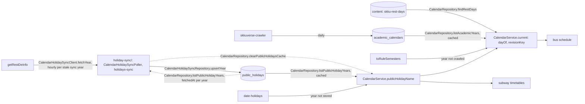

# Calendar Architecture

> What `src/calendar/` mirrors from the official special-day calendar, how it reads SKKU's school rest days and academic calendars, how a date is answered, and what happens when a source fails. Read it before changing how any feature decides a public holiday, a school rest day, a semester or a vacation.

## Context

Calendar owns the date questions every feature asks ([ADR 0021](../decisions/0021-academic-calendar.md)): which dates are Korean public holidays (the shuttle schedules and the subway timetables), which are SKKU school rest days (the shuttle schedules) and whether a date is in a semester or a vacation (no reader yet), answered together by the `dayOf` of one `CalendarService.current` snapshot. It mirrors the official calendar of the Korea Astronomy and Space Science Institute, which lists substitute holidays, temporary holidays and election days, and stores it so that a holiday declared later reaches every replica with no deploy. School rest days are the `skku-rest-days` dataset ([ADR 0013](../decisions/0013-runtime-data-in-mongodb.md)), which only `npm run data` writes, over the rest days of the crawled years. Semesters come from `academic_calendars`, which skkuverse-crawler writes and this module only reads, and from the default rule for a year it does not cover. It serves no route. The root module is the read side, the door other features import for `CalendarService`; the `holiday-sync/` sub-module writes the stored years and is registered only by the app module, so a feature that reads holidays never carries the sync.

| System | Quirk tag | Gives | Enters at |
| --- | --- | --- | --- |
| `getRestDeInfo` on data.go.kr (`DATA_GO_KR_SERVICE_KEY`) | `data-go-kr` | One year's holidays per call, each with its date, its name and `isHoliday` | `CalendarHolidaySyncClient.fetchYear` |
| MongoDB `public_holidays` | — | The stored years, one document per year | `CalendarHolidaySyncRepository` writes, `CalendarRepository` reads |
| The rule-based calendar (`date-holidays`, `KR`) | — | An answer for a year with no stored document | `lookupKoreanPublicHoliday` in `src/shared/korean-public-holiday.util.ts` |
| `npm run data` | — | The `skku-rest-days` dataset of the content database's `datasets`, checked at push against the schema ([edit-runtime-data.md](../how-to/edit-runtime-data.md)) | `CalendarRepository.findRestDays` |
| skkuverse-crawler (`academic-calendar`) | `skku` | `academic_calendars` in the crawler's base database (`config.notices.dbName`): one document per academic year with its two semesters, its rest days and its `contentHash` | `CalendarRepository.listAcademicYears` |

The data.go.kr gateway answers before `getRestDeInfo` does, with its own envelope (`gatewayError`). It refuses an unregistered key with HTTP `403` (`returnReasonCode` `30`), and a request whose header value holds `environment=` with HTTP `400` `INVALID_REQUEST_PARAMETER_ERROR` (`returnReasonCode` `10`), before it checks the key. Sentry's `baggage` header holds `sentry-environment=<environment>`, so `sentryOptions()` (`src/infra/sentry-options.ts`) sets `tracePropagationTargets: []` and no outgoing call carries `baggage` or `sentry-trace`. Until it did, every production sync was refused, `public_holidays` stayed empty and every date came from the rules fallback (`holidays.lookup.rules_fallback`). Sentry is off under `npm run dev` (no `SENTRY_DSN`) and `npm run verify:serve` (`SENTRY_DSN=disabled`), so neither reproduces what Sentry changes on the wire; `__tests__/nest/infra/sentry.test.ts` checks the headers an outgoing call carries instead.

## Glossary

| Term | Means | Derived from | Not |
| --- | --- | --- | --- |
| public holiday (`PublicHoliday`) | A KST date the calendar lists with `isHoliday` `Y`, and its name as the calendar spells it | `CalendarHolidaySyncClient.fetchYear`, from `locdate` and `dateName` | — |
| stored year | One year's public holidays and the `fetchedAt` of the sync that wrote them, a `PublicHolidaysDoc` keyed by the year | `CalendarHolidaySyncRepository.upsertYear` | `holidayCache` |
| holiday name | The name of the public holiday on a date, or null | `CalendarService.publicHolidayName` | — |
| rules fallback | The answer for a year with no stored year, from the rule-based calendar | `lookupKoreanPublicHoliday` | — |
| sync years | The KST year of the sync and the year after it | `toSyncYears` | — |
| school rest day | An SKKU day off and its label: the `skku-rest-days` label (`MM-DD` yearly or `YYYY-MM-DD` once, an exact date first), else the crawled year's title on that date less its class-day count | `lookupRestDay`, `toSchoolRestDayLabel` | `restDay` |
| academic year | A year from `ACADEMIC_YEAR_FIRST_DAY` to the last day of February, named by the year it starts in | `toAcademicYear` | `schoolYear` |
| crawled year | A valid `academic_calendars` document, an `AcademicCalendarDoc` keyed by its academic year | `CalendarRepository.listAcademicYears` | — |
| semester (`Semester`) | One of a year's two terms, `term` `1` or `2`, from its `start` to its `end` day, both included | a crawled year's `semesters`, or `toRuleSemesters` | — |
| vacation | A day of an academic year in neither semester | `toAcademicPeriod` | — |
| academic period (`AcademicPeriod`) | Whether a date is a semester or a vacation day, its term, and whether a crawled year or the rule answered it | `toAcademicPeriod` | — |
| rule fallback | The semesters of a year no crawled year covers, from the default rule ([ADR 0021, D3](../decisions/0021-academic-calendar.md)) | `toRuleSemesters` | — |
| calendar day (`CalendarDay`) | A date's public holiday, school rest day and academic period | `dayOf` of a calendar snapshot | — |
| calendar snapshot (`CalendarSnapshot`) | One read of the rest days and the crawled years, which answers every day a caller asks under one revision key | `CalendarService.current` | — |
| revision key | A string that changes whenever a calendar day may change but a public holiday, for a cache built from calendar days | `revisionKey` of a calendar snapshot | — |

## Structure

## Invariants

- Only a process that runs pollers syncs (`config.runsPollers`); an api replica only reads. The registry's warm-up run syncs at startup, then every `config.holidays.syncIntervalMs` (an hour).
- A run fetches only the stale sync years: a sync year with no stored year, or whose `fetchedAt` is a day old or more (`STORED_YEAR_MAX_AGE_MS`, `isStoredYearFresh`). So a failed sync retries within the hour, a stored year is refetched once a day, and a run whose every sync year is fresh calls nothing and resolves. A year the calendar has not published is never stored, so it is asked for every hour until it is.
- Only `src/app.module.ts` imports `CalendarHolidaySyncModule`. A feature imports `CalendarModule`, which holds no poller and no client.
- The sync reports by resolving or rejecting. One sync year failing still stores the other, then the sync rejects, so the stored years keep serving and the job reports failing.
- A sync year the calendar answers with no rows is not published yet and is not stored, so it keeps its stored or rules-fallback answer.
- `CalendarRepository.listPublicHolidayYears` reads the stored years through `createCachedLoader` for `STORED_YEARS_TTL_MS` (ten minutes, so a stored holiday reaches every replica within ten minutes, [runtime roles](../decisions/0012-runtime-roles.md)), waits for the reload once that passes, and keeps the last good years for `STORED_YEARS_STALE_WINDOW_MS` only when a reload fails. Every sync run clears the cache of its own process.
- A stored year is answered from the calendar alone; the rules fallback answers only a year with no stored year, and logs `holidays.lookup.rules_fallback` once an hour per year.
- A date outside the years `lookupKoreanPublicHoliday` takes throws a `RangeError` (`toHolidayYear`) before any answer, a calendar day included, even on a school rest day.
- The school rest days are read as every dataset is ([ADR 0013, D6](../decisions/0013-runtime-data-in-mongodb.md)): through `createDatasetLoader`, a push serves within `DATASET_CACHE_TTL_MS`, a failed or invalid reload keeps the last good revision, and with none ever read `current` answers `CalendarUnavailableError` (`503 CALENDAR_UNAVAILABLE`), which a feature answering riders maps to its own. `publicHolidayName` reads no dataset, so it answers without them.
- The service key travels in the query string, so a failure is a `CalendarHolidaySyncError` that carries the source, the status and a code, never the URL, the key or the axios error ([logging](../reference/logging.md)). When the data.go.kr gateway refuses the request, the code is its `errMsg` and the message also names its `returnReasonCode`: `2026: HTTP 400 INVALID_REQUEST_PARAMETER_ERROR (10)`.
- `CalendarRepository.listAcademicYears` reads `academic_calendars` with the stored years' TTL and stale window, projects only the fields it uses and parses each document with `academicCalendarDoc`: one that fails (its `_id` not its year, its semesters not `isSemesterPair`, a date that is no calendar date) is left out and logged as `academic_calendar.invalid_document`, so its year is answered by the rule, never an error ([ADR 0021, D2](../decisions/0021-academic-calendar.md)). A read that fails with no good value inside the stale window answers no crawled year, so the rule answers every year, logs `academic_calendar.read_failed` and is retried once `ACADEMIC_READ_RETRY_MS` passes, never once a request. The server never writes the collection, and adds no alert: the crawler alerts on a missing or broken year.
- A crawled year answers its academic period alone; the rule fallback answers a year with none, over the public holidays the calendar itself answers, and logs `academic_calendar.rule_fallback` once an hour per academic year (`RULE_FALLBACK_LOG_INTERVAL_MS`).
- The dataset's rest day wins over the crawled one on the same date ([ADR 0021, D4](../decisions/0021-academic-calendar.md)).
- A snapshot's `revisionKey` joins the rest days' revision and each crawled year's `contentHash`, in year order, so it changes with either and with a year added, and its `dayOf` answers every date from that same read, so a cache built from one snapshot never mixes two revisions.
- Other features import only `CalendarModule` and `CalendarService` ([ADR 0010, D1](../decisions/0010-server-architecture.md)).

## Open questions

- Whether a school rest day inside a semester counts as a semester day for the HSSC service hours, the period's first reader; `dayOf` answers it as a semester day today.

## Related

- [ADR 0021](../decisions/0021-academic-calendar.md): one calendar module, the crawled academic calendars and the default rule
- [ADR 0017, D9](../decisions/0017-subway-arrivals.md): why the official calendar, never edited by hand
- [Bus architecture](bus-architecture.md): the shuttle schedules that read the calendar day
- [ADR 0010](../decisions/0010-server-architecture.md): the module shape
- [Docs index](../README.md): writing rules
