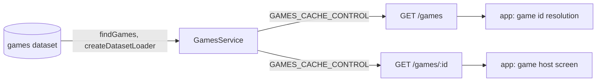

# Games Architecture

> What `src/games/` serves: the registry of hosted games, which says only whether and where the app may open each one. Read it before you list, disable or move a game.

## Context

The registry is the `games` dataset in the content database ([ADR 0013](../decisions/0013-runtime-data-in-mongodb.md)), written only by `npm run data`, which checks each push with `gamesFile`. `GamesRepository.findGames` reads it, and `GamesService` serves it through `createDatasetLoader` as one frozen registry per revision. An entry holds exposure only: its id, its entry URL, whether it is enabled, and the lowest game protocol a host must speak. Whether a game is ranked, how its scores are checked, its copy and its overlay belong to skkuverse-app and its functions, never to this registry. Which origin each game owns stays in code, apart from every mini-app list (`GAME_ID_BY_FIRST_PARTY_ORIGIN` in `src/infra/origins.ts`). The module has one flow, so its controller sits at the root.

| System | Quirk tag | Gives | Enters at |
| --- | --- | --- | --- |
| The content database | — | The `games` dataset: each hosted game's id, entry URL, enabled flag and minimum host protocol, checked at push by `npm run data` | `GamesRepository.findGames` |
| skkuverse-app | — | Nothing; it reads the index and the entries | `GET /games` and `GET /games/:id` |

## Glossary

| Term | Means | Derived from | Not |
| --- | --- | --- | --- |
| registry (`GameRegistry`) | The snapshot of one revision of the stored `games` dataset, frozen: its revision, its entries in the dataset's order and the lookup `entryOf` | `toGameRegistry` over `gamesFile`, served by `GamesService` | — |
| game entry (`GameEntry`) | One hosted game as the app needs it to decide whether and where to open it | `toGameEntry` | — |
| game index (`GameIndex`) | Every entry of one revision, disabled ones included | `GamesService.index` | — |
| entry URL | The page the app loads for a game, on the origin the game owns | the dataset's `entryUrl` | — |
| minimum host protocol | The lowest game protocol a host must speak to open the page; an older host hides the game | the dataset's `minHostProtocol` | — |

## Structure

| Field | App use |
| --- | --- |
| `/games` `games` | Served and not rendered: the app's hosted game screen reads it to resolve a game id |
| `id` | The id the app's own config for that game is keyed by; an entry the app has no config for is ignored |
| `entryUrl` | The page the game host loads |
| `enabled` | False hides the game, even from a build that bundles a copy of it |
| `minHostProtocol` | A host that speaks an older game protocol hides the game |

## Invariants

- The registry is checked at push (`gamesFile`) and parsed again at read (`storedGames`). `GamesService` keeps the read contract of `createDatasetLoader`: a push serves within `DATASET_CACHE_TTL_MS`, an invalid or failed reload keeps the last good registry, and with none both routes answer `503 GAME_REGISTRY_UNAVAILABLE` without `Cache-Control`, so a client keeps the copy it cached.
- The index lists every entry, disabled ones included: a listed id is never opened from a copy a build bundles, and an unlisted one is.
- A served entry is built from its named fields (`toGameEntry`), so no stored value reaches the wire past the schema.
- An unlisted id answers `404 GAME_NOT_FOUND`, which no shared cache keeps.
- Only `GamesModule` binds the general limiter, on `/games`.

## Open questions

None.

## Related

- [Web origins](web-origins.md): why game origins are a trust list of their own
- [ADR 0013](../decisions/0013-runtime-data-in-mongodb.md): runtime data in the content database
- [ADR 0010](../decisions/0010-server-architecture.md): the module shape
