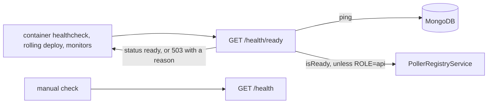

# Health Architecture

> What `src/health/` answers, who asks, and what a `503` means. Read it before you change a readiness condition or a probe.

## Context

Health owns no data and serves no app screen. It answers the probes that decide whether a container is up and whether a deploy may move on, so its status code is its whole contract.

| System | Quirk tag | Gives | Enters at |
| --- | --- | --- | --- |
| The container healthcheck in `docker-compose.yml` | — | A probe of each api container (the poller binds no port and has none) | `GET /health/ready` |
| The rolling deploy, run outside this repository | — | A wait on each api replica before the next restarts | `GET /health/ready` |
| UptimeRobot and the per-host heartbeat (a host cron) | — | Outside-in and inside-out probes that alert on failure | `GET /health/ready`, through nginx |
| MongoDB | — | A ping | `ping` in `src/infra/db.ts` |
| The poller registry | — | Whether the pollers have started | `PollerRegistryService.isReady` |

## Glossary

| Term | Means | Derived from | Not |
| --- | --- | --- | --- |
| liveness | `GET /health`: the process answers, with its uptime | `HealthController.health` | `isAlive` |
| readiness | `GET /health/ready`: the database pings and, outside `ROLE=api`, the pollers have started | `HealthController.ready` | `isHealthy` |
| pollers ready | The registry has registered at least one poller and started every one | `PollerRegistryService.isReady` | — |

## Structure

## Invariants

- Both routes write raw JSON through `@Res()`, not the response envelope: the probes read the status code alone ([ADR 0010, D6](../decisions/0010-server-architecture.md)).
- `GET /health/ready` answers `503` with reason `db unreachable` when the ping fails, and `503` with reason `pollers not started` when a process that runs pollers has not started them; an `ROLE=api` replica skips the poller check.
- A database outage logs `health.db_unreachable` at most once per `DB_DOWN_LOG_INTERVAL_MS`, however often the probes ask.
- The module provides no `PollerRegistryService`: it injects the one from the global scheduling module, since a second registry would never report ready.

## Open questions

None.

## Related

- [ADR 0010](../decisions/0010-server-architecture.md): the module shape
