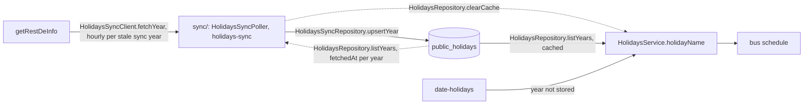

# Holidays Architecture

> What `src/holidays/` mirrors from the official special-day calendar, how a date is answered, and what happens when the calendar fails. Read it before changing how any feature decides a public holiday.

## Context

Holidays owns which dates are Korean public holidays for every feature that depends on them: the shuttle schedules today, the subway timetables next. It mirrors the official calendar of the Korea Astronomy and Space Science Institute, which lists substitute holidays, temporary holidays and election days, and stores it so that a holiday declared later reaches every replica with no deploy. It serves no route. The root module is the read side, the door other features import for `HolidaysService`; the `sync/` sub-module writes the stored years and is registered only by the app module, so a feature that reads holidays never carries the sync.

| System | Quirk tag | Gives | Enters at |
| --- | --- | --- | --- |
| `getRestDeInfo` on data.go.kr (`DATA_GO_KR_SERVICE_KEY`) | `data-go-kr` | One year's holidays per call, each with its date, its name and `isHoliday` | `HolidaysSyncClient.fetchYear` |
| MongoDB `public_holidays` | — | The stored years, one document per year | `HolidaysSyncRepository` writes, `HolidaysRepository` reads |
| The rule-based calendar (`date-holidays`, `KR`) | — | An answer for a year with no stored document | `lookupKoreanPublicHoliday` in `src/shared/korean-public-holiday.util.ts` |

The data.go.kr gateway answers before `getRestDeInfo` does, with its own envelope (`gatewayError`). It refuses an unregistered key with HTTP `403` (`returnReasonCode` `30`), and a request whose header value holds `environment=` with HTTP `400` `INVALID_REQUEST_PARAMETER_ERROR` (`returnReasonCode` `10`), before it checks the key. Sentry's `baggage` header holds `sentry-environment=<environment>`, so `sentryOptions()` (`src/infra/sentry-options.ts`) sets `tracePropagationTargets: []` and no outgoing call carries `baggage` or `sentry-trace`. Until it did, every production sync was refused, `public_holidays` stayed empty and every date came from the rules fallback (`holidays.lookup.rules_fallback`). Sentry is off under `npm run dev` (no `SENTRY_DSN`) and `npm run verify:serve` (`SENTRY_DSN=disabled`), so neither reproduces what Sentry changes on the wire; `__tests__/nest/infra/sentry.test.ts` checks the headers an outgoing call carries instead.

## Glossary

| Term | Means | Derived from | Not |
| --- | --- | --- | --- |
| public holiday (`PublicHoliday`) | A KST date the calendar lists with `isHoliday` `Y`, and its name as the calendar spells it | `HolidaysSyncClient.fetchYear`, from `locdate` and `dateName` | `restDay` (the SKKU rest days, which bus owns) |
| stored year | One year's public holidays and the `fetchedAt` of the sync that wrote them, a `PublicHolidaysDoc` keyed by the year | `HolidaysSyncRepository.upsertYear` | `holidayCache` |
| holiday name | The name of the public holiday on a date, or null | `HolidaysService.holidayName` | — |
| rules fallback | The answer for a year with no stored year, from the rule-based calendar | `lookupKoreanPublicHoliday` | — |
| sync years | The KST year of the sync and the year after it | `toSyncYears` | — |

## Structure

## Invariants

- Only a process that runs pollers syncs (`config.runsPollers`); an api replica only reads. The registry's warm-up run syncs at startup, then every `config.holidays.syncIntervalMs` (an hour).
- A run fetches only the stale sync years: a sync year with no stored year, or whose `fetchedAt` is a day old or more (`STORED_YEAR_MAX_AGE_MS`, `isStoredYearFresh`). So a failed sync retries within the hour, a stored year is refetched once a day, and a run whose every sync year is fresh calls nothing and resolves. A year the calendar has not published is never stored, so it is asked for every hour until it is.
- Only `src/app.module.ts` imports `HolidaysSyncModule`. A feature imports `HolidaysModule`, which holds no poller and no client.
- The sync reports by resolving or rejecting. One sync year failing still stores the other, then the sync rejects, so the stored years keep serving and the job reports failing.
- A sync year the calendar answers with no rows is not published yet and is not stored, so it keeps its stored or rules-fallback answer.
- `HolidaysRepository.listYears` reads the stored years through `createCachedLoader` for `STORED_YEARS_TTL_MS` (ten minutes, so a stored holiday reaches every replica within ten minutes, [runtime roles](../decisions/0012-runtime-roles.md)), waits for the reload once that passes, and keeps the last good years for `STORED_YEARS_STALE_WINDOW_MS` only when a reload fails. Every sync run clears the cache of its own process.
- A stored year is answered from the calendar alone; the rules fallback answers only a year with no stored year, and logs `holidays.lookup.rules_fallback` once an hour per year.
- A date outside the years `lookupKoreanPublicHoliday` takes throws a `RangeError` (`toHolidayYear`) before any answer.
- The service key travels in the query string, so a failure is a `HolidaysSyncCalendarError` that carries the source, the status and a code, never the URL, the key or the axios error ([logging](../reference/logging.md)). When the data.go.kr gateway refuses the request, the code is its `errMsg` and the message also names its `returnReasonCode`: `2026: HTTP 400 INVALID_REQUEST_PARAMETER_ERROR (10)`.
- Other features import only `HolidaysModule` and `HolidaysService` ([ADR 0010, D1](../decisions/0010-server-architecture.md)).

## Open questions

None.

## Related

- [ADR 0017, D9](../decisions/0017-subway-arrivals.md): why the official calendar, never edited by hand
- [Bus architecture](bus-architecture.md): the shuttle schedules that read the holiday name
- [ADR 0010](../decisions/0010-server-architecture.md): the module shape
- [Docs index](../README.md): writing rules
