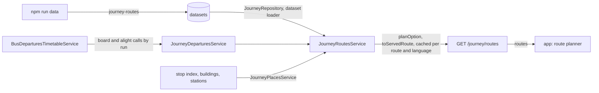

# Journey Architecture

> What `src/journey/` plans for the app's route planner: the routes and options it serves on `GET /journey/routes`, the `journey-routes` dataset they come from, and the doors it reads departures through. Read it before adding a route, an option, a line or a source.

## Context

Journey owns only the `journey-routes` dataset: lines, routes, options and legs, edited with `npm run data` ([ADR 0013](../decisions/0013-runtime-data-in-mongodb.md)). Everything else it mirrors at plan time: departures from each source's door, and every cited place from its owning catalog. It writes nothing, and the planner reads only MongoDB through other modules' services ([ADR 0022, D6](../decisions/0022-journey-and-call-spec.md)).

| System | Quirk tag | Gives | Enters at |
| --- | --- | --- | --- |
| `npm run data` (scripts/lib/datasets/store.js) | — | The `journey-routes` dataset, checked at push against the target's stops, buildings and stations | `JourneyRepository.findRoutes` |
| bus (`BusDeparturesTimetableService`) | — | Each timetabled run's board and alight calls for one service between two stops | `JourneyDeparturesService.listDepartures` |
| bus (`BusStopIndexService`), building (`BuildingService`), subway (`SubwayStationsService`, `SubwayStationCoordsService`) | — | The name and coords of each cited stop, building and station | `JourneyPlacesService.findPlace` |
| TMAP pedestrian routing | — | Walk minutes, distance and path, measured once by a person at authoring time and stored with their evidence; the server never calls it | the dataset |

## Glossary

The shared terms call, run and run id are [ADR 0022](../decisions/0022-journey-and-call-spec.md)'s, used here as there.

| Term | Means | Derived from | Not |
| --- | --- | --- | --- |
| call (`StopCall`) | One run's visit to one stop, with its instants, basis, run and flags; served through `toCall` | A door, from its stored source | an arrival on a journey leg |
| run | One trip of a line on a service day; a timetabled run calls at every stop of its sequence | The source's timetable or vehicle | `trip`, a prose-only word for a whole journey |
| run id (`runId`) | A run's opaque identity, stable within a service day and a timetable revision; compared, never parsed | The door | — |
| place | Where a leg starts or ends: a kind, the owning catalog's id, a name in the request language, coords, a platform and a tap action | `JourneyPlacesService.findPlace` over a place ref | — |
| place ref (`PlaceRef`) | How the dataset cites a place: `<kind>:<id>` in `PLACE_REF_PATTERN`, the id the catalog's verbatim | `toPlaceRef` | a copied name or coords |
| stop area | Stops grouped for picking a place, `bus_stop_area` in a place ref; refused at push until the planner resolves one | `bus-stops` `stopAreas` | a station, which in bus is a stop by its route index |
| line (`JourneyLine`) | A dataset line: its source, the source's own line id, mode, name, color and icon | the dataset | — |
| leg (`JourneyLeg`) | One step of an option: a walk, a transfer between platforms of one station, or a ride on a line from a board stop to an alight stop | the dataset, planned by `planOption` | — |
| option (`JourneyOption`) | One way between a route's two ends, its legs in order; served running with times or not running with a reason | the dataset, planned by `planOption` | `itinerary` |
| route (`JourneyRoute`) | A from and a to with its options in data order, which breaks an arrival tie | the dataset | `corridor` |
| catch margin (`catchMarginSec`) | How long before a call the rider must be at the stop to catch it | the dataset | — |
| wait (`waitSec`) | A ride's boarding time minus the rider's arrival at the stop | `planOption` | — |

## Structure

| Field | App use |
| --- | --- |
| `routes[].from`, `to`, `name` | The planner's two ends and its title |
| `options[].status`, `reason`, `nextServiceAt` | Whether an option runs now; an ended one shows its next first departure |
| `options[].leaveAt`, `arriveAt` | When to leave and when the option arrives, counted against `meta.serverNow` |
| `legs[].kind`, `mode`, `label`, `icon`, `color` | Each leg's row; an unknown kind draws from these alone |
| `legs[].board`, `alight`, `later`, `waitSec`, `basis` | A ride's calls, its next catchable calls and its certainty, an estimate shown as approximate |
| `legs[].path` | A walk's line on the map |

## Invariants

- A place is cited, never copied: the dataset holds `<kind>:<id>` refs, and each resolves through its owning catalog at push (`toPlaceIssues`, against the target environment) and again at plan time (`JourneyPlacesService`). A place that no longer resolves serves the options citing it as unavailable, and a route end that does not leaves the route out.
- A `bus-stops` push reruns this dataset's checks (`recheckTriggers`), so it cannot drop a cited stop, the alias an unlisted route's cited pole needs, or the sequence order a cited ride boards by.
- Each ride boards the first run catchable a catch margin after the legs before it; the legs before the first ride are timed back from it (`planOption`). A vehicle with no seat left is skipped, and unknown seats are boardable.
- A ride's `basis` is the weaker of its two calls (`toLegBasis`); an alight the door cannot place takes the leg's `rideMinutes` as an estimate.
- An option with no run left is not running, ended, with the board's `nextServiceAt`; one whose door failed is unavailable. Options run by arrival, then data order, then the rest in data order (`toOptionOrder`).
- `JOURNEY_SOURCE_IDS` names every source the registry maps; adding one fails `tsc` until the registry maps it.
- A planned route is cached per route and language for `PLAN_CACHE_TTL_MS`, single-flight, and served with `JOURNEY_ROUTES_CACHE_CONTROL`; the dataset never read answers `503` `JOURNEY_ROUTES_UNAVAILABLE`.
- Only `JourneyModule` binds the general rate limiter under `/journey`.

## Open questions

- A place's tap `action` is served null until the app decides where a tap on a stop, building or station opens.
- Stop areas resolve at push in `bus-stops` but not in the planner; a route end at a stop area waits for that.
- The TOPIS and subway doors, transfers and `warnings` land with the options that need them ([transit-route-planner.md](../plans/transit-route-planner.md)).

## Related

- [ADR 0022](../decisions/0022-journey-and-call-spec.md): the call, places, legs, options and doors
- [transit-route-planner.md](../plans/transit-route-planner.md): the PR sequence and the dataset's options
- [ADR 0013](../decisions/0013-runtime-data-in-mongodb.md): the dataset's push and read contract
- [Docs index](../README.md): writing rules
