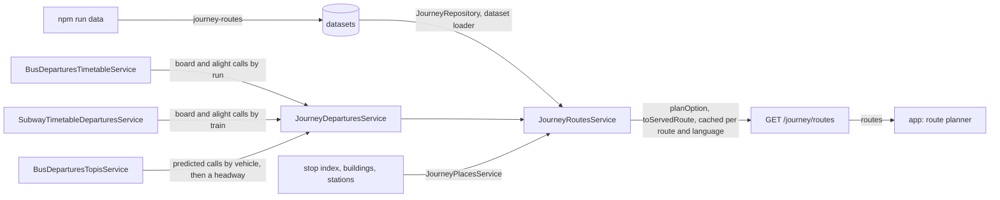

# Journey Architecture

> What `src/journey/` plans for the app's route planner: the routes and options it serves on `GET /journey/routes`, the `journey-routes` dataset they come from, and the doors it reads departures through. Read it before adding a route, an option, a line or a source.

## Context

Journey owns only the `journey-routes` dataset: lines, routes, options and legs, edited with `npm run data` ([ADR 0013](../decisions/0013-runtime-data-in-mongodb.md)). Everything else it mirrors at plan time: departures from each source's door, and every cited place from its owning catalog. It writes nothing, and the planner reads only MongoDB through other modules' services ([ADR 0022, D6](../decisions/0022-journey-and-call-spec.md)).

| System | Quirk tag | Gives | Enters at |
| --- | --- | --- | --- |
| `npm run data` (scripts/lib/datasets/store.js) | — | The `journey-routes` dataset, checked at push against the target's stops, buildings, stations and subway timetables | `JourneyRepository.findRoutes` |
| bus (`BusDeparturesTimetableService`) | — | Each timetabled run's board and alight calls for one service between two stops | `JourneyDeparturesService.listDepartures` |
| bus (`BusDeparturesTopisService`) | — | Each TOPIS route's predicted vehicles at the board pole, the calls `/bus/live` serves there, joined by vehicle to its call at the alight pole; the stored row's headway (`term`) and the pole's first and last run (`firstTm`, `lastTm`) | `JourneyDeparturesService.listDepartures` |
| subway (`SubwayTimetableDeparturesService`) | — | Each train's board and alight calls between two platforms of one line, from the service day's stored `subway-timetables`, as the station board serves a timetable train; a train the board platform's station board lists live or estimated, by that board's call (`SubwayArrivalsService.listPlatformCalls`) | `JourneyDeparturesService.listDepartures` |
| bus (`BusStopIndexService`), building (`BuildingService`), subway (`SubwayStationsService`, `SubwayStationCoordsService`) | — | The name and coords of each cited stop, building and station | `JourneyPlacesService.findPlace` |
| TMAP pedestrian routing | — | Walk minutes, distance and path, measured once by a person at authoring time and stored with their evidence; the server never calls it | the dataset |

## Glossary

The shared terms call, run and run id are [ADR 0022](../decisions/0022-journey-and-call-spec.md)'s, used here as there.

| Term | Means | Derived from | Not |
| --- | --- | --- | --- |
| call (`StopCall`) | One run's visit to one stop, with its instants, basis, run and flags; served through `toCall` | A door, from its stored source | an arrival on a journey leg |
| run | One trip of a line on a service day; a timetabled run calls at every stop of its sequence | The source's timetable or vehicle | `trip`, a prose-only word for a whole journey |
| run id (`runId`) | A run's opaque identity, stable within a service day and a timetable revision; compared, never parsed | The door | — |
| place | Where a leg starts or ends: a kind, the owning catalog's id, a name in the request language, coords, a platform and a tap action | `JourneyPlacesService.findPlace` over a place ref | — |
| place ref (`PlaceRef`) | How the dataset cites a place: `<kind>:<id>` in `PLACE_REF_PATTERN`, the id the catalog's verbatim | `toPlaceRef` | a copied name or coords |
| stop area | Stops grouped for picking a place, `bus_stop_area` in a place ref; refused at push until the planner resolves one | `bus-stops` `stopAreas` | a station, which in bus is a stop by its route index |
| line (`JourneyLine`) | A dataset line: its source, the source's own line id, mode, name, color and icon | the dataset | — |
| leg (`JourneyLeg`) | One step of an option: a walk, a transfer between platforms of one station, or a ride on a line from a board stop to an alight stop | the dataset, planned by `planOption` | — |
| option (`JourneyOption`) | One way between a route's two ends, its legs in order; served running with times or not running with a reason | the dataset, planned by `planOption` | `itinerary` |
| route (`JourneyRoute`) | A from and a to with its options in data order, which breaks an arrival tie | the dataset | `corridor` |
| catch margin (`catchMarginSec`) | How long before a call the rider must be at the stop to catch it | the dataset | — |
| wait (`waitSec`) | A ride's boarding time minus the rider's arrival at the stop | `planOption` | — |

## Structure

| Field | App use |
| --- | --- |
| `routes[].from`, `to`, `name` | The planner's two ends and its title |
| a place's `action` | A tap opens the map at that place |
| `options[].status`, `reason`, `nextServiceAt` | Whether an option runs now; an ended or not-started one shows its next departure (a reason the app does not know reads as ended) |
| `options[].leaveAt`, `arriveAt` | When to leave and when the option arrives, counted against `meta.serverNow` |
| `legs[].kind`, `mode`, `label`, `icon`, `color` | Each leg's row; an unknown kind draws from these alone |
| `legs[].board`, `alight`, `later`, `waitSec`, `basis` | A ride's calls, its next catchable calls and its certainty, an estimate shown as approximate |
| `legs[].path` | A walk's line on the map |

## Invariants

- A place is cited, never copied: the dataset holds `<kind>:<id>` refs, and each resolves through its owning catalog at push (`toPlaceIssues`, against the target environment) and again at plan time (`JourneyPlacesService`). A place that no longer resolves serves the options citing it as unavailable, and a route end that does not leaves the route out.
- A place is served by the id its catalog serves: a stop's canonical id, never the `seoul-<arsId>` alias the dataset may cite. A stop, station or building place's tap `action` is a `route` to `/map?place=<kind>:<id>` by that id (`toPlaceAction`); a stop area and the rider's location are not tappable.
- A `bus-stops` push reruns this dataset's checks (`recheckTriggers`), so it cannot drop a cited stop, the alias an unlisted route's cited pole needs, or the sequence order a cited ride boards by.
- Each ride boards the first run catchable a catch margin after the legs before it; the legs before the first ride are timed back from it (`planOption`). A vehicle with no seat left is skipped, and unknown seats are boardable.
- A ride's `basis` is the weaker of its two calls (`toLegBasis`); an alight the door cannot place takes the leg's `rideMinutes` as an estimate.
- A subway ride lists only trains that call at its board platform and then at its alight one: within one table joined by the train's row, so a train ending short or an express passing the alight platform is never boarded; across two tables by train number, a train the alight table numbers apart still listed with no alight call. Every PoC ride's two platforms read one table, and the 남태령 probe found every through train numbered alike ([transit-route-planner.md](../plans/transit-route-planner.md#probes)). Its first and last flags are across the ride's trains, so the last train of a ride is the last that reaches the alight platform.
- A ride starts at its board call's time, departure first, or at its expected arrival when that is later, since a run running late leaves no earlier than it arrives (`toBoardTime`), and ends at its alight call's arrival, falling back to its departure (`toAlightTime`; [ADR 0022, D5](../decisions/0022-journey-and-call-spec.md), amended): a subway alight call stays the station board's, both scheduled instants included, while the rider leaves at the arrival.
- A subway ride boards a train its board platform's station board lists live or estimated by the very call that board serves for its run, with the ride's first and last flags; the train's delay past its timetable arrival there moves its alight call's expected arrival by as much, as an estimate. Past the stored trains, and for a platform whose state is stale, it boards from the timetable.
- A TOPIS ride boards the predicted vehicles the live route lists at its board pole inside the plan's window (TOPIS names two a stop), each call exactly as `/bus/live` serves it, and its alight is the same vehicle's call at the alight pole when TOPIS names it there, else the leg's `rideMinutes` (`toTopisBoard`). Past them, while the pole's service day runs (`toServiceSpan`, by the time of day of its stored first and last run), the ride boards half the stored headway after the rider is ready, naming no vehicle, as an estimate; with no stored `term` it extrapolates nothing. Before the first run it boards that run from TOPIS's published time; once TOPIS says the service ended at the pole or its last run has passed, it lists no headway and names the next service day's first run. Overnight TOPIS answers no rows (header code `4`), so the pole's first and last run then come from the hours the poller last stated on the route's registry document (`BusRealtimeJongroService.listServiceHours`); a route with none stored names no next service.
- At push a TOPIS ride's poles are stops of its route through the stop index the server builds, the alight after the board (`toTopisRideIssue`), and a cited pole of an unlisted route resolves only through a `bus-stops` alias, which a `bus-stops` push may not drop.
- At push a subway ride's platforms are of its stations and on its line's `sourceLineId`, and every day type's stored tables run a train from one to the other (`toRideTimetableIssue`, through `subwayRideIssueOf`); with no stored `subway-timetables` that check is a warning.
- An option with no run left on any ride is not running, never running with a leg missing: `notStarted` when its next service falls later the same KST date, else `ended` (`toNoService`). Its `nextServiceAt` is the board's when the first ride has none left; when a later ride has none, it is the first ride's boarding that reaches that ride's next first run, as long before it as this plan's legs took, and never before the first ride's own next run (`toChainNextServiceAt`). An option whose door failed is unavailable. Options run by arrival, then data order, then the rest in data order (`toOptionOrder`).
- A ride's `later` lists at most the next two catchable listed calls after the boarded one, a full vehicle skipped; a TOPIS ride boarded on its headway lists none, since a headway names no run a rider could let pass.
- Each connection between two rides is judged by the next ride's wait at its stop: under `TIGHT_TRANSFER_SEC` it warns `tightTransfer`; under the uncertainty of the arrival before it (`ESTIMATE_UNCERTAINTY_SEC` for an estimated arrival, plus half the headway for a ride boarded on one) or of a named run's estimated board, `connectionAtRisk` (`toConnectionWarnings`). The first ride has no connection. A warning's message names the next ride's board place in the request language.
- `JOURNEY_SOURCE_IDS` names every source the registry maps; adding one fails `tsc` until the registry maps it.
- A planned route is cached per route and language for `PLAN_CACHE_TTL_MS`, single-flight, and served with `JOURNEY_ROUTES_CACHE_CONTROL`; the dataset never read answers `503` `JOURNEY_ROUTES_UNAVAILABLE`.
- Only `JourneyModule` binds the general rate limiter under `/journey`.

## Open questions

- Stop areas resolve at push in `bus-stops` but not in the planner; a route end at a stop area waits for that.

## Related

- [ADR 0022](../decisions/0022-journey-and-call-spec.md): the call, places, legs, options and doors
- [transit-route-planner.md](../plans/transit-route-planner.md): the PR sequence and the dataset's options
- [ADR 0013](../decisions/0013-runtime-data-in-mongodb.md): the dataset's push and read contract
- [Docs index](../README.md): writing rules
