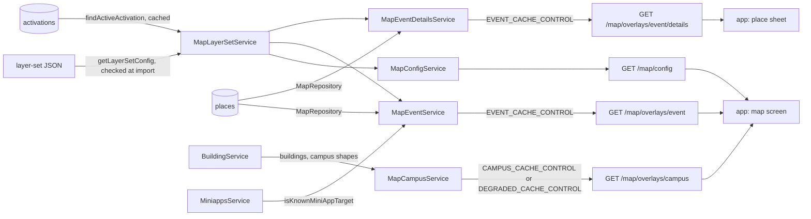

# Map Architecture

> What `src/map/` serves under `/map`: the map's layers and chips, the campus overlays it mirrors from the building module, and a festival's places, overlays and sheets. Read it before you change a layer, a chip, the layer-set file or an overlay field.

## Context

Map owns two things: the base map's layer catalogue, and the festival structure tier, one layer-set JSON file per festival committed next to its loader. The buildings and campus shapes it draws are the building module's, and the festival's places and activations are written by ops scripts into Mongo; map only reads them. Each route is its own sub-module (`config/`, `campus/`, `event/`, `event-details/`), and `layer-set/` answers "which festival is live, and how is it drawn" for three of them; the root holds the places repository, the shared overlay wire and the base layers.

| System | Quirk tag | Gives | Enters at |
| --- | --- | --- | --- |
| The layer-set files | — | Each festival's layers, chips, list facets and category table, shipped with a deploy | `getLayerSetConfig` |
| `places` and `activations` (eventmap database) | `mongodb` | The festival's places, and the window that switches a layer set on | `MapRepository` |
| The places importer (`scripts/lib/map-places-file.js`) | — | Places written to Mongo, checked by the same rules the server reads with | `overlayPlaceDoc`, `sheetPlaceDoc` |
| The building module | `skku` | Buildings and hand-authored campus shapes | `BuildingService`, injected into `MapCampusService` |
| The mini-app registry | — | Which mini-app targets a sheet button may open | `MiniappsService.isKnownMiniAppTarget` |
| GeoJSON | `geojson` | The `[lng, lat]` position order and ring winding, served as stored | `map.wire.ts` |
| The NAVER map SDK | `naver-map` | Polygon defaults the base and festival styles override | `BASE_LAYERS`, `EVENT_SHAPE_STYLE` |
| skkuverse-app | — | Nothing; it reads the four routes | `GET /map/config` and the overlay routes |

## Glossary

| Term | Means | Derived from | Not |
| --- | --- | --- | --- |
| layer (`LayerSpec`) | One kind of thing with one toggle: what is drawn, its style, its endpoint and its chip group | `BASE_LAYERS`, `eventLayerSpecs` | — |
| layer set (`LayerSet`) | One festival's layers, chips, facets, camera and category table, as one JSON file | `layerSetFile` in `map-layer-set.schema.ts` | `festivalConfig`, `layerConfig` |
| activation (`ActivationDoc`) | The Mongo switch that makes a layer set live between `activeFrom` and `activeUntil` while `enabled` | `findActiveActivation` | `eventWindow` |
| live layer set | The layer set whose activation is open now and whose file this build loaded | `MapLayerSetService.liveLayerSet` | `currentFestival` |
| place (`MapPlaceDoc`) | One operating entity of a festival: a spot, its geometry, its windows and its buttons | the places importer | — |
| overlay (`MapOverlay`) | One drawable thing, tagged by the renderer that draws it (`marker`, `polygon`, `path`) | `toEventOverlay`, the campus mappers | — |
| chip (`MapChipSpec`) | One pill above the map: a camera, the layers it turns on, and the list it opens | `eventChipSpecs`, `BASE_CHIPS` | `filterButton` |
| chip group | A layer's `chipGroupId`: the layers a chip may switch off; `null` means none ever | `LayerSpec.chipGroupId` | `exclusiveGroup` |
| reset chip | The synthesised chip that goes back to the festival's default view | `resetChip` | — |
| presentation (`ItemPresentation`) | A category's layer, pin priority, tap and location accuracy | `presentationFor` | `categoryStyle` |
| facet | A list filter axis a chip may show; an `hours` facet is derived from a place's windows, a `tag` facet is authored | `facetsOf` | — |
| sheet (`PlaceSheet`) | The body a tapped place opens: its head, buttons and blocks | `toPlaceSheet` | `sheetBody` |
| degraded | The campus overlay fell back to `FALLBACK_MARKERS` because the buildings read was empty | `MapCampusService.getCampusOverlays` | `isFallback` |

## Structure

What the app reads, from `skkuverse-app/packages/shared/src/map/parser.ts` and `skkuverse-app/packages/shared/src/map/placeDetail.ts`:

| Field | App use |
| --- | --- |
| `/map/config` `campuses` | The campus toggle, each campus's camera, and `radiusM` to tell which campus the camera is on |
| `/map/config` `layers` | The layer list and filter sheet; `defaultVisibleWhen`, `userConfigurable` and `style` decide what is on and how it draws |
| `/map/config` `chips` | The chip row; a tap moves the camera, swaps layers within the chip group and opens the chip's list |
| `/map/config` `cameraDefaults` | The camera for a marker tap, a search result and a campus switch |
| overlay `kind`, `geometry`, `layerId` | The renderer and the layer that draws it; an unknown `kind` is skipped |
| overlay `tap` | A building sheet, a place sheet, or a chip run; `null` draws a backdrop |
| overlay `hours`, `facets`, `orderByOption`, `pinPriority` | The open-now filter, the chip's list filters and order, and the collision ladder |
| overlay `fields` | Parsed, and drawn nowhere |
| `/map/overlays/event/details` `details` | The sheet of a tapped place, looked up by its `tap.placeId` |

## Invariants

- A layer-set file is read and checked once, when `map-layer-set.config.ts` is first imported; a bad file is logged as `map.layerset.config_rejected` and skipped, so the base map keeps serving and only the festival is missing. Its messages name the exact path, and a spec pins them.
- The loader's leaves (the root and layer-set rules, mappers, schemas, constants and types) never import the loader: an ESLint block refuses it, because the loader imports them at load.
- A bad base chip stops the boot (`assertValidChipSpecs` at import); a bad festival file, place, button, block or facet value is dropped and logged, never thrown into a request.
- The activation read is cached for `EVENT_CACHE_TTL_MS` with an `EVENT_STALE_WINDOW_MS` stale window, and a cached activation is still checked against the clock, so its window closes on time. `/map/config` answers with the base layers when the lookup fails.
- Both event routes cache their whole projection on the same TTL, and both overlay collections are one response per data source, pins and shapes together.
- A stored geometry is served as stored: points and lines by reference, polygon rings rewound (`toWirePolygon`); the only rebuilt pair is a building's, from its `location`.
- The event map is timezone-free: windows and facet options are absolute instants, compared with no zone arithmetic.
- `degraded` never reaches the wire, and the campus fallback is sent with `DEGRADED_CACHE_CONTROL`.
- Cloudflare caches `/map/overlays/campus` and both event routes without varying on `Accept-Language`, so their bodies carry every language and their `meta` names none: `ResponseInterceptor` leaves `lang` out of any response with a `public` or `s-maxage` `Cache-Control`.
- Only `MapModule` binds the general limiter on `/map/config` and `/map/overlays`; the sub-modules bind nothing.
- The `.wire` files publish what is served today, including the campus overlay's string `placeId`.

## Open questions

- Overlay `fields` and the `content` action type parse in the app and draw nothing.
- The place schemas the server reads with (`overlayPlaceDoc`, `sheetPlaceDoc`) check what makes a place undrawable, not the importer's whole rule set; a hand edit the importer would refuse can still be served if it draws.

## Related

- [Map code map](../reference/map-code-map.md): where each part of `src/map/` lives, boot versus request time, and what to touch for each change
- [Configure map overlays](../how-to/configure-map-overlays.md): what the map can draw and how to add or change it
- [Map overlays API](../reference/map-overlays-api.md): the routes and the overlay contract
- [Event places](../reference/event-places.md): the `places` and `activations` storage contract
- [ADR 0010](../decisions/0010-server-architecture.md): the module shape
