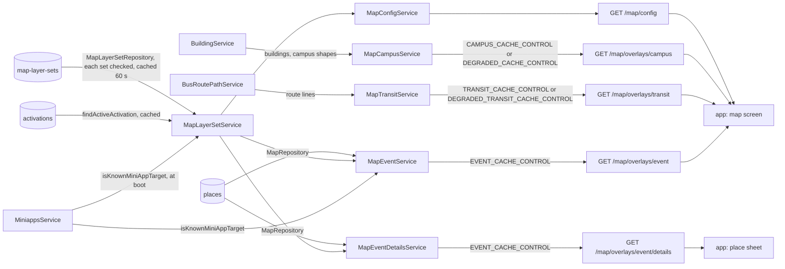

# Map Architecture

> What `src/map/` serves under `/map`: the map's layers and chips, the campus overlays it mirrors from the building module, the Jongro route lines it draws from the bus module, and a festival's places, overlays and sheets. Read it before you change a layer, a chip, a layer set or an overlay field.

## Context

Map owns two things: the base map's layer catalogue, and the festival structure tier: every festival's layer set, stored as the `map-layer-sets` dataset in the content database and edited with `npm run data`, so a festival is added with no deploy. The buildings and campus shapes it draws are the building module's, the Jongro route lines the bus module's, and the festival's places and activations are written by ops scripts into Mongo; map only reads them. Each route is its own sub-module (`config/`, `campus/`, `transit/`, `event/`, `event-details/`), and `layer-set/` answers "which festival is live, and how is it drawn" for three of them; the root holds the places repository, the shared overlay wire and the base layers.

| System | Quirk tag | Gives | Enters at |
| --- | --- | --- | --- |
| The `map-layer-sets` dataset (content database `datasets`, written by `npm run data`) | `mongodb` | Each festival's layers, chips, list facets and category table, one set per `layerSetId`, checked at push and again at read | `MapLayerSetRepository` |
| `places` and `activations` (eventmap database) | `mongodb` | The festival's places, and the window that switches a layer set on | `MapRepository` |
| The places importer (`scripts/lib/map-places-file.js`) | — | Places written to Mongo, checked by the same rules the server reads with | `overlayPlaceDoc`, `sheetPlaceDoc` |
| The building module | `skku` | Buildings and hand-authored campus shapes | `BuildingService`, injected into `MapCampusService` |
| The bus module | — | Each Jongro route's stored line as TOPIS draws it, a route with none left out and flagged, or `503` when nothing can be read | `BusRoutePathService`, injected into `MapTransitService` |
| The mini-app registry | — | Which mini-app targets a sheet button or a link chip may open | `MiniappsService.isKnownMiniAppTarget`, injected into `MapEventService` and `MapLayerSetService` |
| GeoJSON | `geojson` | The `[lng, lat]` position order and ring winding, served as stored | `map.wire.ts` |
| The NAVER map SDK | `naver-map` | Polygon defaults the base and festival styles override | `BASE_LAYERS`, `EVENT_SHAPE_STYLE` |
| skkuverse-app | — | Nothing; it reads the five routes | `GET /map/config` and the overlay routes |

## Glossary

| Term | Means | Derived from | Not |
| --- | --- | --- | --- |
| layer (`LayerSpec`) | One kind of thing with one toggle: what is drawn, its style, its endpoint and its chip group | `BASE_LAYERS`, `eventLayerSpecs` | — |
| layer set (`LayerSet`) | One festival's layers, chips, facets, camera and category table, one entry of the `map-layer-sets` dataset | `layerSetFile` and `checkedLayerSet` in `map-layer-set.schema.ts` | `festivalConfig`, `layerConfig` |
| rejected layer set (`RejectedLayerSet`) | A stored set that fails its checks at read, or repeats an earlier `layerSetId`: left out, not served, and logged once per revision | `storedLayerSets` | — |
| activation (`ActivationDoc`) | The Mongo switch that makes a layer set live between `activeFrom` and `activeUntil` while `enabled` | `findActiveActivation` | `eventWindow` |
| live layer set | The layer set whose activation is open now and which the stored dataset holds and serves | `MapLayerSetService.liveLayerSet` | `currentFestival` |
| place (`MapPlaceDoc`) | One operating entity of a festival: a spot, its geometry, its windows and its buttons | the places importer | — |
| overlay (`MapOverlay`) | One drawable thing, tagged by the renderer that draws it (`marker`, `polygon`, `path`) | `toEventOverlay`, the campus mappers | — |
| chip (`MapChipSpec`) | One pill above the map: a camera, the layers it turns on, and the list it opens; or a link it opens | `eventChipSpecs`, `BASE_CHIPS` | `filterButton` |
| base chip | A permanent chip, served whether or not a festival is live and ahead of the festival's row | `BASE_CHIPS` | — |
| link chip | A chip whose action is the shared link shape (`actionType`, `actionValue`) and changes no layer | `BASE_CHIPS` | — |
| chip group | A layer's `chipGroupId`: the layers a chip may switch off; `null` means none ever | `LayerSpec.chipGroupId` | `exclusiveGroup` |
| reset chip | The synthesised chip that goes back to the festival's default view | `resetChip` | — |
| presentation (`ItemPresentation`) | A category's layer, pin priority, tap and location accuracy | `presentationFor` | `categoryStyle` |
| facet | A list filter axis a chip may show; an `hours` facet is derived from a place's windows, a `tag` facet is authored | `facetsOf` | — |
| sheet (`PlaceSheet`) | The body a tapped place opens: its head, buttons and blocks | `toPlaceSheet` | `sheetBody` |
| degraded | An overlay route fell back to a static answer: the campus overlay to `FALLBACK_MARKERS` because the buildings read was empty, the transit overlay to the stored lines alone because a route has none | `MapCampusService.getCampusOverlays`, `MapTransitService.getTransitOverlays` | `isFallback` |
| route line layer | A base layer that draws one Jongro route's line, opt-in (`defaultVisibleWhen` `never`, `userConfigurable`), named after the route (`jongro07_route`) | `BASE_LAYERS` | — |

## Structure

What the app reads, from `skkuverse-app/packages/shared/src/map/parser.ts` and `skkuverse-app/packages/shared/src/map/placeDetail.ts`:

| Field | App use |
| --- | --- |
| `/map/config` `campuses` | The campus toggle, each campus's camera, and `radiusM` to tell which campus the camera is on |
| `/map/config` `layers` | The layer list and filter sheet; `defaultVisibleWhen`, `userConfigurable` and `style` decide what is on and how it draws |
| `/map/config` `chips` | The chip row; a `focus` tap moves the camera, swaps layers within the chip group and opens the chip's list, a `webview` tap opens its page; a chip of another action kind, `link` included, is dropped by builds that do not list it in `CHIP_ACTION_KINDS` |
| `/map/config` `cameraDefaults` | The camera for a marker tap, a search result and a campus switch |
| overlay `kind`, `geometry`, `layerId` | The renderer and the layer that draws it; an unknown `kind` is skipped |
| overlay `tap` | A building sheet, a place sheet, or a chip run; `null` draws a backdrop |
| overlay `hours`, `facets`, `orderByOption`, `pinPriority` | The open-now filter, the chip's list filters and order, and the collision ladder |
| overlay `fields` | Parsed, and drawn nowhere |
| `/map/overlays/event/details` `details` | The sheet of a tapped place, looked up by its `tap.placeId` |

## Invariants

- A push of `map-layer-sets` is refused for every issue of any set (`layerSetsDataset`): its structure, its cross-references, its chip row against the base layers and chips, and a `layerSetId` stored twice.
- At read, each stored set is checked on its own (`storedLayerSets`): a bad or repeated one is left out and logged once per revision as `map.layer_sets.invalid_set`, with its id and issues, and every other set keeps serving: the fail-soft of [ADR 0010's validation decision](../decisions/0010-server-architecture.md#d5-validation-zod), per set.
- The layer sets are read only while an activation is live, through the dataset loader (`createDatasetLoader`: `DATASET_CACHE_TTL_MS`, with a `DATASET_STALE_WINDOW_MS` stale window). With no good value ever read (the dataset missing, invalid or unreadable), `/map/config` serves the base map and the event routes serve no overlay and no sheet, logged at error at most once a minute as `map.layer_sets.unavailable`. That is the degraded answer [ADR 0013's read contract](../decisions/0013-runtime-data-in-mongodb.md#d6-the-read-contract) allows, never a `503`.
- A live activation naming a set the dataset lacks, or one left out, serves the base map, logged once per activation and revision as `map.eventmap.activation_unservable` (`no_layer_set` or `layer_set_rejected`). Close a window before you remove its set.
- A push reaches `/map/config` within `DATASET_CACHE_TTL_MS`, a minute, and the event routes, which cache their answer for `EVENT_CACHE_TTL_MS` on top, within that plus five seconds. The `/map/config` ETag is the hash of the body, so it changes with a revision exactly when the served body does.
- A bad base chip stops the boot: `assertValidChipSpecs` against the base layers, and `assertValidLinkChips` against the mini-app registry, when Nest builds `MapLayerSetService`. A bad layer set, place, button, block or facet value is dropped and logged, never thrown into a request.
- A link chip's `webview` value is served absolute (`toServedActionValue`); its other values are served as written. A layer set authors only `focus` chips.
- The activation read is cached for `EVENT_CACHE_TTL_MS` with an `EVENT_STALE_WINDOW_MS` stale window, and a cached activation is still checked against the clock, so its window closes on time. `/map/config` answers with the base layers when the lookup fails.
- Both event routes cache their whole projection on the same TTL, and both overlay collections are one response per data source, pins and shapes together.
- A stored geometry is served as stored: points and lines by reference, polygon rings rewound (`toWirePolygon`); the only rebuilt pair is a building's, from its `location`.
- The event map is timezone-free: windows and facet options are absolute instants, compared with no zone arithmetic.
- `degraded` never reaches the wire. The campus fallback is sent with `DEGRADED_CACHE_CONTROL` (`no-store`), the transit answer with a route left out with `DEGRADED_TRANSIT_CACHE_CONTROL` (a minute), so the line shows within a minute of its first sync.
- A transit overlay is the stored line as stored, unclosed, on its route line layer; the route line layers are off by default, so an installed app fetches `/map/overlays/transit` only once a user turns one on.
- The route line layers share one style in the routes' `themeColor` (`src/bus/jongro-routes.json`), and their order in `BASE_LAYERS` is their draw order: the app adds them in that order and the later one lies on top, so `jongro07_route` comes after `jongro08_route` ([Draw order](../reference/map-overlays-api.md#draw-order)).
- Cloudflare caches `/map/overlays/campus`, `/map/overlays/transit` and both event routes without varying on `Accept-Language`, so their bodies carry every language and their `meta` names none: `ResponseInterceptor` leaves `lang` out of any response with a `public` or `s-maxage` `Cache-Control`.
- Only `MapModule` binds the general limiter on `/map/config` and `/map/overlays`; the sub-modules bind nothing.
- The `.wire` files publish what is served today, including the campus overlay's string `placeId`.

## Open questions

- `npm run data` cannot refuse removing a layer set that an enabled activation names: the activations are in the eventmap database, outside the content database the tool reads.

- Overlay `fields` and the `content` action type parse in the app and draw nothing.
- The place schemas the server reads with (`overlayPlaceDoc`, `sheetPlaceDoc`) check what makes a place undrawable, not the importer's whole rule set; a hand edit the importer would refuse can still be served if it draws.

## Related

- [Map code map](../reference/map-code-map.md): where each part of `src/map/` lives, boot versus request time, and what to touch for each change
- [Configure map overlays](../how-to/configure-map-overlays.md): what the map can draw and how to add or change it
- [Map overlays API](../reference/map-overlays-api.md): the routes and the overlay contract
- [Event places](../reference/event-places.md): the `places` and `activations` storage contract
- [ADR 0010](../decisions/0010-server-architecture.md): the module shape
