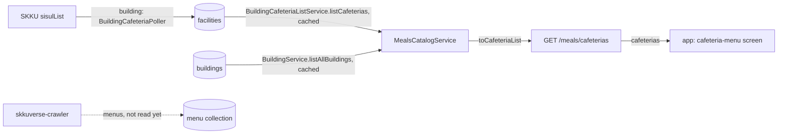

# Meals Architecture

> What `src/meals/` serves for the app's cafeteria-menu screen, which cafeterias it lists and where they come from, and the boundary the menus will cross. Read it before adding a meals route or reading a menu.

## Context

Meals serves the cafeterias, and later their menus, to the app's cafeteria-menu screen. It owns no data. The cafeterias are building's: the cafeteria sync (`BuildingCafeteriaService`) mirrors SKKU's facility registry into `facilities`, and meals reads them through `BuildingCafeteriaListService` and their buildings through `BuildingService`, the doors building opens to other features ([ADR 0010, D1](../decisions/0010-server-architecture.md)). The menus will be skkuverse-crawler's: it crawls SKKU's menu pages and will write one document per cafeteria, date and meal, which this module will only read. Until that collection exists, meals serves the cafeteria list alone.

| System | Quirk tag | Gives | Enters at |
| --- | --- | --- | --- |
| building (`BuildingCafeteriaListService`, `BuildingService`) | `mongo` | The campus's cafeterias from `facilities`, and the buildings they sit in from `buildings` | `BuildingCafeteriaListService.listCafeterias`, `BuildingService.listAllBuildings` |
| skkuverse-crawler (meals module) | — | Not read yet: the menu of each cafeteria per date and meal | — |

## Glossary

| Term | Means | Derived from | Not |
| --- | --- | --- | --- |
| cafeteria | A place SKKU's facility registry lists as a cafeteria (kind `0201`), one `facilities` document. It is listed whether or not the crawler has a menu for it: the dormitory cafeterias have none | `BuildingCafeteriaListService.listCafeterias` | `restaurant`, `diningHall` |
| `conspaceCd` | SKKU's code for a registered facility: the cafeteria's `id` on the wire, `_id` in `facilities`, and the cafeteria id SKKU's menu page and skkuverse-crawler use | sisulList `conspaceCd` | a bare code |
| cafeteria building | The stored building whose `buildNo` is the cafeteria's: its `skkuId`, `buildNo`, `displayNo` and name, or null when no stored building has that `buildNo` | `toCafeteriaList` | — |
| floor | The floor the registry names, in both languages; null when it names none | sisulList `floorNm`, `floorNmEng` | — |
| cafeteria list (`CafeteriaList`) | The body of `GET /meals/cafeterias`: one campus's cafeterias in `conspaceCd` order | `cafeteriaList` | — |
| meal code | The crawler's one-letter meal: `B` breakfast, `L` lunch, `D` dinner, `S` snack, `R` reservation. Part of a menu document's key; no route reads it yet | skkuverse-crawler `MealCode` | `mealType` |

## Structure

| Field | App use |
| --- | --- |
| `cafeterias[].id` | Not read yet: the planned screen keys a cafeteria, and the menus it will ask for, by the `conspaceCd` |
| `cafeterias[].name`, `campus`, `building`, `floor`, `spaceCd`, `location` | Not read yet: the planned screen's cafeteria header and the link to the building's sheet by `building.skkuId` |

## Invariants

- `campus` is required, `hssc` or `nsc` (`CAFETERIA_CAMPUSES`, building's campus codes restated because a feature imports only building's types); anything else answers `400` `INVALID_CAMPUS` before any read.
- The list holds only the requested campus's cafeterias, in `conspaceCd` order, and each building is matched by `buildNo` alone, since the first digit of a `buildNo` is its campus.
- An empty English name or floor serves the Korean one, as the building detail does.
- A cafeteria with no stored building serves `building: null`; one without coordinates serves `location: null`. Neither is filled from another source.
- Both reads go through building's caches (`BUILDING_CACHE_TTL_MS`), so a list is at most one cafeteria sync interval plus that TTL old. A failed read answers `500`, never an empty list.
- The body names both languages and depends on no request header, so it is shared-cacheable (`CAFETERIA_LIST_CACHE_CONTROL`) and its envelope carries no `meta.lang`.
- Meals writes nothing and owns no collection; only `MealsModule` binds the general rate limiter under `/meals`.

## Open questions

- Where the crawler writes menus, and under which collection name, is not decided. The menus route waits for it: the crawler keys a menu document by the `conspaceCd`, the date and the meal code, and holds cells of items.
- Whether a cafeteria the crawler has no menu for (the dormitory cafeterias) stays in the list once menus exist.

## Related

- [Building architecture](building-architecture.md): the cafeteria sync and the `facilities` collection
- [ADR 0010](../decisions/0010-server-architecture.md): the module shape and the service door
- [Docs index](../README.md): writing rules
