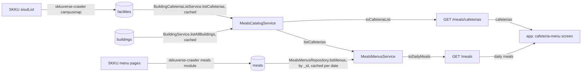

# Meals Architecture

> What `src/meals/` serves for the app's cafeteria-menu screen: which cafeterias it lists and where they come from, and the daily menus it reads from skkuverse-crawler. Read it before adding a meals route or changing how a menu is served.

## Context

Meals serves the cafeterias and their menus to the app's cafeteria-menu screen. It owns no data. The cafeterias are building's: skkuverse-crawler mirrors SKKU's facility registry into `facilities`, building parses the cafeteria rows where it reads them, and meals reads them through `BuildingCafeteriaListService` and their buildings through `BuildingService`, the doors building opens to other features ([ADR 0010, D1](../decisions/0010-server-architecture.md)). The menus are skkuverse-crawler's: it crawls SKKU's menu pages for this week and next and writes one document per cafeteria, KST date and served meal into `meals` (database `MONGO_MEALS_DB_NAME`), which this module only reads.

| System | Quirk tag | Gives | Enters at |
| --- | --- | --- | --- |
| building (`BuildingCafeteriaListService`, `BuildingService`) | `mongo` | The campus's cafeterias from `facilities`, and the buildings they sit in from `buildings` | `BuildingCafeteriaListService.listCafeterias`, `BuildingService.listAllBuildings` |
| skkuverse-crawler (meals module) | — | The menu of each cafeteria per KST date and meal code, in `meals` (`MealDoc` in `py/src/skkuverse_crawler/modules/meals/models.py`) | `MealsMenusRepository.listMenus` |

## Glossary

| Term | Means | Derived from | Not |
| --- | --- | --- | --- |
| cafeteria | A place SKKU's facility registry lists as a cafeteria (kind `0201`), one `facilities` document. It is listed whether or not the crawler has a menu for it: the dormitory cafeterias have none | `BuildingCafeteriaListService.listCafeterias` | `restaurant`, `diningHall` |
| `conspaceCd` | SKKU's code for a registered facility: the cafeteria's `id` on the wire, `_id` in `facilities`, and the `cafeteriaId` of a menu | sisulList `conspaceCd` | a bare code |
| cafeteria building | The stored building whose `buildNo` is the cafeteria's: its `skkuId`, `buildNo`, `displayNo` and name, or null when no stored building has that `buildNo` | `toCafeteriaList` | — |
| floor | The floor the registry names, in both languages; null when it names none | sisulList `floorNm`, `floorNmEng` | — |
| cafeteria list (`CafeteriaList`) | The body of `GET /meals/cafeterias`: one campus's cafeterias in `conspaceCd` order | `cafeteriaList` | — |
| meal code | The crawler's one-letter meal: `B` breakfast, `L` lunch, `D` dinner, `S` snack, `R` reservation, served in that order (`MEAL_CODES`) | skkuverse-crawler `MealCode` | `mealType` |
| menu (`MenuDoc`) | One crawler document: a cafeteria's cells for one KST date and meal code, keyed `{conspaceCd}:{date}:{meal code}` (`toMenuId`) | skkuverse-crawler `MealDoc` | — |
| cell (`MenuCell`) | One block of SKKU's menu page: a corner's items, raw text, like count and photo, with the crawler's parse status. Served as a corner | skkuverse-crawler `MenuCell` | — |
| corner | A served cell: on the wire's `corners`, without the parse status and with only the items served that day | `toDailyMeals` | — |
| menu item (`MenuItem`) | One dish or set in a cell, with its price, dishes, quantity, priced options and tags; `days` names the weekdays it is limited to | skkuverse-crawler `MenuItem` | — |
| daily meals (`DailyMeals`) | The body of `GET /meals`: one campus's cafeterias, each with the meals served on one KST date | `dailyMeals` | — |

## Structure

| Field | App use |
| --- | --- |
| `cafeterias[].id` | The key of a cafeteria card, and the building sheet's link into the screen |
| `cafeterias[].name`, `campus`, `building`, `floor` | The cafeteria card's header and the link to the building's sheet by `building.skkuId` |
| `cafeterias[].meals[].code` | The meal tabs: only the codes some cafeteria serves that day |
| `meals[].corners[]` | The corner rows: `isFixedMenu` folds a standing board apart, `needsReview` shows `rawText` instead of `items`, `likes` is shown only |
| `corners[].items[]` | The menu lines: name, price, set dishes, quantity, priced options and tags |

## Invariants

- `campus` is required, `hssc` or `nsc` (`CAFETERIA_CAMPUSES`, building's campus codes restated because a feature imports only building's types); anything else answers `400` `INVALID_CAMPUS` before any read, on both routes.
- `date` is a KST calendar date, `YYYY-MM-DD`, and an impossible one answers `400` `INVALID_DATE`. Without it, `GET /meals` serves today in KST from the injected `Clock`, never the UTC date.
- `GET /meals` lists every cafeteria of `GET /meals/cafeterias`, in the same order, on any date: a cafeteria without a menu that day serves `meals: []`, and a date without menus answers `200`, never `404`.
- A menu is read by `_id`, every cafeteria × meal code of the date, so the read needs no index on a collection this server does not own; the fields read are parsed (`menuDoc`), and a document of another shape is left out and logged as `meals.menus.invalid_document`.
- A junk or closed cell is not served; an item limited to other weekdays is not served, so the wire carries no `days`; a corner left with no item is served only when it needs review, and a meal only with a corner left. An option without a price is left out: the wire promises one.
- Menus are cached per date and campus for `MENU_CACHE_TTL_MS` per replica; a failed read answers `500`, never empty menus.
- Both bodies name both languages and depend on no request header, so they are shared-cacheable (`CAFETERIA_LIST_CACHE_CONTROL`, `DAILY_MEALS_CACHE_CONTROL`) and their envelope carries no `meta.lang`.
- Meals writes nothing and owns no collection; only `MealsModule` binds the general rate limiter under `/meals`.

## Open questions

- Whether a cafeteria the crawler has no menu for (the dormitory cafeterias) stays in the lists, and whether `GET /meals/cafeterias` should flag which ones have menus.
- Opening hours: the crawler writes SKKU's raw hours and notice per cafeteria into `meal_cafeterias`, which no route reads yet. The recommended path joins them to `facilities` by `conspaceCd`.
- The menu document type restates the crawler's `MealDoc` by hand; it moves to a type generated from the crawler's export once the crawler publishes one ([ADR 0010, D13](../decisions/0010-server-architecture.md)).

## Related

- [Building architecture](building-architecture.md): the `facilities` collection and its cafeteria reads
- [ADR 0010](../decisions/0010-server-architecture.md): the module shape and the service door
- [Docs index](../README.md): writing rules
