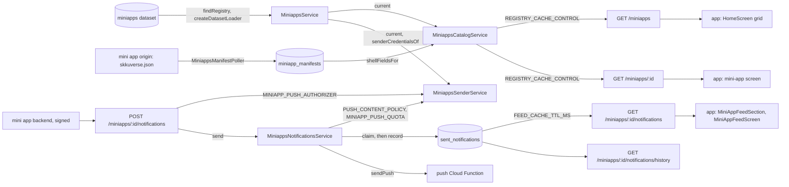

# Miniapps Architecture

> What `src/miniapps/` serves: the mini-app registry, each mini app's detail with its shell, and the broadcast feed a mini app pushes to its subscribers. Read it before you register a mini app, change the shell, or touch the send path.

## Context

The registry is the `miniapps` dataset in the content database ([ADR 0013](../decisions/0013-runtime-data-in-mongodb.md)), written only by `npm run data`, which checks each push with `checkedRegistry` and `toRegistryIssues`. `MiniappsRepository.findRegistry` reads it, and `MiniappsService`, the module's door, serves it through `createDatasetLoader` as one frozen snapshot per revision (`current`). Who owns each first-party origin stays in code (`MINIAPP_ID_BY_FIRST_PARTY_ORIGIN` in `src/infra/origins.ts`); each revision read is checked against it and a mismatch is logged. A first-party mini app's own manifest, served from its origin, overrides the shell the registry sets: a poller fetches it from each first-party origin and stores its shell fields in `miniapp_manifests`, keyed by origin, and `GET /miniapps/:id` reads them from there, so an api replica fetches no manifest. The broadcast feed is stored too: each send writes a `sent_notifications` row, then asks the push Cloud Function to deliver it. The root holds the door, its repository, the registry's schema, snapshot and shell parse; `catalog/` serves the registry routes and the public feed, `manifest/` fetches, stores and reads back the manifests, `sender/` holds every perimeter decision about a push sender, for any push route: whether a call may act as the mini app in its path (`MINIAPP_PUSH_AUTHORIZER`, `MiniappsSenderService.authorize`), what it may send (`PUSH_CONTENT_POLICY`, `checkDraft`) and how often (`MINIAPP_PUSH_QUOTA`, `takeQuota`), and `notifications/` a mini app's own signed send and history ([signed calls](../reference/miniapps-api.md#54-signed-calls)), the feed rows and the Cloud Function call. Unlike building's flows, which inject their parent's repository, this module's flows read the registry through the door, so every reader shares one cache and one snapshot per revision. Whether an id is registered is the snapshot's `isRegistered`, and an unregistered id gets `toMiniAppNotFound` on every route.

| System | Quirk tag | Gives | Enters at |
| --- | --- | --- | --- |
| The content database | — | The `miniapps` dataset: the mini apps, their logos, start URLs and fallback shells, checked at push by `npm run data` | `MiniappsRepository.findRegistry` |
| A first-party mini app's origin | — | Its manifest's shell fields, polled per origin and stored | `MiniappsManifestClient.fetchShellFields` |
| MongoDB | `mongo` | The `sent_notifications` rows of the feed and the unique index that guards a repeated send, and the `miniapp_manifests` documents the poller writes and the detail route reads | `MiniappsNotificationsRepository`, `MiniappsManifestRepository` |
| The push Cloud Function | — | The fan-out to the mini app's topic and its delivery counts | `MiniappsNotificationsClient.sendPush`, through `postToFcmFunction` |
| A mini app's backend | — | A send or history read signed with its registered `Ed25519` key, and a required `Idempotency-Key` on a send | `MiniappsNotificationsController` |
| skkuverse-app | — | Nothing; it reads the registry, the details and the feed | `GET /miniapps` and its siblings |

## Glossary

One noun, two spellings, by rule: a class is `Miniapps<Flow><Role>`, because `class-name` derives it from the file name (`miniapps-catalog.service.ts`), and a constant or error code writes `MINIAPP` (`MINIAPP_NOT_FOUND`, which the app reads). Every other name, type and wire field writes it as two words, `miniApp` or `MiniApp` (`MiniAppDetail`, `miniAppId`, `MiniAppPushPayload`), as skkuverse-app's types do; a new name follows that, and the ESLint block `naming/miniapp-spelling` refuses `miniappX` or `MiniappX` anywhere in `src/`.

| Term | Means | Derived from | Not |
| --- | --- | --- | --- |
| registry (`MiniAppRegistry`) | The snapshot of one revision of the stored `miniapps` dataset, frozen: its revision, the version, the ordered `indexEntries`, the `detailsById`, the lookups (`isRegistered`, `detailOf`, `senderCredentialsOf`, `isKnownMiniAppTarget`) and the target grammar; a request takes one for all its checks and its response | `toMiniAppRegistry` over `checkedRegistry`, served by `MiniappsService.current` | `appRegistry` |
| index entry (`MiniAppIndexEntry`) | One mini app as the home grid and deep links need it, both logos resolved | `toIndexEntry` | — |
| detail (`MiniAppDetail`) | One mini app's start URL, badge, links and complete shell, as `GET /miniapps/:id` sends it | `toDetailResponse` | — |
| shell (`ShellConfig`) | What the app draws around a mini app's page: the name pill, the header, the status bar and the background | `DEFAULT_SHELL`, under the registry's fields, under the manifest's | — |
| manifest (`Manifest`) | A first-party mini app's own `skkuverse.json`; this server reads only its shell, through `parseShellFields` | `parseManifest`, which only the mapper spec calls: it mirrors the SDK's parse so the spec can run the SDK's test vectors ([Mini-app API](../reference/miniapps-api.md), the shell parser section) | — |
| first-party origin | An origin one registered mini app owns outright, whose manifest is polled and stored | `firstPartyOrigin`, over `FIRST_PARTY_MINIAPP_ORIGINS` | — |
| stored manifest | A first-party origin's last good manifest shell fields and when they were fetched, one `MiniAppManifestDoc` per origin; a detail merges its origin's | `MiniappsManifestService.refresh`, read by `MiniappsManifestService.shellFieldsFor` | — |
| mini-app target (`MiniAppTarget`) | A mini app's id and an optional path on its origin, the grammar shared with the app | `parseMiniAppTarget` | — |
| sent notification (`SentNotificationDoc`) | One broadcast as stored: the texts, the action, when it was sent and what delivery reported | `toSentNotification` | `inbox` |
| feed entry (`MiniAppFeedEntry`) | A sent notification in the request's language, without its delivery | `toFeedEntry` | — |
| push sender (`PushSender`) | The mini app a send is for, the key that signed the call (null for a call allowed with no key, as `local-dev` allows every call), and the registry snapshot its `id` was checked against, which its link is checked against too | `MiniappsSenderService.authorize` | — |
| sender credentials (`SenderCredentials`, `src/perimeter/perimeter.ports.ts`) | What `MINIAPP_PUSH_AUTHORIZER` is told about a registered sender: its detail's `sender` (`status`, `scopes`, `signingKeys`), which the detail route never serves; a detail without one is `pending` with none | `MiniAppRegistry.senderCredentialsOf`, null for an unregistered id | — |
| push content scope (`PushContentScope`, `src/perimeter/perimeter.ports.ts`) | A push sender's id and registry target check, with the first-party game ids no target may name: what `PUSH_CONTENT_POLICY` checks a send's link against | `MiniappsSenderService.checkDraft`, over `GAME_ID_BY_FIRST_PARTY_ORIGIN` | — |
| send attempt (`SendAttempt`) | One call to the Cloud Function for a written row: the row, its log fields and when the call started; not its result, which is the delivery | `MiniappsNotificationsService.send` | — |
| idempotency key (`idempotencyKeyHeader`) | A sender's name for one send, stored on its row; a repeat with it answers that row's outcome | `toReplayedOutcome`, over the row `claimSentNotification` stored | — |
| delivery status (`DeliveryStatus`) | What a send's own Cloud Function call came back as: delivered, refused before sending, or unknown; a stored row with neither `delivery` nor `deliveryError` has none yet | `classifyDeliveryFailure`, for a failed call | `readBy` |
| push payload (`MiniAppPushPayload`) | The data the Cloud Function relays to each device, the keys its own list names | `MiniappsNotificationsClient.sendPush` | — |
| push map target (`PushMapTarget`) | A send's optional `chipId` and `placeId`: the chip or place a current app opens the map with, beside the route; stored, sent and compared on a repeat, never served on the feed | `pushMapTarget`, parsed by `MiniappsNotificationsService.send` beside `PUSH_CONTENT_POLICY`'s check | — |

## Structure

What the app reads, from `skkuverse-app/packages/shared/src/miniapps/schema.ts` and `skkuverse-app/packages/shared/src/miniapps/feed-parse.ts`:

| Field | App use |
| --- | --- |
| `/miniapps` `miniApps` | The home grid tiles, ordered by `order`; `hidden` keeps an entry off the grid but resolvable |
| `/miniapps` `shortName`, `name` | The tile label, and the feed screen's title |
| `/miniapps` `homeLogo`, `shellLogo` | The tile, and the shell's title pill and info sheet |
| `/miniapps` `version` | Parsed, not gated on |
| `/miniapps/:id` `startUrl`, `shell` | The mini-app screen opens the start URL inside the shell |
| `/miniapps/:id` `verified`, `description`, `relatedLinks`, `noticeBanner` | The page-info sheet |
| `/miniapps/:id/notifications` | The feed card and screen; an entry without a parseable `sentAt` is skipped |

## Invariants

- The registry is checked at push (`checkedRegistry`, `toRegistryIssues`, the ui datasets' references to its ids, and its ids against the stored `games`, which share one namespace with them) and parsed again at read (`storedRegistry`). `MiniappsService.current` keeps the read contract of `createDatasetLoader`: a push serves within `DATASET_CACHE_TTL_MS`, an invalid or failed reload keeps the last good snapshot, and with none every registry route and both signed push routes answer `503 MINIAPP_REGISTRY_UNAVAILABLE` without `Cache-Control`, so a send writes nothing. `miniapps.registry.missing`, `.invalid` and `.read_failed` log at most once a minute, `miniapps.registry.owner_mismatch` once per revision.
- A request takes one snapshot for all its checks and its response. Another module awaits `current` only when its data names a mini app, or `findCurrent` where it serves without one: the map's event overlays drop their `miniapp` buttons instead.
- A served index entry and detail are built from named fields (`toIndexEntry`, `toDetailResponse`), and a detail's `shell` is always complete.
- A manifest is fetched only from a first-party origin, never followed through a redirect, and bounded by `MAX_MANIFEST_BYTES` and `FETCH_TIMEOUT_MS`. The poller stores it every `POLL_INTERVAL_MS`, one poller per origin; a failed fetch rejects only that origin's tick and leaves its stored document, the last good manifest. A detail reads every stored manifest in one cached read (`MANIFEST_CACHE_TTL_MS`, the last read kept for `MANIFEST_STALE_WINDOW_MS` through a failed reload); a missing document or no good read merges `{}`, the registry's own shell, never an error.
- Broadcast only, by decision (the Revisited section of skkuverse-app's ADR on the notification inbox): a sent notification has no user field and no read state.
- A send writes the feed entry first, then calls the Cloud Function with its id, then records what came back; a failed call leaves `delivery` null with a `deliveryError` that says whether a resend is safe (`classifyDeliveryFailure`), and a failed record after a delivery is logged, never reported as a failed send.
- The feed is cached per replica for `FEED_CACHE_TTL_MS` with no stale window, and the sender's replica drops its copy after the insert.
- A send carries an `Idempotency-Key` and calls the Cloud Function at most once per key and mini app: it reads the key, then claims it with its insert under the unique index `miniAppId_idempotencyKey_unique`, which the poller builds; a repeat, or the loser of a race, answers the stored row through `toReplayedOutcome` when `toNotificationContent` of both is equal, and is refused as `IDEMPOTENCY_KEY_REUSED` when not ([ADR 0020](../decisions/0020-miniapp-push-link-policy.md)).
- A send's draft is checked by `PUSH_CONTENT_POLICY` ([ADR 0023](../decisions/0023-perimeter-ports.md)), its link by `toLinkProblem` with the push policy: a `route` is exactly one of the routes the policy allows or the sender's own `/miniapp-feed/<id>`, a `webview` or `external` value any https URL, a `miniapp` target any mini app the push sender's registry snapshot holds, `hidden` or not, and never a first-party game, which the push content scope refuses in code since `npm run data push` checks the registry against the games the target database stores, and `_dev` stores none ([ADR 0020](../decisions/0020-miniapp-push-link-policy.md)).
- Only `MiniappsModule` binds the general limiter, on `/miniapps`, which covers the signed routes; a send also takes the sender's quota (`MINIAPP_PUSH_QUOTA`).
- A signed call is verified against the sender's registered keys before its status and scopes are read, so an unknown id, another app's key or a bad signature answers `401` before any `404` or `403`; a signed send needs an `Idempotency-Key` (`refuseUnkeyedSignedSend`, then `send`, which takes it as a required argument), which the signature covers. History is `/miniapps/:id/notifications/history`, never the public feed's path, which a shared cache may serve. `MINIAPP_PUSH_AUTHORIZER` takes no shared token, and no route under `/internal/miniapps` exists ([ADR 0020](../decisions/0020-miniapp-push-link-policy.md)).

## Open questions

- Feed rows sent before [ADR 0020](../decisions/0020-miniapp-push-link-policy.md) may carry a `route` a send now refuses (`/mini-app?id=…`); the feed serves them as stored, and only the app's feed rule checks them (`spencer0124/skkuverse#72`).

## Related

- [Mini-app API](../reference/miniapps-api.md): the routes, the shell and the send payload field by field
- [Register a mini app](../how-to/register-a-miniapp.md): adding an entry to the registry
- [ADR 0010](../decisions/0010-server-architecture.md): the module shape
