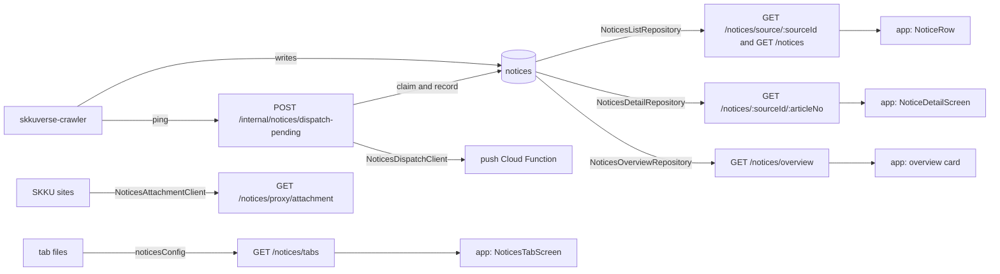

# Notices Architecture

> What `src/notices/` serves: the notice tabs, lists and details the crawler's documents feed, the search overview the ai writes, the attachment proxy, and the push dispatch the crawler's ping triggers. Read it before you change a notice route, a push field or the tab files.

## Context

The crawler owns the `notices` collection: it writes every document, and skkuverse-ai writes the summary fields through it. This server reads it, adds one read index, and writes only the five push fields of the dispatch. The tab files (`categories.json`, `sources.json`, `exclude-reasons.json`) are the crawler's codegen output, hash-locked and copied by the umbrella. The root holds the module file, the document type, the tab files' loader and what several flows share; `tabs/`, `list/`, `detail/`, `overview/`, `attachment/` and `dispatch/` are one flow each, `facts/` parses the crawler's `facts` record for the flows that serve it, `row/` renders a parsed record as the list row the umbrella's notice list rows decision specifies, which `list/` serves on each list item, and reads one notice for `screen/`, which renders the detail screen of the same decision from that reading, which `detail/` serves next to the summary. `legacy/` derives the summary a shipped app reads from the same reading for a notice with facts and no summary, for `list/`, `detail/` and the push body of `dispatch/`.

| System | Quirk tag | Gives | Enters at |
| --- | --- | --- | --- |
| skkuverse-crawler | `skkuverse-crawler` | The notice documents with their `facts` record, the unique article index, the tab files and the cycle-end ping | `NoticeDoc`, `NoticesFactsService`, `noticesConfig`, `NoticesDispatchController` |
| skkuverse-ai | `skkuverse-ai` | The summary fields (through the crawler) and the overview answer | `selectRoleBadge`, `NoticesOverviewClient` |
| MongoDB Atlas | `atlas` | The list and detail reads, the `$rankFusion` retrieval and the atomic dispatch claim | `NoticesListRepository`, `NoticesOverviewRepository`, `NoticesDispatchRepository` |
| SKKU department sites | `skku`, `gnuboard` | Attachment files, some behind a board session or a hotlink check | `NoticesAttachmentClient` |
| axios | `axios` | The outbound calls of the proxy and the overview | `NoticesAttachmentClient` |
| The push Cloud Function | — | The fan-out to the notice's topics and its delivery counts | `NoticesDispatchClient`, through `postToFcmFunction` |

## Glossary

| Term | Means | Derived from | Not |
| --- | --- | --- | --- |
| notice (`NoticeDoc`) | One crawled article on one board, as stored, its push fields included | the crawler's document | `NoticeDto` |
| source (`SourceConfig`) | One board the crawler reads, with its campus and availability | `sources.json` | a board (prose only) |
| category (`CategoryConfig`) | One tab definition, fixed to a source or a picker over several | `categories.json` | — |
| tab (`NoticeTab`) | A category as `GET /notices/tabs` serves it, in one language | `toTabsResponse` | `tabConfig` |
| list row (`NoticeListRow`) | The fields of a notice a list read loads | `LIST_PROJECTION` | — |
| list item (`NoticeListItem`) | A notice as a list cell shows it: flags, no body | `toListItem` | — |
| summary brief (`NoticeSummaryBrief`) | The list cell's one-liner and badge dates | `toSummaryBrief` | — |
| cursor (`CursorPayload`) | The last served row's date and id, the next page's start | `encodeCursor`, `decodeCursor` | — |
| page (`NoticePage`) | The served rows of a read of one more than the limit | `toNoticePage` | `FindResult` |
| detail row (`NoticeDetailRow`) | The fields of a notice the detail read loads | `DETAIL_PROJECTION` | — |
| detail (`NoticeDetail`) | One notice with its Markdown body, attachments, full summary and screen | `toDetailItem` | — |
| full summary (`NoticeSummaryFull`) | The detail's summary, the ai's arrays passed through | `toSummaryFull` | — |
| facts (`NoticeFacts`) | The crawler's extracted record of one notice group, as its schema's `v: 1` gives it | `noticeFacts` | — |
| facts snapshot (`FactsSnapshot`) | One earlier version of a notice's facts, kept for the change check | `factsHistory` | — |
| facts row (`FactsRow`) | A notice as the umbrella's two-line list row shows it, in finished Korean, at KST now: the first line within its character budget and never cut mid-word, the second with no track tag (`trackedLine2` keeps it for the detail's status line), and a qualifier left out whole when the second line would pass its budget | `toFactsRow` | — |
| quote text (`toQuoteText`) | A fact's quote as the row and the screen show it: the crawler's table `label`, then ` · `, then the quote, or the quote alone when the label is empty or the quote already says it | `toQuoteText` | — |
| benefit text (`toBenefitText`) | A benefit as the row and the screen show it: its quote text, with a draw marked as one unless the text already says so | `toBenefitText` | — |
| quote texts (`toQuoteTexts`) | The texts a fact offers a line that may not fit it, in order: its quote text, then the quote text of the crawler's `compact` when it stored one, which keeps the label and, for a benefit (`toBenefitTexts`), the draw mark; only the list row reads past the first | `toQuoteTexts`, `toBenefitTexts` | — |
| item row (`NoticeItemRow`) | A facts row as a list item carries it as `row`: the app sketch's field names, plus the board on a read of two or more sources and the list day, with no status or item id | `toItemRow` | — |
| list day (`ListDay`) | The day header a list item sits under (today, yesterday, this week, earlier), by the KST day of its notice's posting date, the list's sort key, so the groups run in list order | `toListDay` | — |
| row status (`RowStatus`) | Where the notice's main thing stands on the KST day: from a statement, from its dates, or no date | `toRowStatus` | — |
| row token (`RowToken`) | The one status word that leads the row's first line: the first of the umbrella's token precedence that applies | `TOKEN_PRECEDENCE` | — |
| row item (`RowItem`) | A dated item of the facts with its KST days resolved once per row | `toItemDays` | — |
| row reading (`RowReading`) | `row/`'s one read model of a notice at KST now: its parsed source, its row, the status of its main event with the sign-up windows set aside, its dated items in record order and two closures that write days on the row's calendar | `toRowReading` | — |
| item reading (`ItemReading`) | One dated item of a row reading with the line the row writes for it and its status read alone; positional, because a record can repeat an item id | `toRowReading` | — |
| notice screen (`NoticeScreen`) | The detail's header, status line, blocks, action bar, collapse and original, as finished Korean at KST now | `NoticesScreenService.renderScreen` | — |
| screen scope (`ScreenScope`) | What a block builder or header rule reads: a row reading and the names building gave each stored place id | `renderScreen` | — |
| derived brief (`DerivedBrief`) | The `summary` fields a shipped app reads (`oneLiner`, `type`, `startAt`, `endAt`), derived from a row reading when the notice has no stored summary: the row's date line then its qualifier, the shown window's end, a type from the shown item's kind | `toDerivedBrief` | — |
| notice type (`NoticeType`) | The board category's group (academic, scholarship, jobs, event) that picks which blocks lead | `NOTICE_TYPE_BY_CATEGORY` | — |
| block key (`BlockKey`) | One block of the umbrella's block table, in its order; its label, numbering and fold are `BLOCK_SPECS` and its lines `BLOCK_LINES` | `BLOCK_KEYS` | — |
| KST day (`KstDay`) | A calendar day in Korea as a whole day count since `1970-01-01`, the unit every row date compares in | `toKstDay` | — |
| dedup key (`dedupKeyOf`) | A candidate's content in the overview's cache key: its trimmed title and content hash, so an edited notice is a new key | the notice | — |
| cluster key (`clusterKeyOf`) | What the copies of one article share: the crawler's `dupOf`, or the notice's own `_id` while the crawler has not linked it; the list, the push and the overview each count an article once on it | `dupOf` | — |
| cluster member (`ClusterMember`) | A copy at or before the cursor of a list of several sources, read for its cluster key: an earlier page served its article | `CLUSTER_MEMBER_PROJECTION` | — |
| scanned row (`ScannedRow`) | A row of a list of several sources read only for its place in the list and its cluster key; the rows served are read again in full | `SCAN_PROJECTION` | — |
| shown copy | The copy of an article a list of several sources serves: the first in list order, which no crawl moves | `selectShownRows` | — |
| representative (`selectRepresentative`) | The copy a merged push links to | the group and its topics | — |
| claim window (`ClaimWindow`) | The age floor, lease cutoff and attempt cap of one claim | `toClaimWindow` | — |
| sweep summary (`SweepSummary`) | What one dispatch sweep claimed, sent and skipped | `NoticesDispatchService.sweepPending` | — |
| push payload (`NoticePushPayload`) | The data the Cloud Function relays to devices | `NoticesDispatchClient.sendPush` | — |
| candidate (`OverviewCandidate`) | A retrieved notice the ai may cite | `NoticesOverviewRepository` | — |
| overview (`Overview`) | The ai's answer with its citations renumbered for the app | `mapOverview` | — |

## Structure

What the app reads, from `skkuverse-app/packages/shared/src/notices/parser.ts` and the screens in `skkuverse-app/apps/mobile/src/features/notices/`:

| Field | App use |
| --- | --- |
| `/notices/tabs` `tabs` | The tab bar, the picker's sources with their availability and excluded-reason copy, and the default selections |
| list `summary` | The row's one-liner and its deadline badge (`formatDeadlineBadge`); derived from `facts` while the notice has no stored summary |
| list `department`, `views`, `hasAttachments` | The row's chip, view count and attachment fallback line |
| list `nextCursor`, `hasMore` | Infinite scroll |
| detail `contentMarkdown`, `attachments` | The body, else the original page through `sourceUrl`, and the attachment list through the proxy |
| detail `summary` | The summary card |
| detail `screen` | The status line, the blocks, the pinned action bar, the collapse and the original, all finished Korean; the app computes no word of it |
| detail `author`, `views` | The header line |
| `/notices/overview` `overview` | The answer card above a search, with numbered source chips |

## Invariants

- Every notice read takes an inclusion projection (`LIST_PROJECTION`, `DETAIL_PROJECTION`, `CANDIDATE_PROJECTION`), so a field the crawler adds is never served by accident, and no list read loads a body.
- The list reads sort on date then `_id`, never `crawledAt`, which the crawler rewrites ([ADR 0007](../decisions/0007-notice-ordering-key.md)), are hinted to `FORCE_INDEX` and bounded by `HOT_READ_MAX_TIME_MS`; `NoticesListRepository` creates that index at boot.
- A list of two or more sources serves each article once, as its shown copy at that copy's place in the list (umbrella `docs/decisions/0009-notice-list-rows.md`, `D8`). The order, the cursor and `hasMore` follow the served rows, so a page never repeats an article an earlier page served. A list of one source serves every copy.
- The list routes check their input in one schema, in the order the routes have always answered: the source, then the type, then the cursor. A search text that is empty, too long or holds a control character is dropped, never an error.
- `NoticesDispatchRepository` is the only writer of `pushedAt`, `pushAttempts`, `dispatchClaimedAt`, `pushError` and `pushSkippedReason`. A claim is atomic and a lease, so two replicas never push one notice twice ([ADR 0003](../decisions/0003-fcm-dispatch-cloud-function-claim-lease.md)), and the age gate is the notice's own KST date ([ADR 0008](../decisions/0008-dispatch-age-gate-on-publication-date.md)). A notice is claimable once the crawler's live facts job has written `factsAt`, whatever its `factsGate` ([ADR 0024](../decisions/0024-dispatch-gate-on-facts.md)); `aiSummaryAt` gates nothing. Each claim takes the newest claimable notice, by `date` then `_id`, so a backlog larger than one sweep sends the newest first. A group whose boards have no push topic (a `skku-main`-only article) is recorded as a skip: `pushedAt` set, so no claim takes it again, `pushSkippedReason: "no-topic"`, and no attempt counted.
- Cross-posted copies of one article, the notices of one cluster key, share one push to the union of their topics ([ADR 0005](../decisions/0005-notice-dispatch-content-group.md)), capped at `TOPIC_CAP`.
- A notice's stored `facts` reach a flow only through `NoticesFactsService.parseFacts`. A notice with none reads as null. A record that fails the `v: 1` schema, or carries another `v`, reads as null too and logs `notices.facts.unparsed` with the notice id, at most once a minute per notice. The schema strips a key it does not know, and `__tests__/contracts/notice-facts.test.ts` fails when it and `contracts/consumed/notice-facts.schema.json` differ on a required key or an enum, and pins the table `label` of codebook `v3.11` on a condition's or a benefit's quote and of a cost of missing, and the `compact` the crawler writes for the row's qualifier on those, on the words that make a notice not for students (which also carry a `label`) and on a place, with the record's `compacts` mark, which the general comparison would let a stripped key hide.
- A page of rows is rendered at request time by `NoticesRowService.renderRows`, which parses each notice's facts through `NoticesFactsService.parseFacts` and renders every row against the KST day of the one `now` its caller's Clock gave, so a row changes only at KST midnight and a notice with no usable facts pairs with no row. Every word it writes is Korean product copy in `notices-row.constants.ts`, whatever the request language, except the label joiner and the draw mark it shares with the screen in `notices.constants.ts`. A qualifier whose fact the crawler read from a table reads `label · quote` (`toQuoteText`, `toBenefitText`), so the fit of the second line measures that whole text first. A rule offers its texts in order, the full text and then the crawler's `compact` of it under the same label (`toQuoteTexts`, `toBenefitTexts`; the place rule offers `places[0].text` and its `compact`), and `toFittedQualifier` takes the first that fits and drops the qualifier whole when none does, never showing a compact without its label and never falling to a lesser rule. The count of conditions and the online word have no compact. The detail's screen and the derived one-liner keep the full text, which `RowReading.fullQualifier` holds. The crawler's `row.py` is its reference: its golden cases run in `notices-row.rules.spec.ts`, which lists each case where the umbrella's decision overrides it.
- The detail's `screen` is rendered by `NoticesScreenService.renderScreen` through `NoticesRowService.readNotice` at the one `now` the detail's Clock gave, and is null when the notice has no usable facts. Its status line, action bar and collapse read the one status the row reads. Every block is a notice type's leading blocks and then the umbrella's table order (`toBlockOrder`), one builder per block (`BLOCK_LINES`), and a block with no lines is left out. A place building names on a building sheet gets a `map` action to `skku_building:<skkuId>` with its room; one written off campus gets a `search` action with its words; any other place shows its quote and gets no action. When building's read fails, every place does, and the detail still answers. A fact the verifier disputed is left out, and a fact a track repeats in a block where it also stands untagged shows once, untagged (`toDistinctLines`). A folded block sends every line, and `foldedCount` counts the ones after the first `maxLines` the app starts hidden. The block of dated lines runs by start day with the ended lines after the ones still ahead, newest first (`toSessionOrder`), so the fold hides the least relevant tail; a notice read from production pins it (`notices-screen.service.spec.ts`). A condition, an exclusion, a benefit and a cost of missing read from a table show `label · quote` in `text` (`toQuoteText`, `toBenefitText`), and a line's `quote` stays the record's own words for the app to highlight. Every line says whether its quote came from the body, the title or a poster. Every word is Korean product copy in `notices-screen.constants.ts`.
- The tab files are parsed at import by `noticesConfig`, and a bad file stops the boot with `notices.tabconfig.invalid`.
- An attachment request reaches only what `OUTBOUND_POLICY` allows for `notice-attachment`, on every hop ([ADR 0023](../decisions/0023-perimeter-ports.md)), and a type not known safe inline is served inside the sandbox CSP.
- The overview never fails its request: a runtime failure is a null overview with a reason.
- With `NOTICE_OVERVIEW` off, the production default, the overview answers a null overview with reason `unavailable` before it retrieves or calls the ai.

## Open questions

- Notice reads are typed, not parsed per read ([ADR 0010](../decisions/0010-server-architecture.md), data access): `NoticeDoc` carries the crawler's `CONTRACT` tag, and the list, detail and overview reads are reasoned entries in `__tests__/architecture/exemptions/repository-reads.json`. The crawler's exported document type replaces the hand-written one.
- `notices.topics.ts` has no role suffix because it reads the loaded categories itself; it joins a `.rules` file once it takes them as an argument.
- A list read whose hinted index is missing answers a server error.

## Related

- [Notices API](../reference/notices-api.md): the routes field by field, and the design notes
- [ADR 0003](../decisions/0003-fcm-dispatch-cloud-function-claim-lease.md): the dispatch claim lease
- [ADR 0005](../decisions/0005-notice-dispatch-content-group.md): one push per cross-posted article
- [ADR 0024](../decisions/0024-dispatch-gate-on-facts.md): the push gate is the crawler's `factsAt`
- [ADR 0007](../decisions/0007-notice-ordering-key.md): the list's sort key
- [ADR 0010](../decisions/0010-server-architecture.md): the module shape
