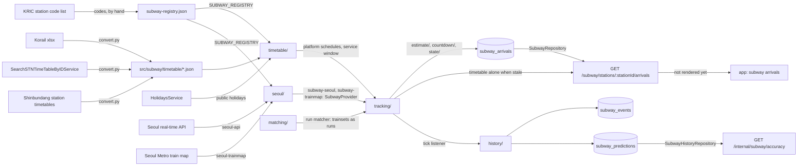

# Subway Architecture

> What `src/subway/` serves about the subway stations near the two campuses and the commute shuttle's stops, how a station and each of its platforms are identified, where their data comes from, how the tracker turns it into arrivals, and what adding a station or a provider touches. Read it before changing the registry, a data source or the estimates.

## Context

Subway owns the real-time arrivals of the served stations: physical stations, each with one platform per line, Sungkyunkwan Univ. on line `1` (a Korail section), Hyehwa on line `4` and the commute shuttle's stops on lines `2`, `3` and `8` (Seoul Metro) on line `K1`, Suin–Bundang (Korail), and on line `D1`, Shinbundang (its own operator). It mirrors the operators' timetables as committed files and, through a provider per jurisdiction, their live train positions and arrival rows; from both it keeps each platform's next trains in `subway_arrivals`, which the arrivals route serves per station. Stations, platforms, lines and neighbors live in a committed registry; the timetables are generated by a script.

| System | Quirk tag | Gives | Enters at |
| --- | --- | --- | --- |
| The KRIC station code list on data.kric.go.kr | — | The operator, line and station codes every platform id joins | `src/subway/subway-registry.json`, written by hand |
| The Korail timetable xlsx files, weekday and holiday, one per line | — | Each line `1` and `K1` train's arrival and departure at the stations, their upstream stations and their watched stations, and its destination, written as the train map and the Seoul API name it (`KORAIL_ABBREVIATIONS` for the short names; any other must be in `KORAIL_TERMINI`); a line `K1` express calls at every served station | `scripts/subway-timetable/convert.py`, into `src/subway/timetable/` |
| The Shinbundang operator's station timetable files, weekday and holiday | — | Each line `D1` station's minutes per direction, with no train number: `convert.py` chains them into runs, numbered from `1001` down and `1002` up, a short turn marked where it ends at Jeongja | `scripts/subway-timetable/convert.py`, into `src/subway/timetable/` |
| Seoul open data `SearchSTNTimeTableByIDService` (`SEOUL_OPENAPI_GENERAL_KEY`) | — | Each line `2`, `3`, `4` and `8` station's timetable per day type and direction; a line `2` trip to 성수 written as the circle it runs, `내선순환` or `외선순환`, and a branch trip refused | `scripts/subway-timetable/convert.py`, into `src/subway/timetable/` |
| The Seoul real-time subway API (`SEOUL_SUBWAY_API_KEY`, in the request path) | `seoul-subway-api` | Every train position of a line, and a station's arrival rows of every line there, told apart by `subwayId`, with their countdowns, which lines `1`, `8` and `K1` never publish; line `2` numbers a train by its operational number and names a circle train's destination `성수` both ways; line `K1` positions never report a departure; line `8` writes two station names with a suffix the train map leaves out; line `D1` numbers its trainsets, not its trips, stamps a position response once and dates its arrival rows ahead | `SubwaySeoulApiClient` |
| The Seoul Metro train map, crawled | `seoul-trainmap` | Every train of every line it covers, lines `1` to `8` and not `K1`, in one page (`ALL_LINES_PAGE`), by station and status, departures in Korail sections included; line `2` titles a circle train by its circle and gives a branch train its own direction digits | `SubwaySeoulTrainmapClient` |
| The holidays module | — | Whether a service day is a public holiday, which picks its day type | `SubwayTimetableService`, through `HolidaysService` |
| MongoDB `subway_arrivals` | — | Each platform's next trains per direction, written by the tracker in the poller process | `SubwayRepository` |
| MongoDB `subway_events` (time-series) and `subway_predictions` | `mongodb` | Each source's first report of a train's state at a served platform, and each served prediction at its horizons with the arrival that resolved it, written by the history in the poller process; both keep the platform id under its stored name `stationId` | `SubwayHistoryRepository` |

## Glossary

| Term | Means | Derived from | Not |
| --- | --- | --- | --- |
| station (`SubwayStation`) | One physical station, as a rider names it: its slug, its names, its `seoulName` and its platforms in served order | the registry, found by `findSubwayStation` | `subwayStop` |
| platform (`SubwayPlatform`) | One line at one station, the tracker's unit: its platform id, its line, its timetable source and its two platform directions | the registry, found by `findSubwayPlatform` | `stationLine` |
| platform id | The KRIC operator, line and station codes joined as `<operator>-<line>-<station>` (`KR-1-0153`); frozen once served | `SubwayPlatform.id` | the Seoul API's own station id, which exists only where that API does |
| line (`SubwayLine`) | A line by its KRIC line code: its line display data and the ids the `seoul` provider polls it by | the registry, by `toSubwayLine` | — |
| line display data | A line's code, localized name, color, six hex digits, and marker, which the app draws with no line table of its own; a served station carries it as `ServedLine`, the arrivals as `line` | `toServedStation`, `toSubwayStationArrivals` | — |
| marker (`LineMarker`) | How the app marks a line, in an outlined circle: its localized text, exactly one character in every language (a numbered line's number, a named line's first syllable in Korean), and its color, six hex digits, for the outline and the text on the app's light background, at least 4.5:1 there, so it is the line's color darkened where that color reads worse | the registry's `marker`, checked by `subwayRegistryFile` and `subway.config.spec.ts` | `badge` |
| registry (`SUBWAY_REGISTRY`) | The committed `subway-registry.json`: lines, stations with their platforms, and neighbors, parsed at import; any issue fails the boot | `loadSubwayRegistry` | — |
| neighbor (`SubwayNeighbor`) | A platform a direction names that no station serves: its line, its Seoul name, its train-map name where the map writes another, and its localized name where it is a previous or next station | the registry's `neighbors`, by platform id | — |
| served station (`ServedStation`) | A station as other modules read it: its slug, its title and its lines' display data in platform order | `toServedStation`, listed by `SubwayStationsService.listStations` | — |
| station row | A station as the transit tab places it, by slug; the ui module builds it from a served station | `SubwayStationsService.listStations` | — |
| station suffix (`STATION_SUFFIX`) | What each language writes after a station's name to make its title (`혜화역`, `Hyehwa Station`, `惠化站`) | `STATION_SUFFIX` | — |
| localized name (`LocalizedName`) | A name in every supported language | the registry | — |
| direction (`SubwayDirection`) | `up` or `down`, as the operator's timetable names a train's direction | the timetables' `direction` | `bound` |
| platform direction (`PlatformDirection`) | One direction at one platform: its localized name, its upstream platforms, its watched platforms and its next platform | `SubwayPlatform.directions` | — |
| upstream platform (`upstreamPlatformIds`) | Up to three platforms a direction's trains pass just before the platform, nearest first | `PlatformDirection.upstreamPlatformIds` | `prevStations` |
| watched platform (`watchedPlatformIds`) | A platform beyond the upstream ones whose events the tracker also observes for a direction, nearest first, out to the end of the timetable's route: 금정 for Sungkyunkwan Univ. down, the stop before it of every down express, and on to 안양; never a previous station nor counted in stops away | `PlatformDirection.watchedPlatformIds` | — |
| next platform (`nextPlatformId`) | The platform a direction's trains reach just after the platform | `PlatformDirection.nextPlatformId` | — |
| previous station (`previousStation`) | A direction's nearest upstream platform, as the response names it: its platform id and its name in the request language, a neighbor's own or a served platform's station's | `upstreamPlatformIds`, `findPlatformName` | — |
| platform timetable (`PlatformTimetable`) | The committed timetable source that serves a platform: `korail`, `seoul-station` with its Seoul station code, or `shinbundang` | `SubwayPlatform.timetable` | — |
| provider (`SubwayProvider`) | What the tracker observes one upstream of a jurisdiction's data through, on that upstream's own cadence; the `seoul` provider hands it the Seoul API and the train map | `SubwayProvider.observe` | `adapter` |
| provider observations (`ProviderObservations`) | One upstream tick: its source, its train events and its countdown rows | `SubwayProvider.observe` | — |
| `trainNo` | A train's number as the timetable writes it: four digits, an operator letter before or after dropped, on a `timetable` line; `2` and the last three digits on the `circle` line; on a `trainset` line the provider's trainset number, which run matching replaces with its run's number before the tracker reads it | `toTimetableTrainNo`, by the line's numbering, then `matchRuns` | `trainId` |
| train numbering (`TrainNumbering`) | How a line's upstream numbers become `trainNo`: `timetable`, `circle` or `trainset` | the registry's `seoul.trainNumbers` | — |
| circle numbering | Line `2`'s numbering: the API's operational number differs from the timetable's in its first digit only, so a train is `2` and its last three digits, which never repeat within a served platform's day | `toTimetableTrainNo` | — |
| branch train | A line `2` train off the circle, which no served platform sees: an API number led by a branch digit or a branch destination, a train-map direction digit from `MIN_BRANCH_DIRECTION_DIGIT`; dropped | `isBranchTrain`, `toTimetableTrainNo` | — |
| run | One train of a `trainset` line's timetable, as `convert.py` chains its station minutes, numbered by the script: what a served `trainNo` names there | the timetable's `trains` | — |
| trainset number | The number a `trainset` line's upstream gives a train set, kept through its turnarounds and naming no run | the API's `trainNo` | — |
| run matching | Matching each trainset seen on a `trainset` line to the unmatched run of its direction nearest its event, within the estimate's delay range and keeping the trainsets' order, kept while its direction holds, so the tracker sees a run | `matchRuns`, by `SubwayMatchingService` per line in the poller process | — |
| run matcher (`RunMatcher`) | What the matching flow hands the tracker to renumber a `trainset` line's events each tick; without one such a tick rejects | `SubwayTrackingService.setRunMatcher` | — |
| train state (`TrainState`) | Where a train is relative to a station: `approaching`, `arrived` or `departed` | the upstream's row | — |
| train event (`TrainEvent`) | One train's state at one station, when that state changed, and its destination as the upstream names it | a provider's upstream rows | — |
| reported direction (`reportedDirection`) | The direction a position row names (`updnLine`), carried only on a `trainset` line's events and read only where the event's destination names both directions | `toTrainEvents` | — |
| pass-through event | An event at a station a train's timetable row does not call at, which an express passes; it counts as the train's departure from its last row stop before that station, at the latest at the event's time; before the train's first row stop, and on its run into its stop at the served station, it stays its progress, at that station | `mergeObservations` | — |
| Seoul line (`SeoulLine`) | One line the `seoul` provider polls for positions: its Seoul API ids, its train-map line, its train numbering and the platform id of each name its rows write, by the API's name and by the train map's | `toSeoulLines` | — |
| Seoul station (`SeoulStation`) | One station the `seoul` provider asks arrivals for, by its `seoulName`, with the platform of each `subwayId` it serves | `toSeoulStations` | — |
| countdown row (`CountdownRow`) | An upstream's own seconds until a train reaches a platform, and when the upstream generated the row | a provider's upstream rows | — |
| arrival-row window (`isArrivalRowInWindow`) | The `recptnDt` an arrival row may carry to count, from `MAX_ARRIVAL_ROW_AGE_MS` before the fetch to `MAX_ARRIVAL_ROW_AHEAD_MS` after it | `isArrivalRowInWindow` | — |
| first published row (`toFirstPublishedRows`) | A countdown row dated by the earliest generation time of the rows repeating its train's countdown at its station, which the countdown counts from | `SubwayCountdownService` | — |
| settled observations (`SettledObservations`) | One upstream tick's observations from the calls that answered, beside the failures of those that did not | `toSettledObservations` | — |
| empty spell (`EmptySpell`) | How long a train-map line's blocks have had no train, over crawls at most `MAX_EMPTY_CRAWL_GAP_MS` apart | `toEmptySpell` | — |
| service date (`serviceDate`) | The KST date a train runs under, from `SERVICE_DAY_START_HOUR` to the same hour the next day, so a train past midnight is the previous day's | `toServiceDate` | — |
| day type (`DayType`) | `weekday`, `saturday` or `holiday`: which table a source serves on a service day, of those it declares in `TIMETABLE_DAY_TYPES` | `toDayType` | — |
| platform schedule (`PlatformSchedule`) | One platform's timetable for one service day: its day type, its line's travel order per direction and its scheduled trains at instants | `SubwayTimetableService` | — |
| service window (`isInServiceWindow`) | The hours an upstream is observed, from `SERVICE_WINDOW_OPENS_SEC` to the day type's `SERVICE_WINDOW_CLOSES_SEC`, in seconds after midnight of the service day | `SubwayTimetableService.isInServiceWindow` | — |
| train history (`TrainHistory`) | One train's direction, destination and latest accepted progress at a station its timetable row calls at, on one station's line, and when it was last seen | `mergeObservations` | — |
| delay (`toDelaySec`) | A train's seconds behind its own timetable row at its latest event, at least its standing time past a scheduled departure; used to estimate the train, or lent, only from `MIN_DELAY_SEC` to `MAX_DELAY_SEC`, and a train seen outside that range is served at its scheduled time, borrowing no other train's delay | `toDelaySec` | — |
| passing stop (`toPassingStop`) | When a train is scheduled at a station its row passes: its next row stop's arrival less the running time there of the train nearest in time that calls at both, its stands left out | `toPassingStop` | — |
| awaited train (`isAwaitedTrain`) | On the tracker's path, a train overdue at the served station with a row stop before it there and nothing seen of it at or past the station: late, not gone, so it is served its scheduled run from its first row stop away from now | `isAwaitedTrain` | — |
| train arrival (`TrainArrival`) | One train's arrival at a station: its instant, its source and its position | `toStationArrivals` | — |
| arrival source (`ArrivalSource`) | How an arrival was obtained: `live` from a published countdown, `estimated` from the timetable and a delay, `scheduled` from the timetable alone | `toStationArrivals` | — |
| countdown divergence (`CountdownDivergence`) | A live arrival over `MAX_COUNTDOWN_DIVERGENCE_SEC` from the train's estimate; logged, the live one still served while it counts | `toStationArrivals` | — |
| countdown rejection (`CountdownRejection`) | A published countdown a served train does not count, with its reason: `spent`, `out_of_range` or `at_station`; logged | `toStationArrivals` | — |
| arrivals document | A platform's next trains per direction at absolute instants, with the tick's `generatedAt` and service day: a `SubwayArrivalsDoc` in `subway_arrivals`, keyed by platform id | `toArrivalsDoc` | — |
| arrivals write (`writeArrivals`) | Writing a platform's arrivals document only when its trains or service date differ from its last write in this process, or that write is `MAX_UNCHANGED_WRITE_AGE_MS` old | `isArrivalsWriteDue`, by `SubwayStateService` | — |
| stops away (`toStopsAway`) | How far a served train is from the station by its stored position: `0` at the station, an upstream station's place in the list from `1` whatever its state there, null when nothing reported it or it is farther | `toStopsAway` | — |
| tracked tick (`TrackedTick`) | One tracker tick as its listeners get it: the upstream's source, the tick's time and, per platform, the tick's events on its line and the arrivals document written | `SubwayTrackingService.track` | — |
| tick listener (`TrackedTickListener`) | What runs after each tick has written the arrivals; it must not reject | `SubwayTrackingService.addTickListener` | — |
| subway event (`SubwayEventDoc`) | One source's first report of one train's state at one served platform, at the event's time, in `subway_events`; never at a stop the tracker only observes | `SubwayHistoryService` | — |
| lead (`leadMs`) | The time from a tick to a served train's arrival | `SubwayHistoryService` | — |
| horizon (`horizonMin`) | A lead in minutes at which a prediction is recorded, one of `PREDICTION_HORIZONS_MIN` | `toCrossedHorizons` | — |
| prediction (`SubwayPredictionDoc`) | The arrival served at the tick a train's lead first fell to a horizon, with its source and the time it was made; written `open`, then `resolved` or `unresolved` | `toPredictionDoc` | — |
| observed arrival (`ObservedArrival`) | A train's first approaching or first arrived event at a served station, an approach counted `APPROACH_LEAD_MS` on until an arrived one replaces it | `toObservedArrivalAt` | — |
| error (`errorSec`) | A resolved prediction's predicted instant minus the observed arrival, in seconds | `toErrorSec` | — |

## Structure

| Field | App use |
| --- | --- |
| `station` | The station's slug and name in the request language; served and not rendered yet |
| `lines` | One entry per platform in the station's order: the line display data, the `platformId`, and the platform's own `generatedAt` and directions; served and not rendered yet |
| `generatedAt` | Per line: when that platform's arrivals were computed, for a staleness label; the request time when the timetable alone is served; served and not rendered yet |
| `directions` | Up then down, each with its name, `previousStation` and `nextStation` in the request language and at most `MAX_TRAINS_PER_DIRECTION` trains; served and not rendered yet |
| `arrivalAt` | The instant the app counts down to with the device clock; served and not rendered yet |
| `source`, `stopsAway` | How an arrival was obtained and how many stops away its train is; served and not rendered yet |

The root holds the module file, which binds the rate limiter for `subway`, the registry (`subway-registry.json`, its `.schema` and `.config`, and `toSubwayLine`), the provider seam (`SubwayProvider` and the shapes it hands over in `src/subway/subway.types.ts`) and `SubwayRepository`, which the tracker writes and the route reads. Everything after the seam does not depend on the provider: merging, delay, estimates, the stored state and the response.

- `stations/` holds `SubwayStationsService`, the door other modules list the served stations through: each one's slug, its title and its lines' display data.
- `timetable/` parses the committed tables at import, checks that each registered platform's source has a table for each day type it declares, and holds the service-day rules and `findSubwayPlatform`. `SubwayTimetableService` is its door: each platform's schedule for the service day of an instant, and whether the instant is in the service window.
- `estimate/` holds the delay and estimate rules; `SubwayEstimateService` is its door, and reads every countdown through `SubwayCountdownService`, then decides whether each train counts it.
- `countdown/` holds `SubwayCountdownService`, which remembers the countdown rows it was last handed, in the poller process: a row repeating a train's countdown at a station counts from its first publication.
- `seoul-api/` and `seoul-trainmap/` each hold a client, its mapper to train events (and, for the API, countdown rows) and a service that is their door; neither names a platform, since each is handed the platform table of the line it reads. `SubwaySeoulTrainmapService` counts a line with no train as no train until its empty spell exceeds `MAX_EMPTY_LINE_MS`.
- `seoul/` holds `SubwaySeoulService`, which derives what it polls from the registry (`toSeoulLines`: each line's numbering and the platform of each name its rows write): `observeApi` makes one position call per line and one arrival call per station (`toSeoulStations`), `observeTrainMap` crawls the page of every line once, reads each line with a train map from its own blocks and stamps their events with the crawl time, and each upstream call first takes one from its source's daily ceiling (`config.subway.apiDailyCap`, `config.subway.trainMapDailyCap`). `SubwaySeoulPoller` registers `subway-seoul` and `subway-trainmap`, each on its own interval, each handing its upstream to the tracker. Each call of a tick settles apart; `SubwaySeoulPoller` tracks what answered, then rejects the tick with the first failure.
- `tracking/` holds `SubwayTrackingService`. Inside the service window it observes the upstream it is handed, merges the events into each platform's train histories, reading an express's event at a station it passes as its departure from its last stop before it, keeps each source's latest countdown rows, estimates each direction's next `MAX_TRAINS_PER_DIRECTION` trains and hands every platform's arrivals document to `state/`, and every platform to its tick listeners. It also builds a platform's timetable-only document.
- `state/` holds `SubwayStateService`, the tracker's writer: it upserts only the documents an arrivals write is due for, remembering the last written ones in the poller process, and only once their write resolved. Atlas bills by peak operations per second and most ticks change few platforms, so writes follow changes, as `history/` stores events only at served platforms.
- `matching/` holds `SubwayMatchingService`, which registers a run matcher with the tracker and keeps each `trainset` line's matches in the poller process: an event whose destination, or else whose reported direction, names a direction is renumbered as its run, any other dropped and counted in a throttled `subway.matching.unmatched` line.
- `history/` holds `SubwayHistoryService`, which listens to the tracker's ticks: it stores each source's first report of a train's state at the served platform itself in `subway_events`, records the served arrival in `subway_predictions` when a train's lead first falls to each of `PREDICTION_HORIZONS_MIN`, resolves a train's records made before the tick that first sees its approaching or arrived row at the station (an arrived row also replacing an approaching row's resolution), within `UNRESOLVED_AFTER_MS` of their predicted arrival, and marks a record unresolved `UNRESOLVED_AFTER_MS` past its predicted arrival. Each tick writes in batches; a failed write is logged and never fails the tick. `SubwayHistoryController` serves the accuracy report behind the internal token; its aggregation is `toAccuracyPipeline`.
- `arrivals/` holds the route and `findSubwayStation`. For each platform of the station it serves the stored document while it is at most `MAX_STATE_AGE_MS` old and `SUBWAY` is on, else the tracker's timetable-only document, so each line falls back on its own, with labels in the request language. It turns each stored position into the train's stops away and names each direction's previous and next stations (`findPlatformName`).

Adding a station touches `src/subway/subway-registry.json`: the station's slug, names and `seoulName`; per platform its KRIC id checked against the code list, its line, its timetable source and each direction's name, upstream platforms, watched platforms and next platform; each neighbor its line, Seoul name, train-map name where the map writes another, and its localized name where it is a previous or next station; and the line, when it is new, with its display data and Seoul ids; `src/ui/transit/transit-layout.json`: the station placed exactly once; `scripts/subway-timetable/convert.py`: the platform, its upstream platforms and its watched platforms in the timetables it writes, then a rerun; `scripts/copy-build-assets.js`: any new timetable file; `src/subway/timetable/subway-timetable.rules.spec.ts`: the platform's ids, upstream, watched and next platforms pinned; `src/subway/timetable/subway-timetable.service.spec.ts` checks the upstream and next platforms against the timetable's route, the watched ones as the rest of it before the platform, no run between two tracked stops longer than the longest express run and every train in view for ten minutes or from where it starts, and `src/subway/arrivals/subway-arrivals.rules.spec.ts` pins the station and its neighbors' names in every language.

Adding a provider touches a sibling sub-module named after its jurisdiction, holding its clients and mappers, and a poller that hands each of its upstreams to `SubwayTrackingService.track` as a `SubwayProvider` whose observations name their source; the lines it serves, with their ids for that provider beside or in place of `seoul`, since each platform has exactly one provider; and `src/app.module.ts` for the sub-module, and this doc's Context and Glossary for its upstreams.

## Invariants

- A station is identified only by its slug and a platform only by its platform id, each frozen once served, even when a later KRIC list recodes it; a provider's own ids live under that provider's key of the line (`seoul`), and each platform has exactly one provider, chosen by the jurisdiction of its data.
- The registry fails the boot with every issue: a repeated station, platform, line or `subwayId`, a platform on an unlisted line or a second one of a line at a station, a named platform neither served nor a neighbor or on another line, a previous or next neighbor without a name, a train-map name on a line with no map, and a line no platform uses.
- Upstream platforms are listed nearest first, at most three per direction, and they and the next platform are the route's neighbors of the platform in the timetable. Watched platforms continue the upstream ones on the route, nearest first, to its end; they only feed the tracker: a train there has no stops away, and no call is made for them, since positions are one call per line. Each line's route skips no station between its served platforms and reaches far enough that a train is in view ten minutes before a served platform, the longest prediction horizon, or from where it starts (line `2`'s inner circle at Jamsil excepted, the reference says why): a gap is a stretch where the tracker loses the train, and on a line that reports no departure it holds the train at the station before the gap, late.
- A slug that `findSubwayStation` does not find is not served, a platform id included: the route answers `SUBWAY_STATION_NOT_FOUND`.
- Each platform has its own arrivals document and falls back to its timetable on its own, so a station's lines may differ in `generatedAt` and source.
- Timetables are generated by `scripts/subway-timetable/convert.py`, never edited by hand.
- A train event happens at a station the row names as reached: the API's `trainSttus` `3` and the train map's moving status name the station a train is heading for, so they become no event.
- A row at a station outside a line's station table becomes no event; a duplicate row stays, for the tracker to resolve.
- One upstream tick is read as one response: its responses cover lines whose train numbers never overlap, so the newest row per train within it counts.
- An arrival row counts only for the platform of its own `subwayId` at the called station, and only inside the arrival-row window: a row of a line the station does not serve, dated ahead or frozen (a line `K1` row can keep its time for minutes while its text advances) is dropped. `arvlCd` is never read: line `8` marks rows several stations away as arrived.
- A provider hands the tracker timetable numbers: each row's number is read by its line's numbering, and a number the numbering refuses drops the row.
- Within one tick each call settles on its own, and each line's train-map blocks parse on their own: what answered is tracked and the tick then rejects with the first failure; a tick whose every call or line failed, or whose one train-map request failed, is not tracked, so it replaces no countdown rows.
- A train-map line with no train is not a failure until it has had none for over `MAX_EMPTY_LINE_MS` of crawls at most `MAX_EMPTY_CRAWL_GAP_MS` apart: each morning a line is empty for a while after the window opens, and the overnight closure starts a new spell.
- A timetable destination is the name the train map and the Seoul API write for it: `convert.py` refuses a Korail destination in neither of its tables, and one naming trains of both directions unless the line declares it (`__tests__/nest/subway/subway-timetable-convert.test.ts`). A train's direction is its destination's where the day's table runs that destination one way only, else its number's parity, even up and odd down: line `2`'s circle trains, which the API sends to `성수` both ways, go by parity. A trainset number has no parity, so on a `trainset` line the row's reported direction decides instead, never over a one-direction destination: a train leaving a terminus keeps its old `updnLine` for a while.
- A train's latest progress is at a station its timetable row calls at, or, before its first row stop or on its run into its stop at the served station, at a station it passes, measured against its passing stop: elsewhere an event at a station it passes never replaces an observed stop event, and an observed departure keeps its earlier time.
- A sighting counts whatever its delay: a train seen leaving or past the served station is gone, and the delay range only says whose delay an estimate may use. A train seen at or past it is held `PASSED_TRAIN_HOLD_MS`, `MAX_DELAY_SEC` plus the most `MIN_DELAY_SEC` lets a train be early, after it was last seen, so neither a lent delay nor the awaited-train rule lists it again, unless it was seen there earlier still and then vanished from every source; any other missing train is held `MISSING_TRAIN_HOLD_MS`, longer than the longest scheduled run between two row stops, an express from 금정, which no upstream reliably reports in between.
- On the tracker's path an overdue train with a row stop before the served station that nothing has seen at or past it is awaited: the served station's arrival is observed (every train of the first day's records), so it is late, served now plus its scheduled run from its first row stop, until its scheduled departure plus `MAX_DELAY_SEC` passes or a later train of the same kind (express or local: a local may overtake a late express) is seen at or past the station. The timetable-only document never awaits a train.
- Each upstream ticks, fails and reaches its daily ceiling on its own; a ceiling rejects that source's ticks until the next KST date.
- With `SUBWAY=off` nothing calls the provider and the route serves the timetable alone; the provider itself has no switch.
- A platform's arrivals document is rewritten only by an arrivals write: `MAX_UNCHANGED_WRITE_AGE_MS` is half of `MAX_STATE_AGE_MS`, so a platform the tracker ticks is never served stale, and a restart, which forgets the last writes, writes every platform on its first tick.
- The train histories live in the poller process's memory and a restart rebuilds them from the next ticks; `subway_arrivals` holds absolute instants and positions, and stops away are computed per response.
- A response carries arrival instants, never seconds left: the app counts down against the device clock.
- A source's countdown rows count until its next tick replaces them, and none after `MAX_COUNTDOWN_SOURCE_AGE_MS` without one.
- A countdown counts from its first publication until its instant passes, and not when it implies a delay outside `MIN_DELAY_SEC` to `MAX_DELAY_SEC` against the train's scheduled arrival, as for a train not running yet; a countdown a served train does not count is logged with its reason.
- A train last seen approaching or arrived at the served station is served at its observed arrival, whatever its delay, ignores its countdown, and is gone `MAX_STANDING_PAST_DEPARTURE_SEC` past its estimated departure, its scheduled departure plus its delay at arrival: on line `K1`, which no source reports departing, that is the only way out.
- The countdown memory lives in the poller process and only the tracker's ticks advance it, never a timetable-only document; a restart counts each countdown from its next row.
- Every served train is a scheduled one: a train only in countdown rows or in a history, absent from the day's timetable, is not served. On a `trainset` line that holds through run matching: the tracker sees only runs, and a tick of such a line rejects with no run matcher registered rather than serve trainset numbers as trips.
- Only `SubwayModule` binds the rate limiter for `subway`.
- No upstream error carries the request URL, its config or the original error: the API key sits in the path.
- The accuracy history is written only where the tracker ticks, the poller process, after the arrivals are written, and its events only at served platforms: the upstream, watched and next stops feed the tracker and are never stored; both collections expire after `HISTORY_TTL_SEC`. A failed history write is logged at most once per `WRITE_FAILURE_LOG_INTERVAL_MS` and never fails a tick or changes what is served.
- A prediction is recorded only on the tick a train's lead crosses a horizon, so a train first seen inside a horizon gets no record at it, and a restart skips the horizons crossed before it.
- A prediction is resolved only by an observation first seen at a later tick than the one that made it (`isResolvableBy`), so it is never measured against the row it was predicted from; an arrived row replaces an approaching row's resolution, and no record is written for a horizon first crossed once the train is seen arrived.

## Open questions

- Whether `recptnDt` is an event time on line `1`, and any offset to apply, waits on the first days of `subway_events` (the [add-subway-arrivals change](../../openspec/changes/archive/2026-10-17-add-subway-arrivals/design.md), Risks).
- A countdown's divergence from the estimate is logged, not stored with the prediction as the design's countdown decision says: the report compares `live` and `estimated` only across trains.
- Destinations are the upstreams' Korean names; the app has no localized name for a destination yet.

## Related

- [Subway API reference](../reference/subway-api.md): the route's contract
- [Subway arrivals spec](../../openspec/changes/archive/2026-10-17-add-subway-arrivals/specs/subway-arrivals/spec.md): the required behavior
- [Holidays architecture](holidays-architecture.md): the public holidays that choose a timetable's day type
- [Logging reference](../reference/logging.md): the subway pollers' own lines
- (An operations detail is left out of the public history.)
- [ADR 0010](../decisions/0010-server-architecture.md): the module shape
- [Docs index](../README.md): writing rules
