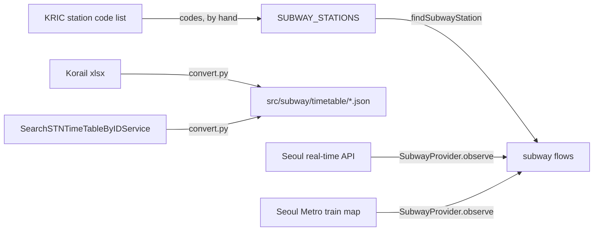

# Subway Architecture

> What `src/subway/` serves about the subway stations nearest the two campuses, how a station is identified, where its data comes from, and what adding a station or a provider touches. Read it before changing the station list or adding a data source.

## Context

Subway owns the real-time arrivals of the stations nearest the two campuses: Sungkyunkwan Univ. on line `1` (a Korail section) and Hyehwa on line `4` (Seoul Metro). It mirrors the operators' timetables as committed files and, through a provider per jurisdiction, their live train positions and arrival rows. The station list lives in code; the timetables are generated by a script.

| System | Quirk tag | Gives | Enters at |
| --- | --- | --- | --- |
| The KRIC station code list on data.kric.go.kr | — | The operator, line and station codes every station id joins | `SUBWAY_STATIONS`, written by hand |
| The Korail timetable xlsx files, weekday and holiday | — | Each line `1` train's arrival and departure at the stations and their upstream stations | `scripts/subway-timetable/convert.py`, into `src/subway/timetable/` |
| Seoul open data `SearchSTNTimeTableByIDService` (`SEOUL_OPENAPI_GENERAL_KEY`) | — | Each line `4` station's timetable per day type and direction | `scripts/subway-timetable/convert.py`, into `src/subway/timetable/` |
| The Seoul real-time subway API and the Seoul Metro train map | — | Train positions and station arrival rows, for the `seoul` provider | `SubwayProvider` |

## Glossary

| Term | Means | Derived from | Not |
| --- | --- | --- | --- |
| station (`SubwayStation`) | A served station: its KRIC codes, its names, its two directions and its seoul ids | `SUBWAY_STATIONS`, found by `findSubwayStation` | `subwayStop` |
| station id | The KRIC operator, line and station codes joined as `<operator>-<line>-<station>` (`KR-1-0153`) | `SubwayStation.id` | the Seoul API's own station id, which exists only where that API does |
| localized name (`LocalizedName`) | A name in every supported language | `SUBWAY_STATIONS` | — |
| direction (`SubwayDirection`) | `up` or `down`, as the operator's timetable names a train's direction | the timetables' `direction` | `bound` |
| station direction (`StationDirection`) | One direction at one station: its localized name and its upstream stations | `SubwayStation.directions` | — |
| upstream station (`upstreamStationIds`) | Up to three stations a direction's trains pass just before the station, by station id, nearest first | `StationDirection.upstreamStationIds` | `prevStations` |
| seoul ids (`SeoulStationIds`) | What the `seoul` provider reaches a station by: `subwayId`, `stationName` in the Seoul API, `trainMapLine` and its timetable | `SubwayStation.seoul` | — |
| station timetable (`StationTimetable`) | The committed timetable source that serves a station: `korail`, or `seoul-station` with its Seoul station code | `SeoulStationIds.timetable` | — |
| provider (`SubwayProvider`) | The source of one jurisdiction's train events and countdown rows; `seoul` serves both stations | `SubwayProvider.observe` | `adapter` |
| provider observations (`ProviderObservations`) | What one provider tick hands the tracker: its train events and countdown rows | `SubwayProvider.observe` | — |
| `trainNo` | A train's number as four digits, the operator's prefix letter dropped | the upstream's train number | `trainId` |
| train state (`TrainState`) | Where a train is relative to a station: `approaching`, `arrived` or `departed` | the upstream's row | — |
| train event (`TrainEvent`) | One train's state at one station and when that state changed | a provider's upstream rows | — |
| countdown row (`CountdownRow`) | An upstream's own seconds until a train reaches a station, and when the upstream generated the row | a provider's upstream rows | — |

## Structure

The root holds the module file, `SUBWAY_STATIONS`, `findSubwayStation` and the provider seam (`SubwayProvider` and the shapes it hands over in `src/subway/subway.types.ts`). Everything after the seam does not depend on the provider: merging, delay, estimates, the stored state, the response and accuracy.

Adding a station touches:

- `SUBWAY_STATIONS`: its KRIC codes checked against the code list, its localized names, each direction's name and upstream stations, and the ids its provider reaches it by;
- `scripts/subway-timetable/convert.py`: the station and its upstream stations in the timetables it writes, then a rerun;
- `scripts/copy-build-assets.js`: any new timetable file;
- `src/subway/subway.rules.spec.ts`: the station's ids and upstream stations pinned.

Adding a provider touches:

- a sibling sub-module named after its jurisdiction, holding its clients and mappers behind `SubwayProvider`;
- the stations it serves: their ids for that provider, beside or in place of `seoul`, since each station has exactly one provider;
- `src/app.module.ts` for the sub-module, and this doc's Context and Glossary for its upstreams.

## Invariants

- A station is identified only by its station id; a provider's own ids live under that provider's key of the station (`seoul`).
- Each station has exactly one provider, chosen by the jurisdiction of its data.
- Upstream stations are listed nearest first, by station id, at most three per direction.
- A station id that `findSubwayStation` does not find is not served.
- Timetables are generated by `scripts/subway-timetable/convert.py`, never edited by hand.

## Open questions

- The tracker, the arrivals route and the `seoul` provider behind `SubwayProvider` are planned in the [add-subway-arrivals change](../../openspec/changes/add-subway-arrivals/design.md), not in `src/` yet.

## Related

- [Subway arrivals spec](../../openspec/changes/add-subway-arrivals/specs/subway-arrivals/spec.md): the required behavior
- [Holidays architecture](holidays-architecture.md): the public holidays that choose a timetable's day type
- [ADR 0010](../decisions/0010-server-architecture.md): the module shape
- [Docs index](../README.md): writing rules
