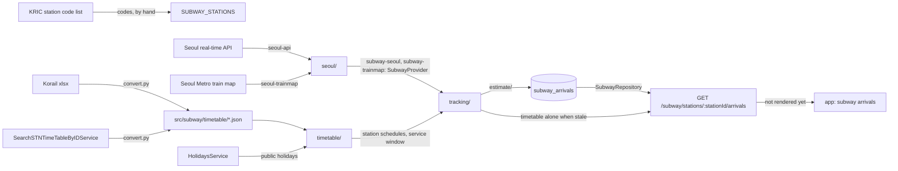

# Subway Architecture

> What `src/subway/` serves about the subway stations nearest the two campuses, how a station is identified, where its data comes from, how the tracker turns it into arrivals, and what adding a station or a provider touches. Read it before changing the station list, a data source or the estimates.

## Context

Subway owns the real-time arrivals of the stations nearest the two campuses: Sungkyunkwan Univ. on line `1` (a Korail section) and Hyehwa on line `4` (Seoul Metro). It mirrors the operators' timetables as committed files and, through a provider per jurisdiction, their live train positions and arrival rows; from both it keeps each station's next trains in `subway_arrivals`, which the arrivals route serves. The station list lives in code; the timetables are generated by a script.

| System | Quirk tag | Gives | Enters at |
| --- | --- | --- | --- |
| The KRIC station code list on data.kric.go.kr | — | The operator, line and station codes every station id joins | `SUBWAY_STATIONS`, written by hand |
| The Korail timetable xlsx files, weekday and holiday | — | Each line `1` train's arrival and departure at the stations and their upstream stations | `scripts/subway-timetable/convert.py`, into `src/subway/timetable/` |
| Seoul open data `SearchSTNTimeTableByIDService` (`SEOUL_OPENAPI_GENERAL_KEY`) | — | Each line `4` station's timetable per day type and direction | `scripts/subway-timetable/convert.py`, into `src/subway/timetable/` |
| The Seoul real-time subway API (`SEOUL_SUBWAY_API_KEY`, in the request path) | `seoul-subway-api` | Every train position of a line, and a station's arrival rows with their countdowns | `SubwaySeoulApiClient` |
| The Seoul Metro train map, crawled | `seoul-trainmap` | Every train of a line by station and status, departures in Korail sections included | `SubwaySeoulTrainmapClient` |
| The holidays module | — | Whether a service day is a public holiday, which picks its day type | `SubwayTimetableService`, through `HolidaysService` |
| MongoDB `subway_arrivals` | — | Each station's next trains per direction, written by the tracker in the poller process | `SubwayRepository` |

## Glossary

| Term | Means | Derived from | Not |
| --- | --- | --- | --- |
| station (`SubwayStation`) | A served station: its KRIC codes, its names, its two directions and its seoul ids | `SUBWAY_STATIONS`, found by `findSubwayStation` | `subwayStop` |
| station id | The KRIC operator, line and station codes joined as `<operator>-<line>-<station>` (`KR-1-0153`) | `SubwayStation.id` | the Seoul API's own station id, which exists only where that API does |
| localized name (`LocalizedName`) | A name in every supported language | `SUBWAY_STATIONS` | — |
| direction (`SubwayDirection`) | `up` or `down`, as the operator's timetable names a train's direction | the timetables' `direction` | `bound` |
| station direction (`StationDirection`) | One direction at one station: its localized name and its upstream stations | `SubwayStation.directions` | — |
| upstream station (`upstreamStationIds`) | Up to three stations a direction's trains pass just before the station, by station id, nearest first | `StationDirection.upstreamStationIds` | `prevStations` |
| seoul ids (`SeoulStationIds`) | What the `seoul` provider reaches a station by: `subwayId`, `stationName` in the Seoul API, `trainMapLine` and its timetable | `SubwayStation.seoul` | — |
| station timetable (`StationTimetable`) | The committed timetable source that serves a station: `korail`, or `seoul-station` with its Seoul station code | `SeoulStationIds.timetable` | — |
| provider (`SubwayProvider`) | What the tracker observes one upstream of a jurisdiction's data through, on that upstream's own cadence; the `seoul` provider hands it the Seoul API and the train map | `SubwayProvider.observe` | `adapter` |
| provider observations (`ProviderObservations`) | One upstream tick: its source, its train events and its countdown rows | `SubwayProvider.observe` | — |
| `trainNo` | A train's number as four digits, the operator's prefix letter dropped | the upstream's train number | `trainId` |
| train state (`TrainState`) | Where a train is relative to a station: `approaching`, `arrived` or `departed` | the upstream's row | — |
| train event (`TrainEvent`) | One train's state at one station, when that state changed, and its destination as the upstream names it | a provider's upstream rows | — |
| Seoul line (`SeoulLine`) | One line the `seoul` provider polls: its Seoul API name, its train-map line, its served stations and the station id of each Seoul station name it covers | `toSeoulLines` | — |
| countdown row (`CountdownRow`) | An upstream's own seconds until a train reaches a station, and when the upstream generated the row | a provider's upstream rows | — |
| service date (`serviceDate`) | The KST date a train runs under, from `SERVICE_DAY_START_HOUR` to the same hour the next day, so a train past midnight is the previous day's | `toServiceDate` | — |
| day type (`DayType`) | `weekday`, `saturday` or `holiday`: which table a source serves on a service day, of those it declares in `TIMETABLE_DAY_TYPES` | `toDayType` | — |
| station schedule (`StationSchedule`) | One station's timetable for one service day: its day type, its line's travel order per direction and its scheduled trains at instants | `SubwayTimetableService` | — |
| service window (`isInServiceWindow`) | The hours an upstream is observed, from `SERVICE_WINDOW_OPENS_SEC` to the day type's `SERVICE_WINDOW_CLOSES_SEC`, in seconds after midnight of the service day | `SubwayTimetableService.isInServiceWindow` | — |
| train history (`TrainHistory`) | One train's direction, destination and latest accepted progress on one station's line, and when it was last seen | `mergeObservations` | — |
| delay (`toDelaySec`) | A train's seconds behind its own timetable row at its latest event, at least its standing time past a scheduled departure | `toDelaySec` | — |
| train arrival (`TrainArrival`) | One train's arrival at a station: its instant, its source and its position | `toStationArrivals` | — |
| arrival source (`ArrivalSource`) | How an arrival was obtained: `live` from a published countdown, `estimated` from the timetable and a delay, `scheduled` from the timetable alone | `toStationArrivals` | — |
| countdown divergence (`CountdownDivergence`) | A live arrival over `MAX_COUNTDOWN_DIVERGENCE_SEC` from the train's estimate; logged, the live one still served | `toStationArrivals` | — |
| arrivals document | A station's next trains per direction at absolute instants, with the tick's `generatedAt` and service day: a `SubwayArrivalsDoc` in `subway_arrivals` | `toArrivalsDoc` | — |
| remaining seconds | A served train's `remainingSec`: whole seconds from the response's `generatedAt` to its arrival, never below zero | `toRemainingSec` | — |

## Structure

| Field | App use |
| --- | --- |
| `station` | The station's id, codes and name in the request language; served and not rendered yet |
| `generatedAt` | The instant `remainingSec` counts from; served and not rendered yet |
| `directions` | Up then down, each with its name in the request language and at most `MAX_TRAINS_PER_DIRECTION` trains; served and not rendered yet |
| `remainingSec` | Meant for a countdown from the app's receive time; served and not rendered yet |
| `source`, `position` | How an arrival was obtained and where its train is; served and not rendered yet |

The root holds the module file, which binds the rate limiter for `subway`, `SUBWAY_STATIONS`, `findSubwayStation`, the provider seam (`SubwayProvider` and the shapes it hands over in `src/subway/subway.types.ts`) and `SubwayRepository`, which the tracker writes and the route reads. Everything after the seam does not depend on the provider: merging, delay, estimates, the stored state and the response.

- `timetable/` parses the committed tables at import and holds the service-day rules. `SubwayTimetableService` is its door: each station's schedule for the service day of an instant, and whether the instant is in the service window.
- `estimate/` holds the delay and estimate rules; `SubwayEstimateService` is its door.
- `seoul-api/` and `seoul-trainmap/` each hold a client, its mapper to train events (and, for the API, countdown rows) and a service that is their door; neither names a station, since each is handed the station table of the line it reads.
- `seoul/` holds `SubwaySeoulService`, which derives the polled lines from `SUBWAY_STATIONS` and the Seoul names of the upstream stations (`SEOUL_STATION_NAME_BY_ID`): `observeApi` makes the API's calls, `observeTrainMap` crawls each line and stamps its events with the crawl time, and each upstream call first takes one from its source's daily ceiling (`config.subway.apiDailyCap`, `config.subway.trainMapDailyCap`). `SubwaySeoulPoller` registers `subway-seoul` and `subway-trainmap`, each on its own interval, each handing its upstream to the tracker.
- `tracking/` holds `SubwayTrackingService`. Inside the service window it observes the upstream it is handed, merges the events into each station's train histories, keeps each source's latest countdown rows, estimates each direction's next `MAX_TRAINS_PER_DIRECTION` trains and upserts every station's arrivals document. It also builds a station's timetable-only document.
- `arrivals/` holds the route. It serves the stored document while it is at most `MAX_STATE_AGE_MS` old and `SUBWAY` is on, else the tracker's timetable-only document, with labels in the request language.

Adding a station touches:

- `SUBWAY_STATIONS`: its KRIC codes checked against the code list, its localized names, each direction's name and upstream stations, and the ids its provider reaches it by;
- `scripts/subway-timetable/convert.py`: the station and its upstream stations in the timetables it writes, then a rerun;
- `scripts/copy-build-assets.js`: any new timetable file;
- `src/subway/subway.rules.spec.ts`: the station's ids and upstream stations pinned.

Adding a provider touches:

- a sibling sub-module named after its jurisdiction, holding its clients and mappers, and a poller that hands each of its upstreams to `SubwayTrackingService.track` as a `SubwayProvider` whose observations name their source;
- the stations it serves: their ids for that provider, beside or in place of `seoul`, since each station has exactly one provider;
- `src/app.module.ts` for the sub-module, and this doc's Context and Glossary for its upstreams.

## Invariants

- A station is identified only by its station id; a provider's own ids live under that provider's key of the station (`seoul`).
- Each station has exactly one provider, chosen by the jurisdiction of its data.
- Upstream stations are listed nearest first, by station id, at most three per direction.
- A station id that `findSubwayStation` does not find is not served: the route answers `SUBWAY_STATION_NOT_FOUND`.
- Timetables are generated by `scripts/subway-timetable/convert.py`, never edited by hand.
- A train event happens at a station the row names as reached: the API's `trainSttus` `3` and the train map's moving status name the station a train is heading for, so they become no event.
- A row at a station outside a line's station table becomes no event; a duplicate row stays, for the tracker to resolve.
- One upstream tick is read as one response: its responses cover lines whose train numbers never overlap, so the newest row per train within it counts.
- Each upstream ticks, fails and reaches its daily ceiling on its own; a ceiling rejects that source's ticks until the next KST date.
- With `SUBWAY=off` nothing calls the provider and the route serves the timetable alone; the provider itself has no switch.
- The train histories live in the poller process's memory and a restart rebuilds them from the next ticks; `subway_arrivals` holds absolute instants, and remaining seconds are computed per response.
- A source's countdown rows count until its next tick replaces them, and none after `MAX_COUNTDOWN_SOURCE_AGE_MS` without one.
- Every served train is a scheduled one: a train only in countdown rows or in a history, absent from the day's timetable, is not served.
- Only `SubwayModule` binds the rate limiter for `subway`.
- No upstream error carries the request URL, its config or the original error: the API key sits in the path.

## Open questions

- The accuracy history and its report are planned in the [add-subway-arrivals change](../../openspec/changes/add-subway-arrivals/design.md), not in `src/` yet.
- A train's position names its station by station id only, and destinations are the upstreams' Korean names; the app has no localized name for an upstream station or a destination yet.

## Related

- [Subway API reference](../reference/subway-api.md): the route's contract
- [Subway arrivals spec](../../openspec/changes/add-subway-arrivals/specs/subway-arrivals/spec.md): the required behavior
- [Holidays architecture](holidays-architecture.md): the public holidays that choose a timetable's day type
- [Logging reference](../reference/logging.md): the subway pollers' own lines
- [ADR 0010](../decisions/0010-server-architecture.md): the module shape
- [Docs index](../README.md): writing rules
