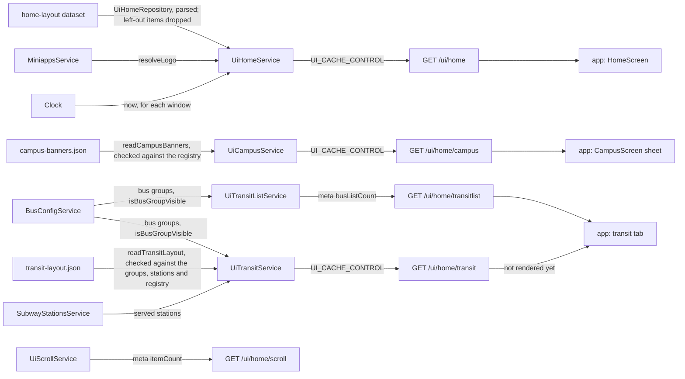

# Ui Architecture

> What `src/ui/` serves under `/ui/home`: the home screen's sections, the campus sheet, the transit tab's layout and bus cards, and the scroll cards. Read it before you change a section, a banner, a tile, a transit item or one of those lists.

## Context

Ui writes nothing. It reads the home layout from the `home-layout` dataset in the content database ([ADR 0013](../decisions/0013-runtime-data-in-mongodb.md)), serves two JSON files committed next to their readers, `campus-banners.json` and `transit-layout.json`, checked at boot, resolves each per request in the request language, and serves two lists built from other modules and translations: the bus groups and the scroll cards. Each route is its own sub-module (`home/`, `campus/`, `transit/`, `transit-list/`, `scroll/`); the root binds the limiter and holds the banner carousel the home and campus flows share and the bus group visibility both transit flows apply.

| System | Quirk tag | Gives | Enters at |
| --- | --- | --- | --- |
| The content database | — | The `home-layout` dataset, written only by `npm run data`, which validates it at push | `UiHomeRepository.findHomeLayout` |
| The committed config files | — | The campus carousel and the transit layout, edited by hand and shipped with a deploy | `readCampusBanners`, `readTransitLayout` |
| The mini-app registry | — | Which mini apps exist, the target and emoji checks, and the logo of a link tile | `MiniappsService`, injected into `UiHomeService`, `UiCampusService` and `UiTransitService` |
| The bus groups | — | Each group's label, card, screen type and visibility; the boot check reads only their ids (`BusConfigService.listGroupIds`) | `BusConfigService.getBusGroups`, injected into `UiTransitListService` and `UiTransitService` |
| The served subway stations | — | Each physical station's slug and title, and each of its lines' code, name, color and marker, from subway's registry | `SubwayStationsService.listStations`, injected into `UiTransitService` |
| moment-timezone | `moment` | A bus group's KST dates and first-day time; a strict parse still reads `24:00` as the next midnight | `isBusGroupVisible` |
| The translations | — | The titles of the scroll cards | `t` in `src/infra/i18n.ts` |
| skkuverse-app | — | Nothing; it reads the routes | `GET /ui/home` and its siblings |

## Glossary

| Term | Means | Derived from | Not |
| --- | --- | --- | --- |
| home layout (`HomeLayout`) | The `GET /ui/home` body: a version and the sections the home screen draws in order | `toHomeLayout` over the `home-layout` dataset | `homeConfig` |
| section | One entry of a layout or sheet, told apart by `type`; the app skips a type it does not know | the config files | `widget` |
| banner carousel (`BannerCarousel`) | A rotating row of banners with an `aspectRatio` and an `autoRotateSec` | `toBannerCarousel` | `slider` |
| banner (`BannerImageRaw`) | One uploaded image in a carousel, with its `alt` text and an optional action | `bannerImageFile` in `ui.schema.ts` | — |
| default banner | The app's own built-in banner, placed by a `{ "type": "default" }` item on home only | the home layout | — |
| window | A banner's `startAt` and `endAt`, each with an offset; the banner shows from the first and stops at the second | `isBannerShowing` | `period` |
| tile (`TileRaw`) | One entry of a tile grid: a registered mini app, a game the app bundles, or a link with its own text and icon | the home layout | `shortcut` |
| link action | An `actionType` with its `actionValue`, checked by the type's rule | `isBrokenLinkAction` | — |
| mini-app feed | A home card showing the latest entries of one mini app's broadcast feed, fetched by the app | the home layout | — |
| left-out item | A tile, feed section or banner of the stored home layout that the running code cannot serve (an unregistered mini app, a broken link action or icon): not served, and logged once per revision | `withoutUnresolvedItems` over `toHomeLayoutIssues` | — |
| campus sheet (`CampusSheet`) | The `GET /ui/home/campus` body: the campus carousel while a banner shows, else no section | `toCampusSheet` | `campusConfig` |
| transit layout (`TransitLayout`) | The `GET /ui/home/transit` body: a version and the transit sections the transit tab draws in order | `toTransitSection` over `transit-layout.json` | — |
| transit section | One `item_list` of the transit layout: an id, a title (null when the layout gives none, and the app draws no header) and its transit items; one left with no item is not served | `toTransitSection` | — |
| transit item | One row of a transit section: a `kind` (`bus`, `subway`, `link` or `group`) naming its referent, and the id, title and subtitle every kind carries; a bus, subway or link item carries an action, and a bus, link or group item an icon | a bus group, a served station, a link or a group written in `transit-layout.json` | — |
| group item | A `group` transit item: a box the app folds and unfolds, with its own title, subtitle and icon, its initial state and the bus, subway or link items it holds, each served as at the top of a section; it holds no group and carries no action | `toGroupTransitItems` over `transit-layout.json` | — |
| initial state | A group item's `initialState`, `collapsed` or `expanded`, written in the layout with no default and served as written: how the app first draws the box | `transit-layout.json` | — |
| visible with | A group's `visibleWith`, one bus group of its own section: the group shows only while that bus group does, and the field is never served | `toGroupTransitItems` | — |
| station row | A `subway` transit item: one physical station by its slug, titled with its station suffix, with a null subtitle (its markers name its lines), and `lines`, each line's code, name, color and marker (its one-character text in the request language and its color), in place of an icon; it opens `/subway?station=<slug>` | `SubwayStationsService.listStations` | — |
| bus group card | One bus group as the transit tab lists it: its card and the screen a tap opens | `toBusGroupCard` | `busItem` |
| scroll card (`ScrollCards`) | One of the three cards `GET /ui/home/scroll` sends | `toScrollCards` | `scrollItem` |
| registry (`MiniAppRegistry`) | What the layout checks read from `MiniappsService`: at boot for the files, at each load for the home layout | `MiniappsService` | — |

## Structure

What the app reads, from `skkuverse-app/packages/shared/src/home/schema.ts`, `skkuverse-app/packages/shared/src/sdui/parser.ts` and `skkuverse-app/packages/shared/src/bus/parser.ts`:

| Field | App use |
| --- | --- |
| `/ui/home` `sections` | `HomeScreen` draws each in order; a section of an unknown type is skipped |
| `/ui/home` banner `alt`, `actionType`, `actionValue` | `HomeBannerCarousel`: the screen-reader label and the tap |
| `/ui/home` tile `kind`, `id` | A `miniapp` tile joins the registry the app holds, a `game` tile the games it bundles; an unknown kind is dropped |
| `/ui/home` feed `miniAppId`, `limit` | `MiniAppFeedSection` fetches that many entries of the mini app's feed |
| `/ui/home` `version` | Parsed; the app falls back to its own when it is missing |
| `/ui/home/campus` `sections` | `CampusScreen` draws them in the sheet, the carousel only while the festival gate is open |
| `/ui/home/campus` `minAppVersion` | Parsed, not read |
| `/ui/home/transitlist` `data` | The transit tab's list of bus cards in builds before the transit layout; a tap opens `action.route` for `action.groupId`. Its shape is frozen: an unknown `action.route` opens the bus realtime screen there |
| `/ui/home/transitlist` `meta.busListCount` | Served, not read |
| `/ui/home/transit` `sections` | No caller in the app sources yet; the sectioned transit tab is to draw each in order and drop a section of an unknown type |
| `/ui/home/transit` item `kind`, `action` | The tab is to drop an item of an unknown kind and open `action` on a tap, never a route derived from `kind` |
| `/ui/home/transit` group `initialState`, `items` | The tab is to draw a group as a gray box, folded or unfolded by `initialState` until the user toggles it, and its items inside |
| `/ui/home/scroll` | No caller in the app sources |

## Invariants

- The campus banners are parsed when Nest builds `UiCampusService`, so a bad file, an unregistered mini app or a broken link action stops the boot (`loadCampusBanners`). Unknown keys are refused, here and in the home layout, so a misspelt key cannot pass and do nothing.
- The home layout is validated at push and parsed at read (`storedHomeLayout`). `UiHomeService` holds it for `DATASET_CACHE_TTL_MS`, keeps the last good one through a failed, missing or invalid reload for `DATASET_STALE_WINDOW_MS`, and with none answers `503 HOME_LAYOUT_UNAVAILABLE` without `Cache-Control`, remembered for one `DATASET_CACHE_TTL_MS` so a missing layout costs one read a minute. Only a missing or invalid layout and a failed read (`UiHomeLayoutReadError`) answer `503`; any other error is a fault and reaches the filter as a `500`. `ui.home_layout.missing`, `.invalid` (per revision) and `.read_failed` log at most once a minute, with `suppressed`. A left-out item is dropped, then a grid it empties, never a carousel.
- The transit layout is parsed when Nest builds `UiTransitService`: an unknown bus group or station, a repeated section or item id, an empty section or group, a broken link action, a group inside a group or without `initialState`, a `visibleWith` bus group that is unknown or that its own section does not place, or a bus group or served station not placed exactly once, children of groups counted, stops the boot (`loadTransitLayout`). A group meant to be hidden keeps its place and uses its visibility. The bus groups are read per request from the bus config, whose Jongro stations come from the bus registry, so a missing registry route answers `503 JONGRO_REGISTRY_UNAVAILABLE` on both transit routes too ([bus](bus-architecture.md), "Invariants").
- A transit item's id is `bus:`, `subway:` or `group:` and its referent's id, or a link's own slug (`toTransitItemId`); a transit item carries no arrival, which stays on each kind's own route.
- Per request, a group whose `visibleWith` bus group is hidden is left out, then hidden bus items inside a group, then a group left with no item, then an emptied section (`toGroupTransitItems`, `UiTransitService`).
- Section and banner ids share one namespace and tile ids another (`findDuplicateId`): each is an analytics item id for a tap.
- A banner shows inside its window on the injected `Clock` (`isBannerShowing`). `GET /ui/home`, `GET /ui/home/campus` and `GET /ui/home/transit` are cached for `UI_CACHE_CONTROL`, which also bounds how late a window takes effect.
- An emptied home carousel is still sent, because the app draws its default banner there; an emptied campus carousel is left out, because the campus sheet has none.
- A bus group card and a bus transit item show by their group's visibility: always, or a date range counting whole days in KST whose first day a `fromTime` (KST `HH:mm`) may open later (`isBusGroupVisible`). A malformed `fromTime` throws instead of hiding the card, and `bus-config.config.ts` refuses a malformed date or time at import.
- The served shapes are built from named fields, so a window and the untranslated text never reach the wire; the `.wire` files publish them.
- `HOME_LAYOUT_VERSION` and `TRANSIT_LAYOUT_VERSION` change only on a breaking change; a new section type, tile kind or item kind is not one.
- Only `UiModule` binds the general limiter on `/ui`; the sub-modules bind nothing.

## Open questions

- `GET /ui/home/transitlist` is frozen and logs `ui.transit_list.legacy_called` at most once an hour with the calls it held back. It is deleted once that line stays near zero for two weeks and the `/app/config` `minVersion` is at or above the first build that renders the transit layout.
- `GET /ui/home/scroll` has no caller in the app sources beyond an endpoint constant. Whether to remove it waits for request logs.
- The first four tiles of the home grid repeat the map's base chips, which builds without the `link` chip kind drop; the two are kept in step by hand ([configure-home.md](../how-to/configure-home.md#rearrange-the-grids)). Whether the tiles stay once those builds are gone is open.
- `minAppVersion`, `meta.busListCount` and `meta.itemCount` are served and not read.

## Related

- [Configure the home screen](../how-to/configure-home.md): editing the layout, the banners and the tiles
- [Edit runtime data](../how-to/edit-runtime-data.md): `npm run data`, the home layout's only writer
- [Register a mini app](../how-to/register-a-miniapp.md): the registry the tiles and the feed reference
- [ADR 0010](../decisions/0010-server-architecture.md): the module shape
