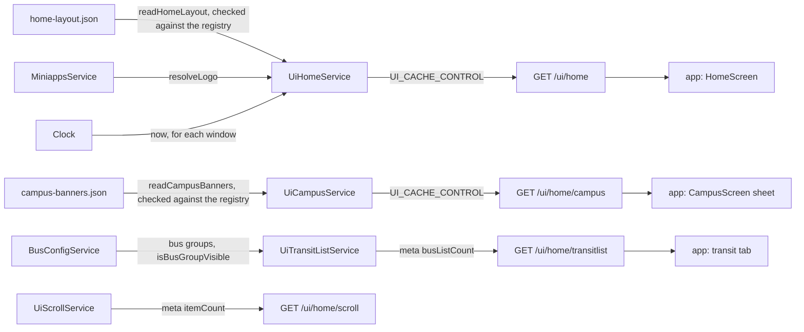

# Ui Architecture

> What `src/ui/` serves under `/ui/home`: the home screen's sections, the campus sheet, the transit tab's bus cards and the scroll cards. Read it before you change a section, a banner, a tile or one of those lists.

## Context

Ui owns no data store. It serves two JSON files committed next to their readers, `home-layout.json` and `campus-banners.json`, checked against the mini-app registry at boot and resolved per request in the request language, plus two lists built from other modules and translations: the bus groups and the scroll cards. Each route is its own sub-module (`home/`, `campus/`, `transit-list/`, `scroll/`); the root binds the limiter and holds the banner carousel the home and campus flows share.

| System | Quirk tag | Gives | Enters at |
| --- | --- | --- | --- |
| The committed config files | — | The home layout and the campus carousel, edited by hand and shipped with a deploy | `readHomeLayout`, `readCampusBanners` |
| The mini-app registry | — | Which mini apps exist, the target and emoji checks, and the logo of a link tile | `MiniappsService`, injected into `UiHomeService` and `UiCampusService` |
| The bus groups | — | Each group's label, card, screen type and visibility | `BusConfigService.getBusGroups`, injected into `UiTransitListService` |
| moment-timezone | `moment` | A bus group's KST dates and first-day time; a strict parse still reads `24:00` as the next midnight | `isBusGroupVisible` |
| The translations | — | The titles of the campus buttons and the scroll cards | `t` in `src/infra/i18n.ts` |
| skkuverse-app | — | Nothing; it reads the four routes | `GET /ui/home` and its siblings |

## Glossary

| Term | Means | Derived from | Not |
| --- | --- | --- | --- |
| home layout (`HomeLayout`) | The `GET /ui/home` body: a version and the sections the home screen draws in order | `toHomeLayout` over `home-layout.json` | `homeConfig` |
| section | One entry of a layout or sheet, told apart by `type`; the app skips a type it does not know | the config files | `widget` |
| banner carousel (`BannerCarousel`) | A rotating row of banners with an `aspectRatio` and an `autoRotateSec` | `toBannerCarousel` | `slider` |
| banner (`BannerImageRaw`) | One uploaded image in a carousel, with its `alt` text and an optional action | `bannerImageFile` in `ui.schema.ts` | — |
| default banner | The app's own built-in banner, placed by a `{ "type": "default" }` item on home only | `home-layout.json` | — |
| window | A banner's `startAt` and `endAt`, each with an offset; the banner shows from the first and stops at the second | `isBannerShowing` | `period` |
| tile (`TileRaw`) | One entry of a tile grid: a registered mini app, a game the app bundles, or a link with its own text and icon | `home-layout.json` | `shortcut` |
| link action | An `actionType` with its `actionValue`, checked by the type's rule | `isBrokenLinkAction` | — |
| mini-app feed | A home card showing the latest entries of one mini app's broadcast feed, fetched by the app | `home-layout.json` | — |
| campus sheet (`CampusSheet`) | The `GET /ui/home/campus` body: the campus carousel while a banner shows, then the campus buttons | `toCampusSheet` | `campusConfig` |
| campus button | One of the campus sheet's service buttons, with an emoji and a link action | `toCampusSheet` | — |
| bus group card | One bus group as the transit tab lists it: its card and the screen a tap opens | `toBusGroupCard` | `busItem` |
| scroll card (`ScrollCards`) | One of the three cards `GET /ui/home/scroll` sends | `toScrollCards` | `scrollItem` |
| registry (`MiniAppRegistry`) | What the boot checks read from `MiniappsService` | `MiniappsService` | — |

## Structure

What the app reads, from `skkuverse-app/packages/shared/src/home/schema.ts`, `skkuverse-app/packages/shared/src/sdui/parser.ts` and `skkuverse-app/packages/shared/src/bus/parser.ts`:

| Field | App use |
| --- | --- |
| `/ui/home` `sections` | `HomeScreen` draws each in order; a section of an unknown type is skipped |
| `/ui/home` banner `alt`, `actionType`, `actionValue` | `HomeBannerCarousel`: the screen-reader label and the tap |
| `/ui/home` tile `kind`, `id` | A `miniapp` tile joins the registry the app holds, a `game` tile the games it bundles; an unknown kind is dropped |
| `/ui/home` feed `miniAppId`, `limit` | `MiniAppFeedSection` fetches that many entries of the mini app's feed |
| `/ui/home` `version` | Parsed; the app falls back to its own when it is missing |
| `/ui/home/campus` `sections` | `CampusScreen` draws them in the sheet, the carousel only while the festival gate is open |
| `/ui/home/campus` button `webviewTitle`, `webviewColor` | `ButtonGrid` passes them to the web view it opens |
| `/ui/home/campus` `minAppVersion` | Parsed, not read |
| `/ui/home/transitlist` `data` | The transit tab's list of bus cards; a tap opens `action.route` for `action.groupId` |
| `/ui/home/transitlist` `meta.busListCount` | Served, not read |
| `/ui/home/scroll` | No caller in the app sources |

## Invariants

- Both config files are parsed when Nest builds `UiHomeService` and `UiCampusService`, so a bad file, an unregistered mini app, a broken link action or a tile placed twice stops the boot (`loadHomeLayout`, `loadCampusBanners`). Unknown keys are refused, so a misspelt key cannot pass and do nothing.
- Section and banner ids share one namespace and tile ids another (`findDuplicateId`): each is an analytics item id for a tap.
- A banner shows inside its window on the injected `Clock` (`isBannerShowing`). `GET /ui/home` and `GET /ui/home/campus` are cached for `UI_CACHE_CONTROL`, which also bounds how late a window takes effect.
- An emptied home carousel is still sent, because the app draws its default banner there; an emptied campus carousel is left out, because the campus sheet has none.
- A bus group card shows by its visibility: always, or a date range counting whole days in KST whose first day a `fromTime` (KST `HH:mm`) may open later (`isBusGroupVisible`). A malformed `fromTime` throws instead of hiding the card, and `bus-config.data.ts` refuses a malformed date or time at import.
- The served shapes are built from named fields, so a window and the untranslated text never reach the wire; the `.wire` files publish them.
- `HOME_LAYOUT_VERSION` changes only on a breaking change; a new section or tile kind is not one.
- Only `UiModule` binds the general limiter on `/ui`; the sub-modules bind nothing.

## Open questions

- `GET /ui/home/scroll` has no caller in the app sources beyond an endpoint constant. Whether to remove it waits for request logs.
- The campus buttons repeat the first four tiles of the home grid. The app's `CampusScreen` expects them to give way to a promotion feed section.
- `minAppVersion`, `meta.busListCount` and `meta.itemCount` are served and not read.

## Related

- [Configure the home screen](../how-to/configure-home.md): editing the layout, the banners and the tiles
- [Register a mini app](../how-to/register-a-miniapp.md): the registry the tiles and the feed reference
- [ADR 0010](../decisions/0010-server-architecture.md): the module shape
